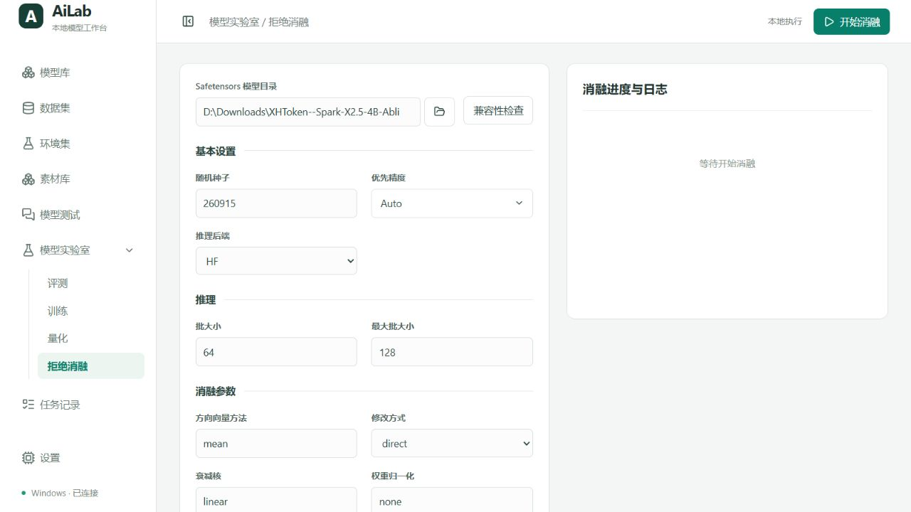
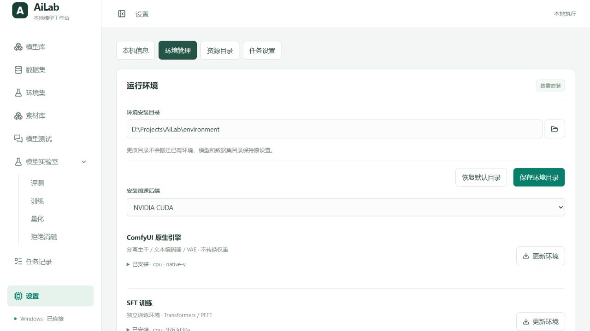
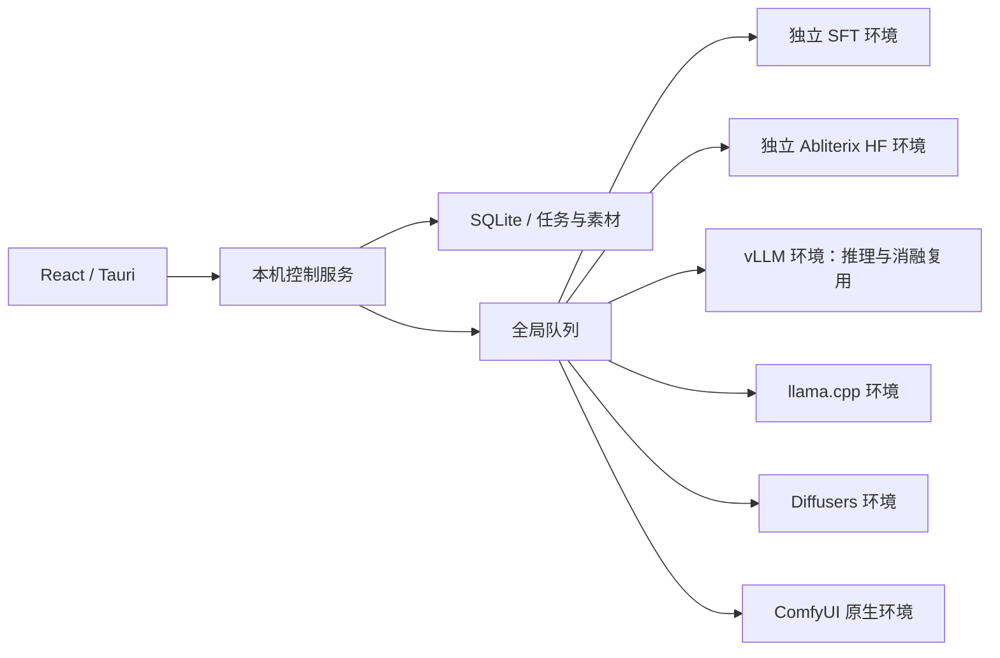

# AiLab

**本地优先的模型训练、推理与实验工作台。**

AiLab 使用 React + Tauri 提供桌面界面，以轻量 Python 控制服务管理任务、资源和运行环境。模型计算在按需安装的独立环境中执行，当前重点是 SFT 微调、拒绝消融、LLM 对话和图像／视频生成。

当前为 **Studio 技术预览**，本文描述当前 `apps/desktop/src/studio` 与 `services/control/ailab_studio` 入口。代码已接入、页面可操作和真实模型验收是不同层次；下文分别说明。历史实现中的功能不自动计入当前版本。

## 已实现的模块

| 模块 | 当前能力 | 边界 |
| --- | --- | --- |
| 环境管理 | 检测本机 CPU、内存、GPU；按需安装／更新训练、llama.cpp、HF 消融、vLLM、Diffusers、ComfyUI 原生环境；自定义安装目录 | 更新创建新环境，检查成功后切换；修改安装目录不会自动搬迁旧环境 |
| 本地模型与数据集 | 扫描指定目录、识别本地资源，供任务选择；进入页面时刷新 | 当前 Studio 尚未接入 Hugging Face 在线浏览与下载 |
| SFT 监督微调 | 指定 Safetensors 模型及数据文件／目录；LoRA／全参数配置；训练、验证、损失曲线与结果记录 | 已接入 Transformers / PEFT 执行器，支持范围取决于模型架构和硬件；不代表所有模型已验收 |
| 拒绝消融 | Abliterix 参数表单及高级 TOML；HF／vLLM 后端选择；direct／lora；静态架构兼容检查、实时日志 | HF 环境独立，安装 vLLM 后才可选该后端；静态检查不会加载模型，也不保证实际运行成功 |
| LLM 对话 | llama.cpp 加载 GGUF；vLLM 加载模型目录；流式响应、思考内容折叠、上下文管理、手动加载／卸载、空闲自动卸载、参数记忆 | 单一会话；视觉输入需匹配模型和处理器；设备建议不能替代实际显存检查 |
| 图像／视频生成 | T2I、T2V、R2V；提示词、负面提示词、Euler 采样、CPU offload、采样进度、结果预览与素材入库 | 两种权重布局分别加载，支持的具体架构见下文 |
| 素材库 | 导入与生成素材、图像／视频和来源筛选、卡片预览、按比例放大／播放、生成参数与时间记录 | 长按卡片约 0.5 秒进入多选；批量删除只删除库内副本，正在被任务使用的素材会保留 |
| 全局任务队列 | 训练、消融、推理共享并发限制；默认同时执行 1 个任务；排队、暂停、取消及详情 | 暂停是进程级暂停，不等于释放显存或保存可重启检查点 |
| 环境集入口 | 打开外部强化学习环境控制界面 | 目前是固定局域网地址的独立入口，不是强化学习训练执行器 |

### 两种媒体模型布局

- **标准 Diffusers 目录**：读取模型索引与组件目录，使用相应 Diffusers Pipeline。
- **ComfyUI 分离权重**：分别选择主干、文本编码器和 VAE 的 Safetensors 文件，交给独立 ComfyUI 原生引擎；不启动 ComfyUI 网页服务，也不把权重自动转换成 Diffusers／Transformers 格式。
- ComfyUI 图像预设：**Anima、Stable Diffusion 1.5、SDXL、FLUX.1**。SDXL 与 FLUX.1 需要两个文本编码器。
- ComfyUI 视频预设：**Wan 2.1 T2V／R2V**；R2V 还需匹配的 CLIP Vision，帧数为 `4n+1`。
- 分离权重入口不是任意 ComfyUI 工作流／自定义节点导入器。未适配架构或不匹配组件会报错，不通过自动转换掩盖兼容性问题。

### 量化基座训练

当前允许受支持量化基座的 **LoRA** 训练。`compressed-tensors`（含 NVFP4）路径在加载时解量化；`bitsandbytes` 路径使用 CUDA 量化训练。两者的内存需求不同，NVFP4 文件较小不意味着训练时仍按 4-bit 占用内存。输出为适配器及基座格式记录，不代表实现了所有量化格式的原生低比特训练。

## 界面预览

以下截图来自当前 Windows 开发界面。配置页截图展示界面能力，不表示训练或消融任务已完成。

### 模型测试


### SFT 训练


### 拒绝消融



### 素材库


### 环境管理



## 尚未实现与待验收

- **评测、量化**：当前菜单保留，页面尚未实现。
- **强化学习训练**：尚未实现环境协议、rollout、奖励计算与训练闭环；环境集目前仅打开外部控制界面。
- **在线资源市场**：Hugging Face 模型浏览、下载及数据集下载尚未接入当前 Studio。先在应用外下载，再设置本地目录。
- **扩展能力**：图像／视频模型微调、音频生成、通用 ComfyUI 工作流导入、远程算力调度与分布式训练均不属于当前实现范围。
- **真实模型验收**：Windows CPU 下已验证 GGUF 对话，以及原始 Anima 分离组件的 Euler 图像生成、进度显示和素材入库。SFT／HF 消融的代码与参数链路已接入，但当前不声明指定 Spark NVFP4 模型的完整训练或消融验收通过。
- **视频与设备验收**：视频执行器已接入，但尚未用本地视频权重完成实机验收；当前版本的 NVIDIA CUDA、Apple MPS、Linux vLLM 仍需对应设备验证。
- **发行**：前端构建和轻量控制服务打包有验证；不等于 Windows／macOS／Linux 三平台原生安装包、签名、公证、干净安装与自动更新均已完成。

## 设计哲学

### 本地优先，明确资源归属

模型、数据、任务记录和生成素材保存在用户设备上。下载、升级与可选远程裁判等网络操作由具体功能触发；本地优先不表示所有功能完全离线。模型目录、数据目录和环境目录分别管理，删除素材库副本不会删除导入源文件。

### 轻量控制服务，隔离计算环境

前后端职责分离，但不为每个页面部署一个微服务。一个本机控制服务处理配置、队列、SQLite 元数据和进程生命周期；计算任务在独立进程及 uv 环境内执行。



训练依赖与其他任务隔离；vLLM 的安装环境可由推理与消融复用，这不意味着两个任务共享已加载模型实例。重依赖不默认塞进安装包，用户按设备与任务需要安装。

### 兼容性显式表达

区分操作系统、加速设备、模型架构和权重布局。支持一类引擎不代表支持它能遇到的所有模型。不能加载时显示原因，不静默改写权重、不自动切换到转换副本，也不把界面成功当作模型成功。

### 保守使用本机资源

默认单任务执行，用户可调整并发上限。CUDA 媒体生成默认启用 CPU offload；LLM 支持空闲后卸载和手动控制。暂停、取消、模型卸载是不同动作，任务状态以实际进程生命周期为准。

## 从源码启动

需要 **Node.js 24 LTS**、npm 和 **Python 3.13 或 3.14**。任务环境由 uv 单独创建，目前使用 Python 3.12。启动界面不要求预先安装所有模型框架。

Windows PowerShell：

```powershell
npm ci
python -m venv .venv
.venv\Scripts\python.exe -m pip install -r services/control/requirements.studio.txt
.venv\Scripts\python.exe scripts/studio.py
```

保持控制服务终端运行，在另一个终端启动前端：

```powershell
npm run dev
```

打开 <http://127.0.0.1:1420/>。macOS／Linux 将 `.venv\Scripts\python.exe` 换成 `.venv/bin/python`。

初次使用：

1. 在“设置 → 环境管理”按需安装环境。源码模式默认目录为项目下的 `environment`。
2. 在“设置 → 资源目录”指定已经下载好的模型和数据目录。
3. 进入模型测试、训练或拒绝消融配置任务。ComfyUI 分离权重需逐项选择组件文件。
4. 在任务记录中检查状态、日志和结果；媒体输出会进入素材库。

vLLM 安装配置要求 Linux + NVIDIA。Windows 可在 WSL2 内运行对应控制服务／环境，但当前没有自动管理 WSL 的能力。llama.cpp 的 GPU 构建还需要本机 C/C++ 工具链。Apple MPS 需要对应框架及模型支持，不能把 CUDA 配置直接搬到 Mac。

详细操作见 [使用说明](docs/USER_GUIDE.md)。

## 开发检查与打包

2026-11-02 清理后复验：前端构建通过，保留的前端测试 91 项、Studio 后端测试 37 项、文档检查测试 3 项通过，控制服务打包产物的启动／外部 worker 检查通过。这些检查不代替上述真实模型与跨平台验收。

```powershell
npm run build
npm test
.venv\Scripts\python.exe -m pip install pytest httpx
.venv\Scripts\python.exe -m pytest tests/studio -q
.venv\Scripts\python.exe scripts/check_public_docs.py
.venv\Scripts\python.exe -m unittest discover -s scripts -p test_public_docs.py
```

打包轻量控制服务：

```powershell
.venv\Scripts\python.exe -m pip install -r services/control/requirements.studio-build.txt
.venv\Scripts\python.exe scripts/desktop/build_studio.py --control-only
.venv\Scripts\python.exe scripts/desktop/verify_studio.py
```

完整桌面构建需要 Rust、Tauri 对应系统构建依赖，再运行 `scripts/desktop/build_studio.py`。macOS 签名配置应替换为自己的签名身份；仓库内历史签名字段不是可直接使用的发布凭据。

## 代码与本地数据

| 路径 | 用途 |
| --- | --- |
| `apps/desktop/src/studio/` | 当前界面 |
| `apps/desktop/src-tauri/` | 原生桌面壳、本机服务连接及文件选择 |
| `services/control/ailab_studio/` | 当前 API、队列、环境、素材与任务执行器 |
| `scripts/studio.py` | 源码启动入口 |
| `scripts/desktop/*studio*.py` | 当前控制服务打包与检查 |
| `tests/studio/`、`tests/frontend/` | 当前控制服务及保留界面的测试 |
| `environment/` | 按需安装的环境与本地资源，不提交 Git |
| `.artifacts/` | 开发状态、数据库、任务产物与构建输出，不提交 Git |
| `backup/` | 本机清理归档及恢复清单，不提交 Git |

`services/control/ailab_control`、顶层 `workers`／`adapters` 和部分原生兼容代码仍保留历史实现及测试依赖；它们不代表当前 Studio 已提供同名功能。未被当前入口引用的旧前端与对应测试、旧公开文档及临时产物已移入本地 backup。

提交前检查 `git status` 与差异，保留锁文件和源码，不上传虚拟环境、模型权重、素材库、数据库、连接令牌或 backup。项目当前不提供已验证的正式发行包。
