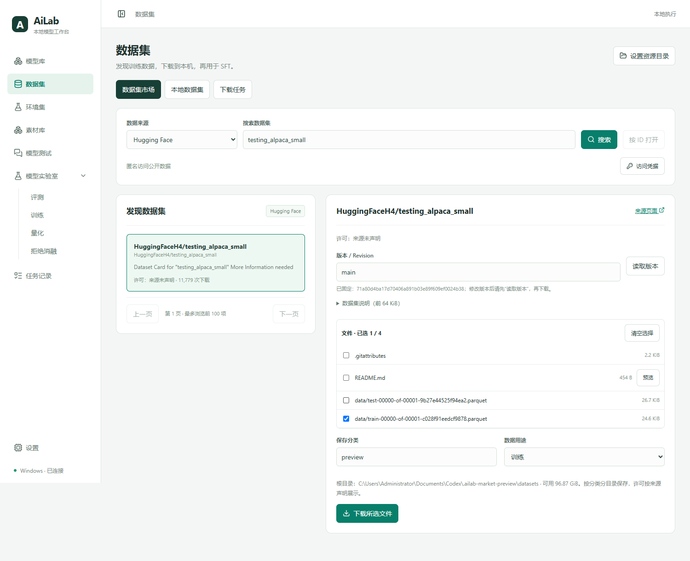
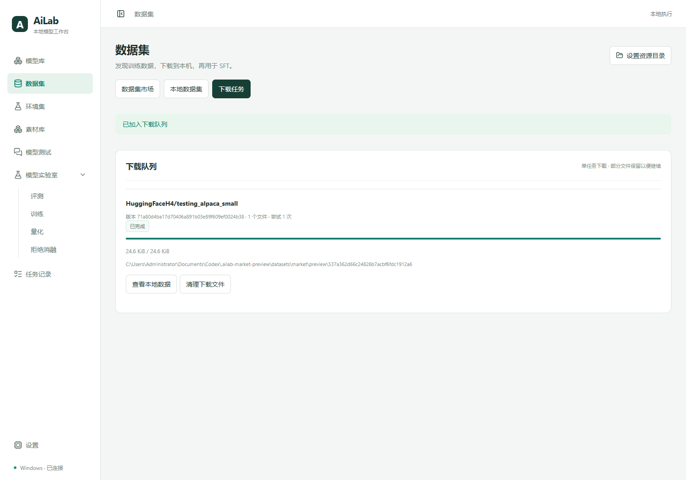
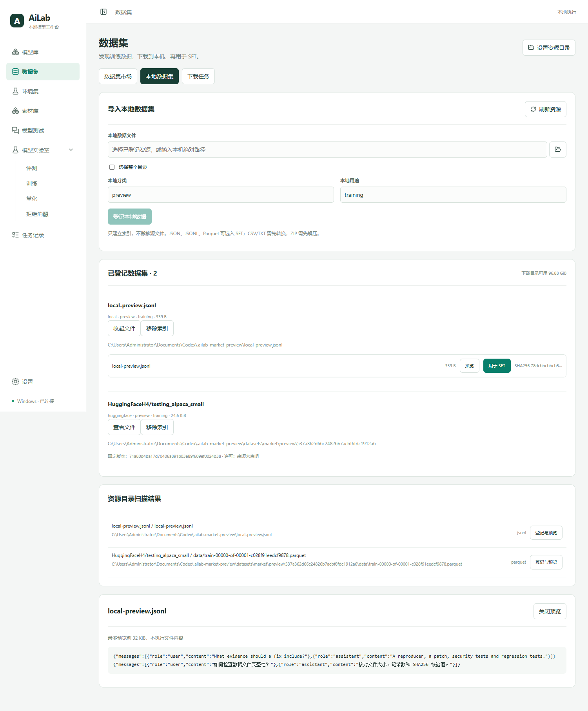
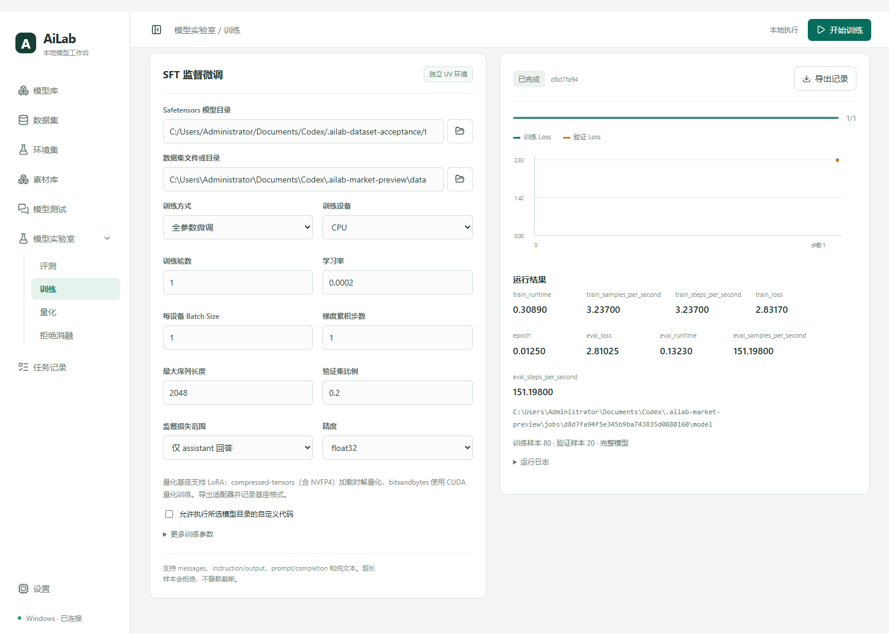
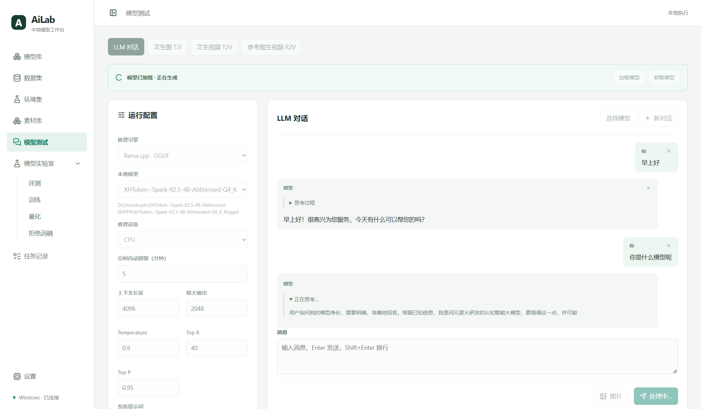
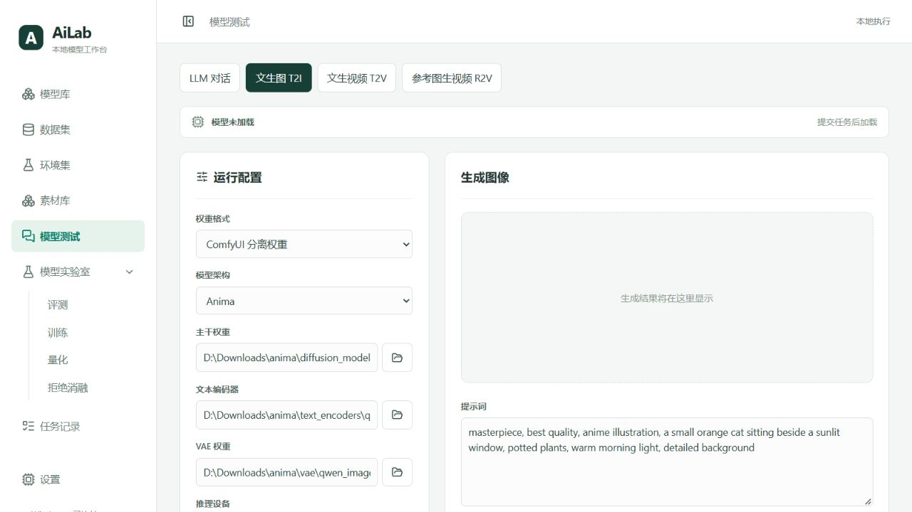
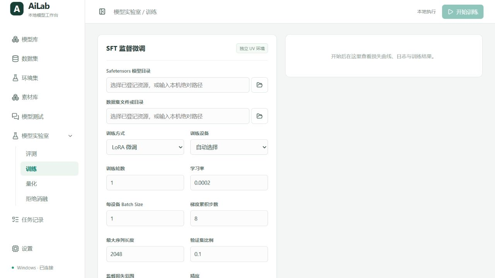
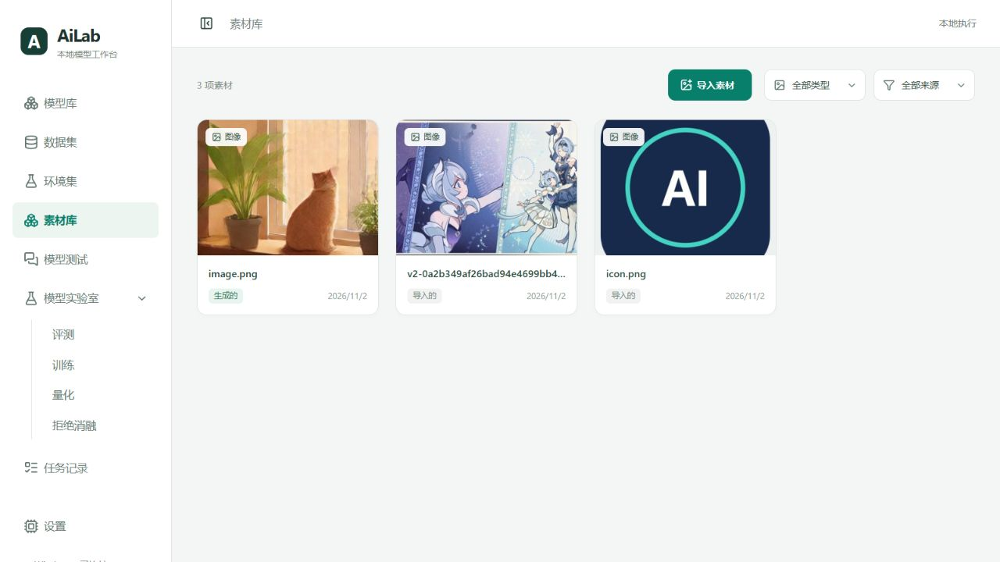
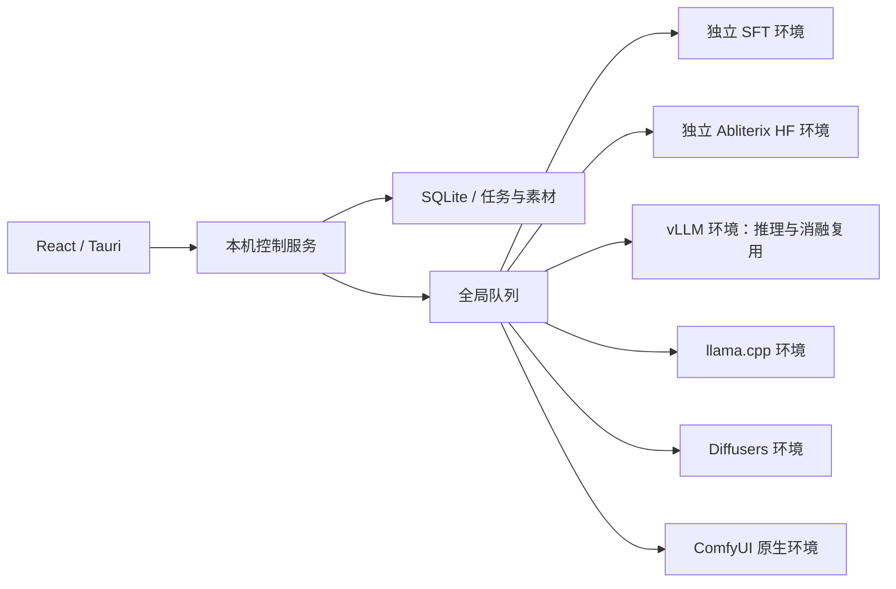

# AiLab

**本地优先的模型训练、推理与实验工作台。**

AiLab 使用 React + Tauri 提供桌面界面，以轻量 Python 控制服务管理任务、资源和运行环境。模型计算在按需安装的独立环境中执行，当前重点是 SFT 微调、拒绝消融、LLM 对话和图像／视频生成。

当前为 **Studio 技术预览**，本文描述当前 `apps/desktop/src/studio` 与 `services/control/ailab_studio` 入口。代码已接入、页面可操作和真实模型验收是不同层次；下文分别说明。历史实现中的功能不自动计入当前版本。

## 全部模块汇总

“已实现”表示当前 Studio 已接入对应界面与执行逻辑，不代表所有模型、硬件和操作系统均已验收；实际验证范围见“尚未实现与待验收”。“部分实现”表示仅完成该模块中的部分功能。

| 模块 | 实现状态 | 当前能力与边界 |
| --- | --- | --- |
| 环境管理 | 已实现 | 检测 CPU、内存、GPU；按需安装／更新训练、llama.cpp、HF 消融、vLLM、Diffusers、ComfyUI 环境；自定义安装目录。更新检查成功后切换；修改目录不会自动搬迁旧环境 |
| 模型管理 | 部分实现 | 扫描指定目录、识别本地模型并供任务选择；进入页面时刷新，模型市场未实现 |
| 数据集管理 | 已实现 | 本地扫描、导入、文件预览与索引；记录来源、版本、大小、SHA256、分类和用途；选择具体 JSON／JSONL／Parquet 文件带入 SFT 配置 |
| Hugging Face 模型浏览与下载 | 未实现 | 尚未接入当前 Studio；需在应用外下载后设置本地模型目录 |
| 在线数据集浏览与下载 | 已实现 | HF／Kaggle 搜索、说明与许可预览、固定版本下载、队列、暂停／继续、失败重试与清理；HF 选文件，Kaggle 下载版本 ZIP，解压导入后使用 |
| SFT 监督微调 | 已实现，待完整模型验收 | Transformers / PEFT 执行器；Safetensors 基座、LoRA／全参数配置、训练与验证、动态损失曲线、结果记录；支持范围取决于模型架构和硬件 |
| 量化基座 LoRA 训练 | 部分实现 | 接入受支持的 compressed-tensors 解量化加载及 CUDA bitsandbytes 路径；不是所有量化格式的原生低比特训练，详见下文 |
| 拒绝消融 | 已实现，待完整模型验收 | Abliterix 参数表单与高级 TOML、HF／vLLM、direct／lora、静态架构检查及实时日志；HF 环境独立，安装 vLLM 后才可选该后端，静态检查不保证运行成功 |
| LLM 对话推理 | 已实现 | llama.cpp 加载 GGUF、vLLM 加载模型目录；流式响应、思考折叠、单会话上下文、手动加载／卸载、空闲卸载与参数记忆；视觉输入需匹配模型及处理器 |
| 图像生成（T2I） | 已实现 | 提示词与负面提示词、Euler 采样、CPU offload、采样进度、预览与素材入库；分别适配标准 Diffusers 目录和指定 ComfyUI 分离权重架构 |
| 视频生成（T2V／R2V） | 已实现，待实机验收 | 文生视频、参考图生视频、素材库选图、采样进度及视频预览；执行器已接入，尚未用本地视频权重完成实机验收 |
| 素材库 | 已实现 | 导入与生成素材、类型与来源筛选、卡片预览、按比例放大／播放、生成参数及时间记录；长按约 0.5 秒多选，批量删除保留导入源文件和正在被任务使用的素材 |
| 全局任务队列与任务记录 | 已实现 | 训练、消融、推理共享并发限制，默认 1 个；支持排队、暂停、取消及详情。进程级暂停不等于释放显存或保存可恢复检查点 |
| 设置与设备信息 | 已实现 | 分类设置、本机配置信息、资源与环境目录、任务并发上限 |
| 强化学习环境集 | 部分实现 | 已提供外部环境控制界面入口；目前为固定局域网地址，尚无统一环境协议与生命周期管理 |
| 强化学习训练 | 未实现 | 尚无环境交互、rollout、奖励计算与训练闭环 |
| 模型自动化评测 | 未实现 | 保留菜单入口，页面留空 |
| 模型量化 | 未实现 | 保留菜单入口，页面留空；与使用量化基座进行 LoRA 训练不同 |
| 图像／视频模型微调 | 未实现 | 不属于当前训练执行器的支持范围 |
| 音频生成 | 未实现 | 尚无音频生成执行器与对应界面 |
| 通用 ComfyUI 工作流导入 | 未实现 | 当前仅支持指定架构预设，不支持任意工作流或自定义节点导入 |
| 远程算力调度与分布式训练 | 未实现 | 当前以本机控制服务和独立计算进程为主 |

### 两种媒体模型布局

- **标准 Diffusers 目录**：读取模型索引与组件目录，使用相应 Diffusers Pipeline。
- **ComfyUI 分离权重**：分别选择主干、文本编码器和 VAE 的 Safetensors 文件，交给独立 ComfyUI 原生引擎；不启动 ComfyUI 网页服务，也不把权重自动转换成 Diffusers／Transformers 格式。
- ComfyUI 图像预设：**Anima、Stable Diffusion 1.5、SDXL、FLUX.1**。SDXL 与 FLUX.1 需要两个文本编码器。
- ComfyUI 视频预设：**Wan 2.1 T2V／R2V**；R2V 还需匹配的 CLIP Vision，帧数为 `4n+1`。
- 分离权重入口不是任意 ComfyUI 工作流／自定义节点导入器。未适配架构或不匹配组件会报错，不通过自动转换掩盖兼容性问题。

### 量化基座训练

当前允许受支持量化基座的 **LoRA** 训练。`compressed-tensors`（含 NVFP4）路径在加载时解量化；`bitsandbytes` 路径使用 CUDA 量化训练。两者的内存需求不同，NVFP4 文件较小不意味着训练时仍按 4-bit 占用内存。输出为适配器及基座格式记录，不代表实现了所有量化格式的原生低比特训练。

## 界面预览

以下截图来自当前 Windows 开发界面。配置页截图展示界面能力，不表示训练或消融任务已完成。

### 数据集市场

搜索公开数据集，预览说明与许可，读取固定版本后选择需要的文件下载。



### 数据集下载队列

查看下载结果、进度及版本。下载后可进入本地管理，也可暂停、继续或清理任务。



### 本地数据集管理

登记已有文件、预览内容、查看来源和校验值，并选择具体训练文件。本图同时展示下载的数据与人工编写的本地预览样例。



### 市场数据到 SFT 的实际结果

以下为从界面点击“用于 SFT”和“开始训练”后的实测结果：100 条样本按 80／20 划分，3,120 参数随机测试模型，Windows CPU／FP32、assistant 监督、1 个训练步骤，完成验证和 Safetensors 导出。该结果用于验证数据链路，不能作为大模型、GPU 或训练效果的验收结论。



### 模型测试



### SFT 训练



### 拒绝消融


### 素材库



### 环境管理


## 尚未实现与待验收

- **评测、量化**：当前菜单保留，页面尚未实现。
- **强化学习训练**：尚未实现环境协议、rollout、奖励计算与训练闭环；环境集目前仅打开外部控制界面。
- **在线模型市场**：Hugging Face 模型浏览和下载尚未接入当前 Studio。先在应用外下载模型，再设置本地目录；数据集市场已接入 HF／Kaggle。
- **扩展能力**：图像／视频模型微调、音频生成、通用 ComfyUI 工作流导入、远程算力调度与分布式训练均不属于当前实现范围。
- **真实模型验收**：Windows CPU 下已验证 GGUF 对话，以及原始 Anima 分离组件的 Euler 图像生成、进度显示和素材入库。SFT／HF 消融的代码与参数链路已接入，但当前不声明指定 Spark NVFP4 模型的完整训练或消融验收通过。
- **视频与设备验收**：视频执行器已接入，但尚未用本地视频权重完成实机验收；当前版本的 NVIDIA CUDA、Apple MPS、Linux vLLM 仍需对应设备验证。
- **发行**：已构建 Windows x64 安装 EXE，并验证原生程序可启动内置控制服务与 WebView2、退出后清理子进程；尚未完成干净机器安装与完整界面验收，也未配置代码签名。macOS／Linux 安装包、签名／公证与自动更新仍需验证。

## 设计哲学

### 本地优先，明确资源归属

模型、数据、任务记录和生成素材保存在用户设备上。下载、升级与可选远程裁判等网络操作由具体功能触发；本地优先不表示所有功能完全离线。模型目录、数据目录和环境目录分别管理，删除素材库副本不会删除导入源文件。

### 轻量控制服务，隔离计算环境

前后端职责分离，但不为每个页面部署一个微服务。一个本机控制服务处理配置、队列、SQLite 元数据和进程生命周期；计算任务在独立进程及 uv 环境内执行。



训练依赖与其他任务隔离；vLLM 的安装环境可由推理与消融复用，这不意味着两个任务共享已加载模型实例。重依赖不默认塞进安装包，用户按设备与任务需要安装。

### 兼容性显式表达

区分操作系统、加速设备、模型架构和权重布局。支持一类引擎不代表支持它能遇到的所有模型。不能加载时显示原因，不静默改写权重、不自动切换到转换副本，也不把界面成功当作模型成功。

### 保守使用本机资源

默认单任务执行，用户可调整并发上限。CUDA 媒体生成默认启用 CPU offload；LLM 支持空闲后卸载和手动控制。暂停、取消、模型卸载是不同动作，任务状态以实际进程生命周期为准。

## 从源码启动

需要 **Node.js 24 LTS**、npm 和 **Python 3.13 或 3.14**。任务环境由 uv 单独创建，目前使用 Python 3.12。启动界面不要求预先安装所有模型框架。

Windows PowerShell：

```powershell
npm ci
python -m venv .venv
.venv\Scripts\python.exe -m pip install -r services/control/requirements.studio.txt
.venv\Scripts\python.exe scripts/studio.py
```

保持控制服务终端运行，在另一个终端启动前端：

```powershell
npm run dev
```

打开 <http://127.0.0.1:1420/>。macOS／Linux 将 `.venv\Scripts\python.exe` 换成 `.venv/bin/python`。

初次使用：

1. 在“设置 → 环境管理”按需安装环境。源码模式默认目录为项目下的 `environment`。
2. 在“设置 → 资源目录”指定已经下载好的模型和数据目录。
3. 进入模型测试、训练或拒绝消融配置任务。ComfyUI 分离权重需逐项选择组件文件。
4. 在任务记录中检查状态、日志和结果；媒体输出会进入素材库。

vLLM 安装配置要求 Linux + NVIDIA。Windows 可在 WSL2 内运行对应控制服务／环境，但当前没有自动管理 WSL 的能力。llama.cpp 的 GPU 构建还需要本机 C/C++ 工具链。Apple MPS 需要对应框架及模型支持，不能把 CUDA 配置直接搬到 Mac。

详细操作见 [使用说明](docs/USER_GUIDE.md)。

## 数据集市场与 SFT 联动

进入“数据集”，在市场页选择 Hugging Face 或 Kaggle，搜索关键词或按 `owner/name` 打开数据集。查看来源说明与许可、读取所需版本，再选择文件、分类和用途加入下载队列。HF 的分支／标签会解析为固定提交 SHA，Kaggle 使用固定版本号；搜索最多浏览前 100 项。数据保存在设置中的数据集根目录，下载中的任务保留最初目录，修改设置不会搬移它们。

下载队列独立于 GPU 计算队列，当前串行传输，支持暂停、取消、失败重试和服务中断后手动继续。来源正确响应 Range 时续传，忽略 Range 时重新下载当前文件，避免把整文件错误追加到部分文件。下载后记录本地 SHA256；HF 若提供 LFS SHA256 则额外核对来源摘要。源站的限流、访问权限和存储／CDN 可达性仍需满足。

“本地数据集”支持登记已有文件或目录、查看文件和有限文本预览。本地导入不移动文件，计算并保存 SHA256；只移除索引不删除源文件。下载任务的“清理下载文件”会删除该任务拥有的目录，正在被训练任务使用的数据会拒绝清理。Kaggle ZIP 不自动解压，CSV／TXT 不自动转换；请解压或转换后重新导入。

对 JSON、JSONL、Parquet 文件点击“用于 SFT”，数据路径带入训练表单，再选择基座模型和参数，明确点击“开始训练”。提交时将已登记数据的 ID、来源、固定版本和实际文件摘要写入训练任务；来源下载文件被改动时要求重新导入。本轮不增加数据自动清洗、任意格式转 SFT 或模型自动下载。

访问凭据由受保护的本机控制服务在内存中保存，重启后需重新配置，也可通过启动环境的 `HF_TOKEN`、`KAGGLE_API_TOKEN` 或 `KAGGLE_USERNAME`／`KAGGLE_KEY` 提供。凭据不写入浏览器草稿、数据库或数据索引；不实现系统钥匙串持久化。受限数据须先在来源网站完成授权，显示来源许可不等于商业使用批准。

在线协议依据：[HF Hub API](https://huggingface.co/docs/hub/api)、[HF 数据下载](https://huggingface.co/docs/hub/datasets-downloading)、[Kaggle 数据集命令](https://github.com/Kaggle/kaggle-cli/blob/main/docs/datasets.md)。本地虚拟环境控制仍按分工保留需求占位，本次不增加 Docker／RL 环境管理。

### 本轮数据链路验收

2026-11-03：公开源实测 HF `HuggingFaceH4/testing_alpaca_small` 的一个 25,166 字节 Parquet（提交 `71a80d4ba17d70406a891b03e89f609ef0024b38`），下载 SHA256 与来源 LFS 摘要一致；Kaggle `uciml/iris` 版本 2 的 3,687 字节 ZIP 下载及本地登记通过。独立浏览器已验证真实市场详情、本地文件查看与带入 SFT 表单。

随后通过当前 SFT API 使用上述 HF 文件的 100 条样本（80／20 划分），以 3,120 参数随机 Llama 测试模型、Windows CPU／FP32、全参数、assistant 监督执行 1 步，记录有限训练与验证损失并导出 Safetensors。该验收只证明数据到训练的真实链路，不验证模型质量、生产规模、GPU／MPS、受限源凭据或全部数据格式；本次没有构建或发布新的桌面安装包。

## 开发检查与打包

2026-11-02 清理后复验：前端构建通过，保留的前端测试 91 项、Studio 后端测试 37 项、文档检查测试 3 项通过，控制服务打包产物的启动／外部 worker 检查通过。这些检查不代替上述真实模型与跨平台验收。

```powershell
npm run build
npm test
.venv\Scripts\python.exe -m pip install pytest httpx
.venv\Scripts\python.exe -m pytest tests/studio -q
.venv\Scripts\python.exe scripts/check_public_docs.py
.venv\Scripts\python.exe -m unittest discover -s scripts -p test_public_docs.py
```

打包轻量控制服务：

```powershell
.venv\Scripts\python.exe -m pip install -r services/control/requirements.studio-build.txt
.venv\Scripts\python.exe scripts/desktop/build_studio.py --control-only
.venv\Scripts\python.exe scripts/desktop/verify_studio.py
```

Windows 完整桌面构建需要 Rust MSVC 工具链、Microsoft C++ Build Tools 和 Windows SDK。安装完成后，可运行 `powershell -ExecutionPolicy Bypass -File scripts/desktop/build_windows.ps1`，生成的安装 EXE 和 SHA256 文件位于 `dist/windows/`；构建依赖与模型环境不会一并封装。其他系统需要 Rust、Tauri 对应系统构建依赖，再运行 `scripts/desktop/build_studio.py`。macOS 签名配置应替换为自己的签名身份；仓库内历史签名字段不是可直接使用的发布凭据。

Windows 安装包默认仅为当前用户安装，支持简体中文／英文安装界面。安装后的模型运行环境默认位于应用安装目录下的 `environment`，可在设置中修改；模型权重和计算环境仍需单独准备。2026-11-02 的 Windows 原生启动检查通过，安装包目前未签名。

## 代码与本地数据

| 路径 | 用途 |
| --- | --- |
| `apps/desktop/src/studio/` | 当前界面 |
| `apps/desktop/src-tauri/` | 原生桌面壳、本机服务连接及文件选择 |
| `services/control/ailab_studio/` | 当前 API、队列、环境、素材与任务执行器 |
| `scripts/studio.py` | 源码启动入口 |
| `scripts/desktop/*studio*.py` | 当前控制服务打包与检查 |
| `tests/studio/`、`tests/frontend/` | 当前控制服务及保留界面的测试 |
| `environment/` | 按需安装的环境与本地资源，不提交 Git |
| `.artifacts/` | 开发状态、数据库、任务产物与构建输出，不提交 Git |
| `backup/` | 本机清理归档及恢复清单，不提交 Git |

`services/control/ailab_control`、顶层 `workers`／`adapters` 和部分原生兼容代码仍保留历史实现及测试依赖；它们不代表当前 Studio 已提供同名功能。未被当前入口引用的旧前端与对应测试、旧公开文档及临时产物已移入本地 backup。

提交前检查 `git status` 与差异，保留锁文件和源码，不上传虚拟环境、模型权重、素材库、数据库、连接令牌或 backup。Windows 安装包可作为技术预览附件发布，不将本机启动检查等同于完整发行验收。
