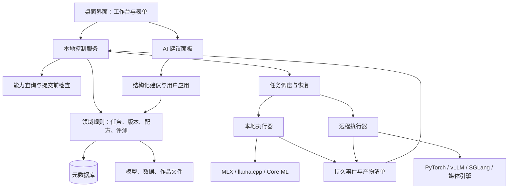

# 技术架构与执行适配器设计

版本：1.1 · 日期：2026-09-09 · 状态：已按审计修订的建议架构；尚未创建正式应用代码或验证打包环境。

相关文档：[数据对象](05-data-model-and-assets.md)、[接口与状态](07-api-and-task-lifecycle.md)、[技术决策](13-decisions-risks-and-questions.md)。

## 1. 设计目标

保持原型已经明确的任务体验，替换浏览器内存状态、模拟计时器和预置输出。业务规则集中管理，真实执行进程独立运行；一个训练进程失败不能使整个应用丢失任务记录。

首期采用模块化单体控制服务加独立执行器，不引入微服务集群、Kubernetes 或复杂的多租户基础设施。远程 GPU 是一个可管理的执行目标，不等于先建设完整云平台。

## 2. 推荐技术组合

| 层 | 建议 | 选择理由 | 分阶段验证内容 |
| --- | --- | --- | --- |
| 界面 | React + TypeScript | 表单、状态和可复用页面结构适合原型产品化 | M0 壳内最小交互；M1 起中文、键盘和业务表单 |
| 桌面宿主 | Tauri 2 | 提供桌面窗口和受控本地能力 | M0 TV-02 侧进程启动、退出与崩溃隔离；M6 安装签名和更新 |
| 本地控制服务 | Python + FastAPI + 类型化数据模型 | 接近训练／推理生态，便于参数校验和接口测试 | M0 TV-02 最小认证与事件；M1 完整服务合同；M6 分发 |
| 元数据 | SQLite | 单用户本地元信息，事务与迁移清晰 | M1 事务、并发读写；M6 升级备份与恢复 |
| 大文件 | 文件系统 + 内容摘要索引 | 模型、媒体和数据文件避免进入数据库 | M1 原子写入、引用；相关功能阶段做磁盘满恢复 |
| 执行 | 独立进程／独立环境 | MLX、CUDA、ROCm 等依赖隔离 | M0 TV-01 最小真实组合；M1 状态合同；M3 训练检查点 |
| 远程执行 | 受控远程执行器，初期可经 SSH 隧道连接 | 复用用户已有服务器，避免默认开放公网端口 | M0 TV-03 指定 LoRA 回程试验；M3 远程身份、重连与补收 |
| 事件 | HTTP 查询 + SSE 进度流 | 满足单向日志与进度，不必首期双向复杂通道 | M0 TV-02 简单事件通路；M1 游标、去重与终态恢复 |

以上为实现建议，不是用户已经决定的技术栈。若 M0 的侧进程打包成本明显超出收益，可采用同一控制服务加本地 Web 界面作为开发验证宿主，再决定桌面壳，领域模型与接口保持不变。

参考：[Tauri 侧进程](https://v2.tauri.app/develop/sidecar/)、[FastAPI 生命周期](https://fastapi.tiangolo.com/advanced/events/)、[SQLite WAL](https://www.sqlite.org/wal.html)。SQLite WAL 的并发特性不能替代备份与一致性设计，数据库文件不直接放在远程共享盘上充当多机数据库。

## 3. 组件关系



AI 不直接连接队列的提交控制路径。用户应用建议和用户提交执行是不同的命令、不同的事件。

## 4. 模块职责

### 4.1 前端

负责页面、表单草稿、即时校验、焦点、状态展示和用户动作。前端可根据能力声明隐藏或禁用控件，但最终提交校验必须在控制服务再次执行。刷新页面后从服务端恢复任务，不依赖前端定时器推进状态。

### 4.2 控制服务

管理项目、数据、模型、配置、设备、环境、任务和评测。提供原子提交、幂等命令、版本检查、权限边界和事件订阅。控制服务不在请求线程直接加载大模型或执行训练。

### 4.3 资源与下载管理

管理文件 manifest、校验、断点续传、解压、路径解析和引用。模型准备、环境安装、数据下载都是独立可观察任务；下载器不会执行仓库中的代码。

### 4.4 能力注册与检查

将设备探测、引擎版本、模型格式和适配器参数 schema 汇合，返回支持条件与准备步骤。缓存能力结果时绑定环境摘要；驱动／引擎变更后失效。

输入产物格式和操作必须双向匹配，引擎不能只按源模型类别推断；媒体任务、推测组件准备记录和前缀缓存身份也由这里统一校验。声明未知的格式／媒体缓存组合不进入运行路径，不能由界面默认值将未知变为支持。

### 4.5 执行器

读取不可变运行快照，准备输入，加载引擎，发出阶段事件，写产物和检查点，处理取消／恢复。它不能修改项目显示名或原始数据，也不能为自己扩大文件访问范围。

### 4.6 评测与登记

评测器读取指定模型／候选、固定数据和评测规则，写不可变报告。登记服务检查产物完整性与准入规则，建立新的模型版本和来源关系。不能通过前端传入一个 `passed: true` 绕过检查。

## 5. 适配器最小合同

| 操作 | 输入 | 输出 | 错误要求 |
| --- | --- | --- | --- |
| `describe` | 适配器版本 | 每项操作的输入／输出格式、结构条件、参数 schema、控制与加载信任能力 | 不访问网络、不启动执行 |
| `probe` | 设备与环境引用 | 硬件事实、驱动、资源、限制 | 区分权限不足与设备不存在 |
| `validate` | 模型、数据、请求配置 | 阻断／提示、有效配置、准备动作 | 返回字段位置与原因代码 |
| `prepare` | 已确认的准备计划 | 环境／模型准备记录 | 不隐式升级已有环境 |
| `run` | 固定执行快照、稳定尝试编号 | 事件流、计算结果、封存产物 manifest | 同一尝试不能重复启动；计算和收集结果分开 |
| `pause` | 运行编号、控制命令编号、检查点策略 | 请求接收、暂停确认或失败及当前执行证据 | 安全点和检查点完整后才确认暂停 |
| `cancel` | 运行编号、控制命令编号 | 请求接收、停止证据或未知结果 | 幂等，不立即假定进程已停止 |
| `force_stop` | 运行编号、控制命令编号、执行器归属标识 | 指定任务的停止证据或失败／未知 | 仅声明支持时提供；不得停止无关进程 |
| `checkpoint` | 运行编号 | 可恢复检查点或不支持 | 说明包含哪些恢复状态 |
| `resume` | 检查点、兼容环境 | 新尝试或明确续跑标识 | 错环境必须拒绝 |
| `collect` | 原尝试编号、封存 manifest 摘要、收集编号、目标资产存储 | 文件校验、登记结果、可续传位置 | 幂等只补收，禁止内部调用 run／resume；部分文件不能冒充完整成功 |

首期不要求每个适配器实现所有控制动作。`supports_pause`、`supports_resume`、`supports_stream`、`supports_checkpoint` 等必须由实际适配器声明，界面按声明展示。

控制服务统一处理命令版本与幂等；适配器返回控制命令编号、执行器事件序号及能否确认仍在运行／已经停止。心跳丢失不是停止证据。暂停检查点失败、取消过程中崩溃、强制停止超时与完成竞争，均按 [07 状态表](07-api-and-task-lifecycle.md) 收敛，不交给前端猜测。（AUD-07）

计算结束先封存只读 manifest，再执行收集。自有执行器保留产物至控制端确认完整登记或用户按明确清单清理，不因本地收集失败自动删除。若外部服务另有固定保留期限，提交前展示期限并标为条件支持，到期或空间不足及时报告；不能声称无限期可补收。补收读取原文件，不改原摘要、不重新训练；原文件损坏或外部保留期已过时返回不可补收和缺失清单。补收完成后的评测／候选登记仍走独立准入，不能因补收成功将原失败评测改为通过。（AUD-08）

## 6. 能力声明示例

以下结构是接口设计示例，`未验证` 不能由 UI 自动改为通过。

```json
{
  "schema_version": "1.1",
  "adapter_id": "mlx-text",
  "adapter_version": "待锁定",
  "model_family": "qwen3",
  "operations": ["generate"],
  "hardware_backends": ["metal"],
  "formats": ["mlx"],
  "format_support": [{"operation": "generate", "inputs": ["mlx"], "outputs": ["text"], "status": "unverified"}],
  "load_policy": {"trust_class": "restricted_weights", "loader": "待锁定的受限加载器", "arbitrary_deserialization": false},
  "controls": {
    "cancel": true,
    "pause": false,
    "resume_from_checkpoint": false,
    "force_stop": false,
    "recollect": true
  },
  "features": {
    "thinking_toggle": {"status": "conditional", "requires": ["兼容聊天模板"]},
    "prefix_cache": {"status": "conditional", "requires": ["指定引擎版本", "完整输入身份与项目隔离已验证"]},
    "mtp": {"status": "unsupported", "reason": "此适配目标未声明原生预测组件"}
  },
  "verification": {"status": "未验证", "report_id": null}
}
```

正式 schema 需将参数类型、单位、默认来源、约束、重启要求和冲突关系一并表达。公开能力名称不要求与每个底层库参数一一同名，由映射层转换并保存结果。

## 7. 环境隔离

MLX、CUDA、ROCm、oneAPI 和媒体模型可能需要不同 Python 版本、依赖或本地库。采用按适配器版本生成的隔离环境，环境标识来自锁文件和平台摘要，不复用一个任意安装包的全局 Python。

桌面基础安装包只包含控制层必要依赖；大模型、训练环境和可选运行器按明确计划准备。环境安装前显示来源、预计下载和磁盘占用、目标目录以及是否需要系统驱动。不要以“连接检查”名义安装驱动或修改系统权限。

运行器命令使用固定可执行文件和参数数组，不把用户输入拼接成 shell 命令。自定义模型仓库需要代码执行时作为独立信任决定处理，不能混入普通权重下载。

### 7.1 模型文件的加载信任边界（AUD-11）

导入分析只检查文件结构、清单和可安全读取的元信息，不反序列化执行未知对象。根据实际格式与加载方式分类，不能只看扩展名：

| 类别 | 导入与加载规则 | 可用边界 |
| --- | --- | --- |
| 受限权重 | 仅允许适配器列出的格式及固定受限加载方式，例如已验证的 safetensors 或严格受限权重加载路径 | 哈希、结构、资源限制与加载器版本一起检查；这不是对任意文件安全的保证 |
| 需要代码执行 | 包括任意 pickle 反序列化、TorchScript 及需自定义仓库代码的路径 | 单列执行内容、来源、文件／网络／凭证范围和隔离方式；用户明确选择该执行范围后才可准备 |
| 未知／不支持 | 无法可靠识别、伪装格式、超出限制或受限加载失败 | 保留未准备状态与原因，拒绝加载；不得自动关闭限制或切换任意反序列化 |

依赖虚拟环境只隔离包版本，不能替代执行权限隔离。需要代码执行的任务必须使用经验证的进程／系统或容器边界，输入只读、仅任务输出目录可写、网络按已确认目的地开放、默认不注入应用凭证；隔离能力缺失时该路径不可启动。信任决定绑定文件摘要、加载器版本与范围，任何变化重新形成计划，不沿用一个永久的“信任此模型”开关。

验收采用受控无害夹具检查：伪装文件、受限加载失败、不受信任检查点、自定义代码要求、越界文件／网络／凭证访问被阻断。隔离执行成功也不等于模型已通过质量或兼容性验收。依据见 [PyTorch 安全政策](https://github.com/pytorch/pytorch/security/policy)。

## 8. 本地与远程执行

本地控制端为每个远程尝试分配稳定的任务编号与幂等键。远端保存自己的任务状态、日志游标和产物 manifest；控制端断开后重连拉取增量状态，而不是再次启动任务。

模型和数据传输按内容摘要确认已有文件，避免重复上传。用户在提交前看到哪些输入要发送到哪个执行设备。凭证保存在操作系统安全存储中，数据库只记录引用；普通日志和配方不保存密钥。

云 GPU 首期只支持用户已配置的实例／服务，不自动创建付费实例。后续资源申请若实现，需要独立的预算、确认和资源释放流程。

## 9. 调度与资源策略

首期采用明确设备队列和有限并发。训练默认独占一个指定设备资源配额；推理实例复用按模型、适配器、精度和引擎配置键进行。无法同时容纳的模型明确排队或卸载，不通过不断 OOM 重试调度。

资源估计只是估计，记录来源、测量时刻和不确定性。实际内存由执行器报告；统一内存、GPU 显存和 CPU 内存分别存储。缓存、模型实例和用户资产分别清理。

## 10. 从 Demo 迁移

1. 保留页面结构、任务名称与可发现入口，提取成正式组件。
2. 将字符串数字转换为类型化字段，统一前后端 schema。
3. 将内存 `store` 拆成服务端领域对象与前端编辑草稿。
4. 用真实任务事件替代每 900 ms 增加进度的模拟计时器。
5. 用资产引用替代内嵌图像／音频，用真实文件和解码结果验收。
6. 删除生产路径里的“模拟连接通过”“预置评测通过”等捷径，只在独立演示模式保留。
7. 迁移 59 组原型测试中的业务边界，并增加接口、进程、设备和持久化测试。

不直接把原型单文件 JavaScript 当作生产后端使用，也不在产品化期间随意重做已确定的信息架构。

## 11. 建议目录结构

以下仅为开发期建议，当前项目并未创建这些代码目录。

```text
apps/desktop/       桌面宿主与前端
services/control/   本地控制服务与领域规则
packages/contracts/ 共享接口与参数 schema
adapters/           训练、推理、评测和转换适配器
workers/            本地与远程执行器
tests/              单元、合同、集成、设备和端到端测试
fixtures/           小型可公开测试数据及来源说明
docs/               本套产品、开发与验收文档
```

## 12. 架构验收

使用一个最小真实运行适配器验证前端提交、能力检查、执行事件、取消、资产落盘和重启恢复。再接入训练器，证明新增后端不需要更改项目、任务和结果归属规则。架构评审以这条纵向路径是否简洁可靠为准，不以接口数量或目录层级为准。

M0 只按 TV-01—TV-03 判断最小模型组合、壳与侧进程及同一 LoRA 回程是否可行，不要求 M1 的项目持久化或 M6 的发布验收先完成。完整接口、故障恢复和安装合同仍在对应工作包阶段验收，技术试验通过不能提前勾选产品 AC。（AUD-12）
