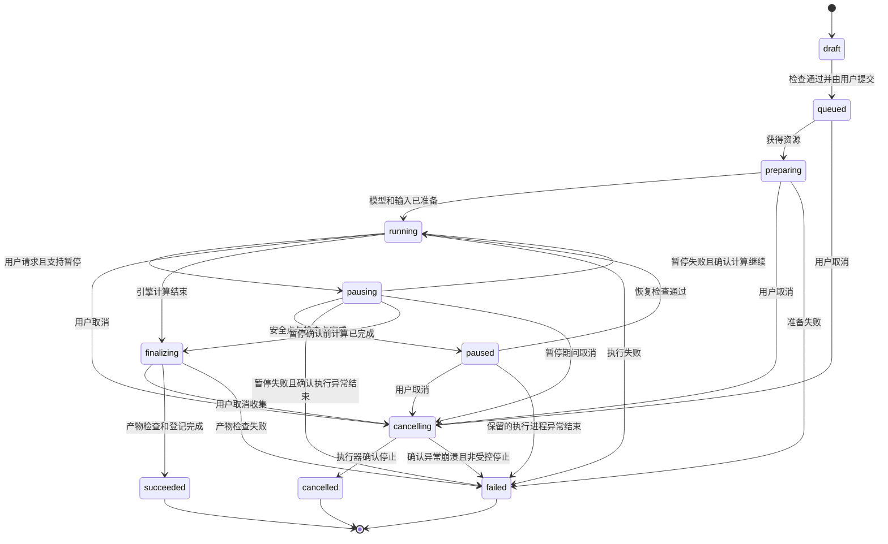

# 接口合同与任务生命周期

版本：1.1 · 日期：2026-09-09 · 状态：已按审计修订的待实现接口合同，不是当前可调用 API。

相关文档：[架构](06-architecture-and-adapters.md)、[对象模型](05-data-model-and-assets.md)、[测试验收](11-testing-and-acceptance.md)。

## 1. 接口约定

接口前缀建议为 `/api/v1`。正文采用 UTF-8 JSON，时间使用带时区的 UTC 时间，容量以字节保存并由界面格式化。金额若未来出现，以明确币种和最小货币单位保存，不用浮点数。

资源编号不可由显示名称派生。集合接口采用游标分页；查询可按项目、类别、状态和时间筛选。修改草稿时携带 `expected_revision`，冲突返回 409 和当前 revision，不覆盖更新的内容。

提交、登记、控制、补收、工作流推进和准备／导出动作支持幂等键。相同命令键与相同请求摘要先返回已有结果，再判断当前版本；新键必须重新校验版本，相同键携带不同摘要返回 409。参数错误返回稳定代码、中文消息、字段路径和修复建议。客户端不能依据任意英文异常文本判断是否可以重试。

## 2. 接口清单

下表中的 `{id}` 代表已存在的稳定资源编号；所有修改都要校验对象归属和版本。

| 方法与路径 | 用途 | 关键输入／输出 | 副作用与限制 |
| --- | --- | --- | --- |
| GET `/projects` | 项目列表 | 游标、归档筛选 | 只读 |
| POST `/projects` | 新建项目 | 名称 | 新建记录 |
| PATCH `/projects/{id}` | 修改项目 | 名称、expected_revision | 不改变已有任务归属 |
| GET `/models` | 模型列表 | 模态、格式、可用状态 | 只读 |
| POST `/models/import-plans` | 分析模型导入 | 来源或已选择路径 | 返回识别格式、manifest 摘要、加载器／受限选项、信任类别、执行范围；不运行待导入代码或未知反序列化 |
| POST `/models/imports` | 用户确认导入 | plan_id、计划摘要、需要执行代码时用户选择的 trust_decision、幂等键 | 固定选择与执行范围为 decision_ref，复核文件和加载方式后创建准备任务；受限失败不自动降级 |
| GET `/datasets` | 数据列表 | schema、来源、下载状态 | 只读 |
| POST `/datasets/import-plans` | 分析导入 | 文件资产或受控来源 | 返回 schema、样例、问题 |
| POST `/datasets/imports` | 创建数据版本 | 已检查计划 | 原子登记，不覆盖旧版本 |
| POST `/datasets/{id}/checks` | 技术检查 | version_id、检查集合 | 新建检查报告 |
| POST `/datasets/{id}/transforms` | 处理数据副本 | version_id、操作和参数 | 新建版本，原件不变 |
| POST `/market/access-requests` | 提交访问申请 | 提供方、数据版本、用途 | 明确向该提供方发送信息 |
| GET `/devices` | 设备配置和状态 | 最近探测时间 | 不隐式扫描 |
| POST `/devices/{id}/probes` | 探测设备环境 | 检查范围 | 只读探测，不安装驱动 |
| GET `/capabilities` | 查询能力 | 模型、格式、环境、操作 | 返回状态、字段和证据来源 |
| POST `/environments/prepare-plans` | 计算环境准备计划 | 适配器版本、设备 | 返回依赖、空间和变更 |
| POST `/environments/preparations` | 执行已确认准备 | plan_id、幂等键 | 新建环境，不覆盖旧环境 |
| POST `/tasks` | 新建任务草稿 | project_id、类别、名称 | 新建任务 |
| PATCH `/tasks/{id}/draft` | 保存草稿 | 配置、expected_revision | 只影响未提交草稿 |
| POST `/tasks/{id}/preflight` | 提交前检查 | draft_revision | 返回有效配置和短期有效检查编号 |
| POST `/tasks/{id}/attempts` | 提交执行 | 检查编号、revision、幂等键 | 固定快照，创建执行尝试 |
| GET `/attempts/{id}` | 查询运行状态 | 无 | 返回真实状态及可用控制动作 |
| GET `/attempts/{id}/events` | 订阅／补拉事件 | 游标或 Last-Event-ID | SSE；重连不重新执行 |
| POST `/attempts/{id}/cancel` | 请求取消 | expected_state_version、幂等键 | 区分请求与停止确认；finalizing 阶段仅取消收集／登记 |
| POST `/attempts/{id}/pause` | 请求安全暂停 | expected_state_version、检查点策略、幂等键 | 仅适配器支持时允许，失败出口见状态表 |
| POST `/attempts/{id}/resume` | 恢复暂停／检查点 | expected_state_version、checkpoint_id、环境摘要、幂等键 | 同进程安全恢复保持尝试；其他情况只建恢复草稿，不自动执行 |
| POST `/attempts/{id}/force-stop` | 强制停止已归属的执行任务 | expected_state_version、幂等键 | 仅声明支持时允许；返回停止证据或未知，不因超时显示已停止 |
| POST `/attempts/{id}/retries` | 复制为新尝试草稿 | expected_state_version、参数修改、幂等键 | 创建草稿，不自动执行；原终态不变 |
| POST `/attempts/{id}/collections` | 补收已完成计算的原产物 | manifest_digest、expected_collection_version、幂等键 | 只校验／传输／登记，不调用计算或恢复；返回 collection_id |
| GET `/collections/{id}` | 查询补收 | 无 | 收集状态、文件校验、登记结果、缺失文件与可选动作 |
| POST `/collections/{id}/cancel` | 取消补收 | expected_collection_version、幂等键 | 停止传输／登记后确认收集 cancelled，不改原计算或尝试终态 |
| POST `/workflow-runs` | 开始工作流实例 | definition_version、project_id、幂等键 | 每个新动作创建独立执行身份，不能复用旧运行编号 |
| GET `/workflow-runs/{id}` | 查询工作流与来源状态 | 无 | 返回 revision、当前步骤、输入版本、接受产物、复用记录及过期标记 |
| PATCH `/workflow-runs/{id}/steps/{step_id}/input` | 编辑步骤输入 | expected_revision、输入 | 新建输入版本，标记下游旧结果过期 |
| POST `/workflow-runs/{id}/advance` | 接受结果并带入下一步 | expected_revision、step_attempt_id、input_revision、artifact_ids、幂等键 | 目标占用和来源校验与推进在同一事务，失败全部不变 |
| POST `/workflow-runs/{id}/reuse-output` | 明确复用旧结果 | expected_revision、源尝试／产物、目标步骤及 input_revision、幂等键 | 记录差异和复用来源，不记为新计算、不自动推进 |
| POST `/evaluations` | 创建独立评测 | 基线、候选、数据版本、规则 | 新建评测任务 |
| POST `/candidates/{id}/register` | 登记可用候选 | evaluation_ids、幂等键 | 服务端重新检查准入 |
| POST `/recipes/{id}/reuse` | 载入配方 | 目标项目、版本差异策略 | 创建新草稿 |
| POST `/works` | 保存作品 | artifact_id、attempt_id | 校验文件已完整落盘 |
| GET `/works/{id}` | 查询作品及修订 | 可选 revision_id | 返回原生成配方、选定作品版本及修订差异，不合并改写来源 |
| POST `/works/{id}/revisions` | 保存字幕等人工修订 | expected_revision、parent_revision_id、修改内容、幂等键 | 新增作品版本，不改生成配方／快照 |
| POST `/exports/prepare` | 准备用户产物导出 | 对象及版本、依赖策略、目标格式／目录 | 固定依赖清单、空间和校验计划，返回 ExportPlan，不发送或发布 |
| POST `/exports` | 执行用户产物导出 | plan_id、计划摘要、幂等键 | 重新检查源文件，创建 kind=export 的任务与尝试，临时写入后校验落盘 |
| GET `/exports/{id}` | 查询导出 | 无 | 返回任务／尝试编号、进度、已验证输出位置及独立使用检查结果；取消走通用 cancel |
| POST `/ai/proposals` | 请求 AI 建议 | 上下文范围、问题 | 只产生建议，不执行 |
| POST `/ai/proposals/{id}/apply` | 应用明确字段修改 | expected_revision | 原子校验和应用 |
| POST `/ai/proposals/{id}/undo` | 撤销该次应用 | 当前 revision | 检查后续修改，避免覆盖 |

发布、云实例采购和组织权限接口不进入首期合同。若后续加入，单独设计用户确认、身份和审计流程。

## 3. 提交前检查合同

检查结果包含阻断项、提示项、请求摘要、实际配置、环境摘要、数据版本、检查版本和有效期。检查编号与这些内容的哈希绑定；任何输入或环境变化都必须重新检查。

检查不等于执行授权。用户点击正式提交才创建运行尝试。提交事务再次检查草稿 revision、检查有效期和资源状态，防止检查后发生模型替换或设备变化。

模型、任务类型、输入媒体、产物格式、推测组件准备组合与已应用执行位置必须一致。工作流任务还绑定 `workflow_run_id`、`step_attempt_id`、`input_revision` 和输入摘要；训练任务绑定分词与监督配方摘要及对应检查报告。提交端不可相信界面可见选项、历史结果选择或一个 `draftReady` 布尔值。（AUD-01—AUD-06、AUD-10）

```json
{
  "task_id": "task-001",
  "draft_revision": 7,
  "operation": "generate",
  "model_version_id": "model-qwen3-demo-v1",
  "input": {
    "messages": [{"role": "user", "content": "请简要说明数据版本的作用。"}],
    "asset_ids": []
  },
  "runtime": {
    "device_id": "device-local-001",
    "environment_id": "env-mlx-demo-001",
    "thinking": "off",
    "context_tokens": 8192,
    "max_output_tokens": 1024,
    "temperature": 0.7,
    "prefix_cache": false,
    "speculation": {"method": "off"}
  }
}
```

示例编号和模型环境均为合同占位数据，不代表已经存在的服务资源。

```json
{
  "preflight_id": "check-001",
  "task_id": "task-001",
  "draft_revision": 7,
  "can_submit": true,
  "blocking": [],
  "warnings": [],
  "effective_config": {
    "thinking": "off",
    "context_tokens": 8192,
    "max_output_tokens": 1024,
    "temperature": 0.7,
    "prefix_cache": false,
    "speculation": {"method": "off"}
  },
  "config_digest": "example-digest-only",
  "expires_at": "2026-09-09T09:10:00Z"
}
```

若发生引擎自动值调整，响应中需要 `changes` 列表显示原因和前后值，重新让用户查看，不能在 `warnings` 中悄悄降级仍将提交视为无变化。

## 4. 执行快照

每个尝试保存：任务和项目编号、源尝试／检查点编号、模型与适配器版本、输入内容摘要与媒体处理版本、数据版本、训练分词／监督配方引用（如适用）、工作流运行／步骤／输入版本（如适用）、请求配置、实际配置、环境摘要、设备事实、加载信任决定引用、提交用户动作、幂等键和 schema 版本。

快照不包含明文凭证、可变 UI 状态、当前选中页签或可覆盖的 latest 引用。前端可以重命名任务，但不得更新执行快照。后续真实测量信息写到运行记录或报告，不回写成当时的配置。

## 5. 状态机

正式状态比 Demo 更细，以真实执行器反馈为准。`draft` 属于任务草稿，提交后才创建从 `queued` 开始的 RunAttempt。下图展示主要边；表中的失败、竞争和无证据规则同样属于合同。（AUD-07）



`disconnected` 不直接作为执行终态：连接状态与运行状态分别记录。远端状态暂不可知时显示“连接中断，运行状态待确认”，不能立即标记失败或再次提交。

终态只有 `succeeded`、`failed`、`cancelled`，一旦持久化不回写。补收状态变化、后续评测和新尝试都以关联记录表达。控制端保存最后确认状态与证据时间；状态未知期间不推断计算已经失败、暂停或停止。

### 5.1 状态字段

| 字段 | 用途 |
| --- | --- |
| `state` | 最后确认的执行状态 |
| `state_version` | 单调递增版本，控制命令的并发条件 |
| `connection_state` | 已连接／断开／重连中 |
| `stop_status` | `not_requested`／`pending`／`confirmed`／`unknown`；停止未确认时不得显示已停止 |
| `last_control` | 命令编号、动作、接收／执行／失败／未知结果、原因及执行器证据引用 |
| `compute_outcome` | `pending`／`succeeded`／`failed`／`cancelled`；只按计算证据确认，与应用最终成功分开 |
| `collection_state` | `not_started`／`collecting`／`succeeded`／`failed`／`cancelled`；汇总独立收集记录 |
| `collection_version` | 单调递增补收并发版本，与终态版本分开 |
| `output_manifest_ref` | 执行器封存的原产物清单及摘要；补收只能引用该内容 |
| `last_event_sequence` | 已持久化事件游标 |
| `phase` | 下载、加载、预处理、训练、生成、评测、写文件等阶段 |
| `progress` | 已知比例或 null；未知不生成伪百分比 |
| `allowed_actions` | 根据状态和适配器能力生成的可用操作 |
| `terminal_reason` | 成功、失败或取消的原因代码 |

### 5.2 状态、事件与可用动作

所有表内动作先检查适配器声明、对象归属、期望版本和幂等键。查询、日志和事件补拉始终可用；“重试”只创建草稿。

| 当前状态 | 事件／动作 | 结果与不变量 |
| --- | --- | --- |
| queued | 获得资源／取消 | 分别进入 preparing／cancelling；队列确认未启动并解除资源后才 cancelled |
| preparing | 准备完成／准备失败／取消 | running／failed／cancelling；超时且远端结果未知时保留状态并查询 |
| running | 暂停／取消／计算完成／执行异常 | pausing／cancelling／finalizing／failed；暂停仅在支持时可用 |
| pausing | 安全点和完整检查点确认 | paused；单独的命令接收或不完整检查点不能确认暂停 |
| pausing | 检查点失败 | 执行器确认继续计算则 running 并记录控制失败；确认异常结束则 failed；无证据保留 pausing、控制结果未知，提供查询、取消或已支持的强制停止 |
| pausing | 取消／计算完成抢先到达 | 取消合法提交则 cancelling；尚未接受取消且计算完成先提交则 finalizing，暂停返回已结束／未暂停 |
| paused | 同尝试安全恢复／取消／进程崩溃 | 确认恢复后 running；取消进入 cancelling；确认非受控异常退出则 failed；恢复校验失败保持 paused |
| finalizing | 收集和登记完成／失败 | succeeded／failed；compute_outcome 保留 succeeded，收集结果单独记录 |
| finalizing | 取消／暂停 | 取消进入 cancelling，仅停止收集与登记；暂停返回不支持当前阶段，状态不变 |
| cancelling | 确认受控停止或从未启动 | cancelled；完整文件保留，未完成文件不可登记成功；计算已完成时保留 succeeded 的 compute_outcome |
| cancelling | 执行器异常崩溃／超时 | 确认任务进程及子进程异常退出则 failed；心跳丢失或停止结果未知继续 cancelling，stop_status=unknown，不伪造 cancelled |
| cancelling | 迟到的暂停／完成事件 | 保留事件证据但不撤销已提交取消；允许记录计算已完成，不再将本尝试登记为 succeeded |
| preparing／running／pausing／paused／cancelling | 用户请求已支持的强制停止 | 进入或保持 cancelling，停止确认后 cancelled；明确的非受控崩溃可 failed；拒绝或超时但未确认停止则保持待确认，不操作无关进程 |
| succeeded／failed／cancelled | 新取消／暂停／强制停止命令 | 返回已有终态和不适用原因，不改变终态；重试／合格的补收另建记录 |

表中的明确崩溃以执行器归属和进程树退出证据为依据；断连不能替代它。强制停止在 finalizing 不作为杀计算进程的入口，收集取消走普通 cancel。若在前端看到旧状态后提交控制，409 返回当前状态、版本和动作列表，客户端刷新后由用户决定下一步。

## 6. 暂停、恢复、取消和重试

### 6.1 暂停

暂停不是停止前端动画，也不默认依赖操作系统强行挂起进程。训练器支持安全点时写检查点再转暂停；推理引擎不能恢复同一请求时只提供取消和以相同配方重跑。页面要解释当前控制能力。

暂停失败必须输出检查点完整性、是否仍在计算、失败原因和可选动作。取消可以打断尚未确认的暂停；迟到的 checkpoint_ready 只登记检查点，不把 cancelling 改回 paused。

### 6.2 恢复

检查点必须包含需要的模型、优化器、调度器、随机状态和数据位置，且记录哪些状态缺失。若只能恢复权重而无法继续同一优化轨迹，应称为“从该权重开始新尝试”。跨设备或引擎版本恢复先检查兼容性。

同一存活执行器的安全暂停恢复可以保持 attempt_id，控制回执记录续跑标识。进程已退出、终态尝试或只能从权重恢复时接口返回新的恢复草稿及 `source_attempt_id`／checkpoint 引用，用户重新检查并提交；不能修改原终态或把尚未启动的新草稿显示为运行中。

### 6.3 取消

用户请求进入 cancelling，执行器在可安全停止点响应。取消后保留已完整产物和日志，未完成产物标记不完整。超时可提供已声明支持的 `/force-stop` 入口，界面说明可能失去最近检查点；该命令只作用于此尝试所属的执行器进程及子进程。请求已接受、信号已发送和超时均不等于停止成功。

控制响应包含 `command_id`、命令结果、最新状态／版本和证据引用。停止结果未知时继续显示待确认并允许补拉状态；不自动新建计算以替代未知运行。用户取消本地等待也不等于取消远端任务。

### 6.4 重试

默认生成新尝试草稿，继承快照并保留 `source_attempt_id`。用户可调整参数后重新检查和提交。原尝试的错误、日志和产物永不被新结果覆盖。

### 6.5 只补收产物（AUD-08）

允许补收的前提是 `compute_outcome=succeeded`，执行器已封存完整 manifest，且原尝试已因收集失败进入 failed 或因用户停止收集进入 cancelled；正在 finalizing 或已有活动补收时返回当前收集记录。失败仅发生在下载、校验或登记阶段才适用；原产物本身缺失／损坏时列出不可恢复文件，不重新调用训练、推理、run 或 resume。

`POST /attempts/{id}/collections` 固定原 manifest 摘要、收集目标和幂等键，新建或返回已有 `ArtifactCollection`；其状态为 collecting → succeeded／failed／cancelled。传输可从已校验块继续，登记按“原尝试 + manifest 摘要 + 文件身份”唯一约束；收集事件和资产登记在同一事务或可靠 outbox 提交。中断重开以 collection_id 补拉，不产生重复资产。

补收成功只更新收集记录与其汇总字段，原 attempt 的失败／取消终态、terminal_reason 和发生时间保持不变。界面显示“计算完成，原收集失败，现已补收”或对应的取消事实；完整文件可保存为作品。需要模型候选时仍独立加载、评测和登记，失败的旧评测保持失败，新评测有新编号。AC-18／AC-21 必须验证磁盘满、传输中断和登记事务失败后，计算调用次数不增加、文件摘要一致、登记恰好一次。

## 7. 事件流

事件在后端持久化后再发给客户端。建议类型：state_changed、phase_changed、progress、log、metric、checkpoint_ready、artifact_ready、control_result、collection_changed、warning、terminal。补收事件包含 collection_id，工作流接受／失效事件包含 workflow_run_id、步骤尝试、输入版本及运行 revision；字幕编辑事件引用 WorkRevision，不修改历史生成事件。

```json
{
  "schema_version": "1.1",
  "attempt_id": "attempt-001",
  "sequence": 18,
  "type": "state_changed",
  "created_at": "2026-09-09T09:05:00Z",
  "payload": {
    "state": "running",
    "state_version": 4,
    "phase": "decode",
    "message": "模型已加载，开始生成输出。"
  }
}
```

SSE 可重复传输，客户端按 attempt_id + sequence 去重。重连从最近已应用游标补拉；超出事件保留窗口时先取状态快照，再从新的游标继续。日志量大时分页或按区间查询，不能一次加载全部文本阻塞界面。

## 8. 幂等与竞争处理

同一项目、任务、幂等键和相同请求摘要返回同一次提交结果；同一个幂等键携带不同请求返回冲突。远端超时后先查询对应 attempt_id，不能直接重复调用执行。

取消与完成竞争时，以同一 `state_version` 上最先成功提交的合法转移决定：成功登记及 succeeded 已提交则取消返回已完成；取消先提交则后续完成只追加计算证据，停止收集后 cancelled，不再成功登记本尝试。初次资产登记与 succeeded／terminal 事件必须原子提交或经可靠 outbox 收敛；不能出现资产已接受却成功状态未提交而被当成取消的窗口。补收单独以 collection_version 和唯一约束裁决，不重写原终态。

工作流推进使用运行 revision 和目标类别占用记录的同一事务；预检查后目标刚启动任务也必须拒绝。失败时步骤位置、接受的输出集合、源草稿和目标草稿都不变，返回阻塞任务及查看／等待／退出动作；解除阻塞后使用新命令键，一次只推进一次。最后一步通过同样的来源与完整性检查后才标记该工作流完整，不能用其他运行的结果填空。旧结果复用是独立用户动作且有来源差异，不能作为结果为空时的隐式分支。（AUD-01／AUD-02）

候选登记使用唯一约束，重复登记返回已有模型版本。用户修改与 AI 应用同时发生时通过草稿 revision 和旧值检查解决，不使用最后写入覆盖。导出同一计划的同一命令返回同一尝试，临时目录与最终目录身份固定；完整包只发布一次，取消／失败不能出现伪完整包。

## 9. 错误结构与分类

```json
{
  "error": {
    "code": "CONTEXT_BUDGET_EXCEEDED",
    "message": "输入与预留输出超过上下文限制。",
    "field": "runtime.max_output_tokens",
    "retryable": false,
    "details": {
      "input_tokens": 7600,
      "reserved_output_tokens": 1024,
      "context_limit": 8192
    },
    "suggested_actions": ["减少输出上限", "检查并裁剪历史", "选择更大上下文的已验证组合"]
  }
}
```

主要错误代码分类：INVALID_CONFIG、UNSUPPORTED_COMBINATION、MODEL_NOT_READY、DATA_SCHEMA_MISMATCH、CONTEXT_BUDGET_EXCEEDED、DEVICE_UNREACHABLE、ENVIRONMENT_CHANGED、OUT_OF_MEMORY、DISK_FULL、ARTIFACT_CORRUPT、CHECKPOINT_INCOMPATIBLE、REVISION_CONFLICT、PROVIDER_ACCESS_REQUIRED。审计补充：CONTROL_NOT_SUPPORTED、CONTROL_RESULT_UNKNOWN、CHECKPOINT_FAILED、MANIFEST_UNAVAILABLE、COLLECTION_CONFLICT、WORKFLOW_INPUT_STALE、WORKFLOW_TARGET_BUSY、MODEL_LOAD_TRUST_REQUIRED、RESTRICTED_LOAD_FAILED、NO_SUPERVISED_TOKENS、EXPORT_SOURCE_CHANGED、EXPORT_INCOMPLETE；每项必须关联当前状态和可执行修复动作。

`retryable` 只表示同样条件下是否可能重试，不授权自动重复昂贵任务。默认对网络读取可有限重试；训练重新执行由用户动作触发。

## 10. 接口安全与本地边界

本地 HTTP 服务仅绑定回环地址，使用会话认证和来源限制。普通网页不能借用用户浏览器访问本地执行能力。桌面宿主只暴露固定命令，不提供任意 shell 执行接口。

文件导入必须是用户选择的文件或明确登记的资产路径，解析后校验授权根目录；符号链接和路径穿越需测试。远端认证使用凭证引用，日志、配方和错误详情不返回秘密内容。

## 11. 接口完成标准

合同测试覆盖类型、边界、幂等、revision 冲突、状态表逐事件、事件重连、控制／完成竞争、终态重复通知、补收不重算、工作流原子推进和产物导出完整性。执行器返回成功但文件损坏时必须最终失败；没有执行器确认的暂停／取消不能作为通过状态。合同测试通过只证明指定实现与这些规则一致，不代替实机训练、推理和发布验收。
