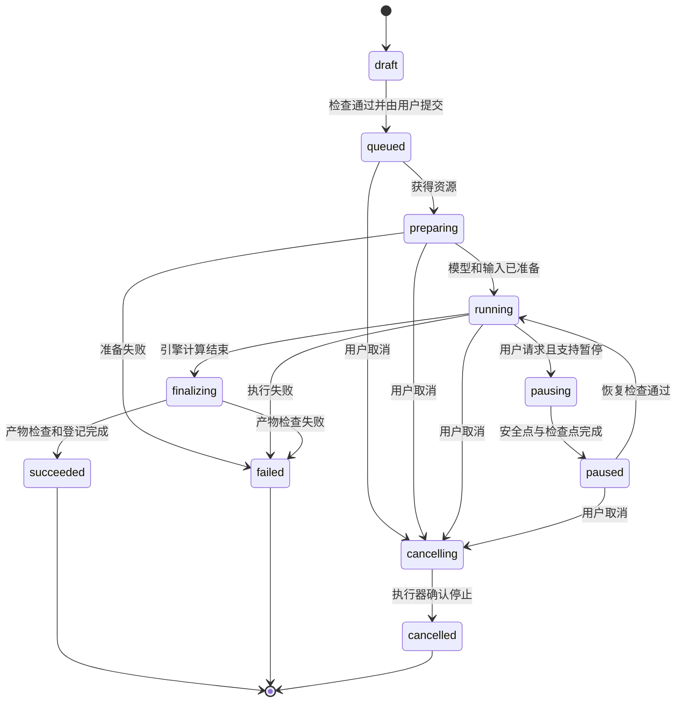

# 接口合同与任务生命周期

版本：1.0 · 日期：2026-09-09 · 状态：待实现的接口设计，不是当前可调用 API。

相关文档：[架构](06-architecture-and-adapters.md)、[对象模型](05-data-model-and-assets.md)、[测试验收](11-testing-and-acceptance.md)。

## 1. 接口约定

接口前缀建议为 `/api/v1`。正文采用 UTF-8 JSON，时间使用带时区的 UTC 时间，容量以字节保存并由界面格式化。金额若未来出现，以明确币种和最小货币单位保存，不用浮点数。

资源编号不可由显示名称派生。集合接口采用游标分页；查询可按项目、类别、状态和时间筛选。修改草稿时携带 `expected_revision`，冲突返回 409 和当前 revision，不覆盖更新的内容。

提交、登记、取消和准备动作支持幂等键。参数错误返回稳定代码、中文消息、字段路径和修复建议。客户端不能依据任意英文异常文本判断是否可以重试。

## 2. 接口清单

下表中的 `{id}` 代表已存在的稳定资源编号；所有修改都要校验对象归属和版本。

| 方法与路径 | 用途 | 关键输入／输出 | 副作用与限制 |
| --- | --- | --- | --- |
| GET `/projects` | 项目列表 | 游标、归档筛选 | 只读 |
| POST `/projects` | 新建项目 | 名称 | 新建记录 |
| PATCH `/projects/{id}` | 修改项目 | 名称、expected_revision | 不改变已有任务归属 |
| GET `/models` | 模型列表 | 模态、格式、可用状态 | 只读 |
| POST `/models/import-plans` | 分析模型导入 | 来源或已选择路径 | 返回文件和信任要求，不运行仓库代码 |
| POST `/models/imports` | 用户确认导入 | plan_id、幂等键 | 创建准备任务 |
| GET `/datasets` | 数据列表 | schema、来源、下载状态 | 只读 |
| POST `/datasets/import-plans` | 分析导入 | 文件资产或受控来源 | 返回 schema、样例、问题 |
| POST `/datasets/imports` | 创建数据版本 | 已检查计划 | 原子登记，不覆盖旧版本 |
| POST `/datasets/{id}/checks` | 技术检查 | version_id、检查集合 | 新建检查报告 |
| POST `/datasets/{id}/transforms` | 处理数据副本 | version_id、操作和参数 | 新建版本，原件不变 |
| POST `/market/access-requests` | 提交访问申请 | 提供方、数据版本、用途 | 明确向该提供方发送信息 |
| GET `/devices` | 设备配置和状态 | 最近探测时间 | 不隐式扫描 |
| POST `/devices/{id}/probes` | 探测设备环境 | 检查范围 | 只读探测，不安装驱动 |
| GET `/capabilities` | 查询能力 | 模型、格式、环境、操作 | 返回状态、字段和证据来源 |
| POST `/environments/prepare-plans` | 计算环境准备计划 | 适配器版本、设备 | 返回依赖、空间和变更 |
| POST `/environments/preparations` | 执行已确认准备 | plan_id、幂等键 | 新建环境，不覆盖旧环境 |
| POST `/tasks` | 新建任务草稿 | project_id、类别、名称 | 新建任务 |
| PATCH `/tasks/{id}/draft` | 保存草稿 | 配置、expected_revision | 只影响未提交草稿 |
| POST `/tasks/{id}/preflight` | 提交前检查 | draft_revision | 返回有效配置和短期有效检查编号 |
| POST `/tasks/{id}/attempts` | 提交执行 | 检查编号、revision、幂等键 | 固定快照，创建执行尝试 |
| GET `/attempts/{id}` | 查询运行状态 | 无 | 返回真实状态及可用控制动作 |
| GET `/attempts/{id}/events` | 订阅／补拉事件 | 游标或 Last-Event-ID | SSE；重连不重新执行 |
| POST `/attempts/{id}/cancel` | 请求取消 | expected_state_version | 幂等，区分请求与最终取消 |
| POST `/attempts/{id}/pause` | 请求安全暂停 | 检查点策略 | 仅适配器支持时允许 |
| POST `/attempts/{id}/resume` | 恢复暂停／检查点 | checkpoint_id、环境摘要 | 验证兼容并记录恢复关系 |
| POST `/attempts/{id}/retries` | 复制为新尝试 | 参数草稿修改 | 创建草稿，不自动执行 |
| POST `/evaluations` | 创建独立评测 | 基线、候选、数据版本、规则 | 新建评测任务 |
| POST `/candidates/{id}/register` | 登记可用候选 | evaluation_ids、幂等键 | 服务端重新检查准入 |
| POST `/recipes/{id}/reuse` | 载入配方 | 目标项目、版本差异策略 | 创建新草稿 |
| POST `/works` | 保存作品 | artifact_id、attempt_id | 校验文件已完整落盘 |
| POST `/exports/prepare` | 准备导出 | 资产和目标格式 | 生成导出清单，尚未对外发送 |
| POST `/ai/proposals` | 请求 AI 建议 | 上下文范围、问题 | 只产生建议，不执行 |
| POST `/ai/proposals/{id}/apply` | 应用明确字段修改 | expected_revision | 原子校验和应用 |
| POST `/ai/proposals/{id}/undo` | 撤销该次应用 | 当前 revision | 检查后续修改，避免覆盖 |

发布、云实例采购和组织权限接口不进入首期合同。若后续加入，单独设计用户确认、身份和审计流程。

## 3. 提交前检查合同

检查结果包含阻断项、提示项、请求摘要、实际配置、环境摘要、数据版本、检查版本和有效期。检查编号与这些内容的哈希绑定；任何输入或环境变化都必须重新检查。

检查不等于执行授权。用户点击正式提交才创建运行尝试。提交事务再次检查草稿 revision、检查有效期和资源状态，防止检查后发生模型替换或设备变化。

```json
{
  "task_id": "task-001",
  "draft_revision": 7,
  "operation": "generate",
  "model_version_id": "model-qwen3-demo-v1",
  "input": {
    "messages": [{"role": "user", "content": "请简要说明数据版本的作用。"}],
    "asset_ids": []
  },
  "runtime": {
    "device_id": "device-local-001",
    "environment_id": "env-mlx-demo-001",
    "thinking": "off",
    "context_tokens": 8192,
    "max_output_tokens": 1024,
    "temperature": 0.7,
    "prefix_cache": false,
    "speculation": {"method": "off"}
  }
}
```

示例编号和模型环境均为合同占位数据，不代表已经存在的服务资源。

```json
{
  "preflight_id": "check-001",
  "task_id": "task-001",
  "draft_revision": 7,
  "can_submit": true,
  "blocking": [],
  "warnings": [],
  "effective_config": {
    "thinking": "off",
    "context_tokens": 8192,
    "max_output_tokens": 1024,
    "temperature": 0.7,
    "prefix_cache": false,
    "speculation": {"method": "off"}
  },
  "config_digest": "example-digest-only",
  "expires_at": "2026-09-09T09:10:00Z"
}
```

若发生引擎自动值调整，响应中需要 `changes` 列表显示原因和前后值，重新让用户查看，不能在 `warnings` 中悄悄降级仍将提交视为无变化。

## 4. 执行快照

每个尝试保存：任务和项目编号、源尝试／检查点编号、模型与适配器版本、输入内容摘要、数据版本、请求配置、实际配置、环境摘要、设备事实、提交用户动作、幂等键和 schema 版本。

快照不包含明文凭证、可变 UI 状态、当前选中页签或可覆盖的 latest 引用。前端可以重命名任务，但不得更新执行快照。后续真实测量信息写到运行记录或报告，不回写成当时的配置。

## 5. 状态机

正式状态比 Demo 更细，以真实执行器反馈为准。



`disconnected` 不直接作为执行终态：连接状态与运行状态分别记录。远端状态暂不可知时显示“连接中断，运行状态待确认”，不能立即标记失败或再次提交。

### 5.1 状态字段

| 字段 | 用途 |
| --- | --- |
| `state` | 最后确认的执行状态 |
| `state_version` | 单调递增版本，控制命令的并发条件 |
| `connection_state` | 已连接／断开／重连中 |
| `last_event_sequence` | 已持久化事件游标 |
| `phase` | 下载、加载、预处理、训练、生成、评测、写文件等阶段 |
| `progress` | 已知比例或 null；未知不生成伪百分比 |
| `allowed_actions` | 根据状态和适配器能力生成的可用操作 |
| `terminal_reason` | 成功、失败或取消的原因代码 |

## 6. 暂停、恢复、取消和重试

### 6.1 暂停

暂停不是停止前端动画，也不默认依赖操作系统强行挂起进程。训练器支持安全点时写检查点再转暂停；推理引擎不能恢复同一请求时只提供取消和以相同配方重跑。页面要解释当前控制能力。

### 6.2 恢复

检查点必须包含需要的模型、优化器、调度器、随机状态和数据位置，且记录哪些状态缺失。若只能恢复权重而无法继续同一优化轨迹，应称为“从该权重开始新尝试”。跨设备或引擎版本恢复先检查兼容性。

### 6.3 取消

用户请求进入 cancelling，执行器在可安全停止点响应。取消后保留已完整产物和日志，未完成产物标记不完整。超时可提供强制终止入口，但必须说明可能失去最近检查点，不能直接显示取消成功。

### 6.4 重试

默认生成新尝试草稿，继承快照并保留 `source_attempt_id`。用户可调整参数后重新检查和提交。原尝试的错误、日志和产物永不被新结果覆盖。

## 7. 事件流

事件在后端持久化后再发给客户端。建议类型：state_changed、phase_changed、progress、log、metric、checkpoint_ready、artifact_ready、warning、terminal。

```json
{
  "schema_version": "1.0",
  "attempt_id": "attempt-001",
  "sequence": 18,
  "type": "state_changed",
  "created_at": "2026-09-09T09:05:00Z",
  "payload": {
    "state": "running",
    "state_version": 4,
    "phase": "decode",
    "message": "模型已加载，开始生成输出。"
  }
}
```

SSE 可重复传输，客户端按 attempt_id + sequence 去重。重连从最近已应用游标补拉；超出事件保留窗口时先取状态快照，再从新的游标继续。日志量大时分页或按区间查询，不能一次加载全部文本阻塞界面。

## 8. 幂等与竞争处理

同一项目、任务、幂等键和相同请求摘要返回同一次提交结果；同一个幂等键携带不同请求返回冲突。远端超时后先查询对应 attempt_id，不能直接重复调用执行。

取消与完成同时发生时，采用最先成功提交的合法状态转移；若产物已经成功登记，取消返回已完成。候选登记使用唯一约束，重复登记返回已有模型版本。用户修改与 AI 应用同时发生时通过草稿 revision 和旧值检查解决，不使用最后写入覆盖。

## 9. 错误结构与分类

```json
{
  "error": {
    "code": "CONTEXT_BUDGET_EXCEEDED",
    "message": "输入与预留输出超过上下文限制。",
    "field": "runtime.max_output_tokens",
    "retryable": false,
    "details": {
      "input_tokens": 7600,
      "reserved_output_tokens": 1024,
      "context_limit": 8192
    },
    "suggested_actions": ["减少输出上限", "检查并裁剪历史", "选择更大上下文的已验证组合"]
  }
}
```

主要错误代码分类：INVALID_CONFIG、UNSUPPORTED_COMBINATION、MODEL_NOT_READY、DATA_SCHEMA_MISMATCH、CONTEXT_BUDGET_EXCEEDED、DEVICE_UNREACHABLE、ENVIRONMENT_CHANGED、OUT_OF_MEMORY、DISK_FULL、ARTIFACT_CORRUPT、CHECKPOINT_INCOMPATIBLE、REVISION_CONFLICT、PROVIDER_ACCESS_REQUIRED。

`retryable` 只表示同样条件下是否可能重试，不授权自动重复昂贵任务。默认对网络读取可有限重试；训练重新执行由用户动作触发。

## 10. 接口安全与本地边界

本地 HTTP 服务仅绑定回环地址，使用会话认证和来源限制。普通网页不能借用用户浏览器访问本地执行能力。桌面宿主只暴露固定命令，不提供任意 shell 执行接口。

文件导入必须是用户选择的文件或明确登记的资产路径，解析后校验授权根目录；符号链接和路径穿越需测试。远端认证使用凭证引用，日志、配方和错误详情不返回秘密内容。

## 11. 接口完成标准

合同测试覆盖类型、边界、幂等、revision 冲突、状态非法转移、事件重连、取消竞争、终态重复通知和产物一致性。执行器返回成功但文件损坏时必须最终失败；没有执行器确认的暂停／取消不能作为通过状态。
