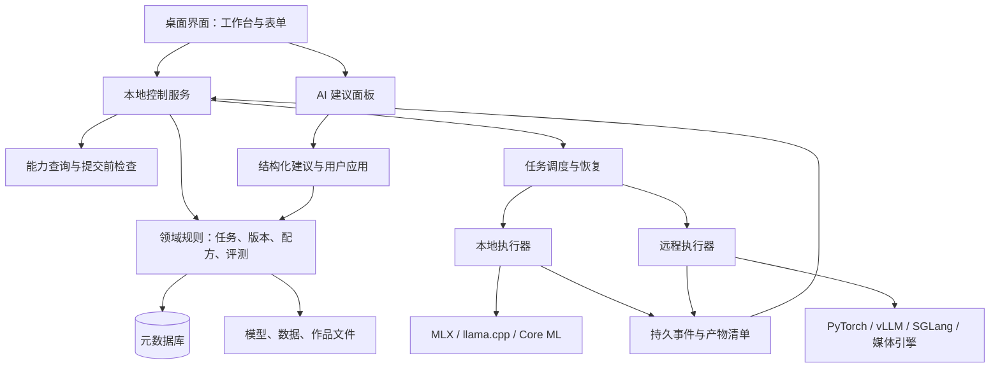

<!-- translation-navigation:start -->
[简体中文](../../../docs/06-architecture-and-adapters.md) · [繁體中文](../../zh-TW/docs/06-architecture-and-adapters.md) · [English](06-architecture-and-adapters.md)
<!-- translation-navigation:end -->

<a id="技术架构与执行适配器设计"></a>

# Technical Architecture and Execution Adapter Design

Version: 1.1 · Date: 2026-09-09 · Status: Proposed architecture revised following the audit; production application code has not yet been created and the packaging environment has not been validated.

Related documents: [Data objects](05-data-model-and-assets.md), [Interfaces and states](07-api-and-task-lifecycle.md), [Technical decisions](13-decisions-risks-and-questions.md).

<a id="1-设计目标"></a>

## 1. Design Goals

Preserve the task experience established by the prototype while replacing browser memory state, simulated timers, and preset outputs. Manage business rules centrally and run real execution processes independently; failure of a training process must not cause the entire application to lose task records.

The initial phase uses a modular monolithic control service with independent executors, without introducing a microservice cluster, Kubernetes, or complex multitenant infrastructure. A remote GPU is a manageable execution target; it does not require building a complete cloud platform first.

<a id="2-推荐技术组合"></a>

## 2. Recommended Technology Combination

| Layer | Recommendation | Rationale | Validation by phase |
| --- | --- | --- | --- |
| Interface | React + TypeScript | Forms, state, and reusable page structures suit productionizing the prototype | M0 minimum interaction in the shell; Chinese, keyboard interaction, and business forms from M1 |
| Desktop host | Tauri 2 | Provides desktop windows and controlled local capabilities | M0 TV-02 sidecar startup, exit, and crash isolation; M6 installation signing and updates |
| Local control service | Python + FastAPI + typed data models | Close to the training / inference ecosystem; facilitates parameter validation and interface tests | M0 TV-02 minimum authentication and events; M1 complete service contracts; M6 distribution |
| Metadata | SQLite | Clear transactions and migrations for single-user local metadata | M1 transactions and concurrent reads / writes; M6 upgrade backup and recovery |
| Large files | File system + content-digest index | Keeps model, media, and data files out of the database | M1 atomic writes and references; disk-full recovery in the relevant feature phases |
| Execution | Independent processes / environments | Isolates dependencies such as MLX, CUDA, and ROCm | M0 TV-01 minimum real combination; M1 state contracts; M3 training checkpoints |
| Remote execution | Controlled remote executor, initially connectable through an SSH tunnel | Reuses users' existing servers without opening public ports by default | M0 TV-03 specified LoRA return-path experiment; M3 remote identity, reconnection, and collection retries |
| Events | HTTP queries + SSE progress stream | Meets one-way logging and progress needs without a complex bidirectional channel in the initial phase | M0 TV-02 simple event path; M1 cursors, deduplication, and terminal-state recovery |

These are implementation recommendations, not a technology stack already selected by the user. If M0 shows that sidecar packaging costs clearly outweigh the benefits, the same control service with a local Web interface can serve as the development-validation host before deciding on the desktop shell; the domain model and interfaces remain unchanged.

References: [Tauri sidecars](https://v2.tauri.app/develop/sidecar/), [FastAPI lifespan](https://fastapi.tiangolo.com/advanced/events/), [SQLite WAL](https://www.sqlite.org/wal.html). SQLite WAL concurrency does not replace backup and consistency design. Do not place the database file directly on a remote shared drive to act as a multihost database.

<a id="3-组件关系"></a>

## 3. Component Relationships



AI does not connect directly to the queue submission control path. Applying a suggestion and submitting execution are different user commands and different events.

<a id="4-模块职责"></a>

## 4. Module Responsibilities

<a id="41-前端"></a>

### 4.1 Frontend

Owns pages, form drafts, immediate validation, focus, state display, and user actions. The frontend may hide or disable controls based on capability declarations, but final submission validation must run again in the control service. After a page refresh, tasks are recovered from the server rather than advanced by frontend timers.

<a id="42-控制服务"></a>

### 4.2 Control Service

Manages projects, data, models, configurations, devices, environments, tasks, and evaluations. Provides atomic submission, idempotent commands, version checks, permission boundaries, and event subscriptions. The control service does not load large models or run training directly in request threads.

<a id="43-资源与下载管理"></a>

### 4.3 Resource and Download Management

Manages file manifests, validation, resumable transfers, extraction, path resolution, and references. Model preparation, environment installation, and data downloads are independently observable tasks; the downloader does not execute repository code.

<a id="44-能力注册与检查"></a>

### 4.4 Capability Registration and Checks

Combines device detection, engine versions, model formats, and adapter parameter schemas to return support conditions and preparation steps. Cached capability results bind the environment digest and are invalidated when drivers / engines change.

Input artifact formats and operations must match in both directions; engines cannot be inferred solely from the source model category. Media tasks, speculative-component preparation records, and prefix-cache identities are also validated centrally here. Unknown format / media-cache combinations do not enter the run path; interface defaults must not turn unknown status into support.

<a id="45-执行器"></a>

### 4.5 Executors

Read immutable run snapshots, prepare inputs, load engines, emit phase events, write artifacts and checkpoints, and handle cancellation / resumption. They cannot modify project display names or original data, or expand their own file-access scope.

<a id="46-评测与登记"></a>

### 4.6 Evaluation and Registration

Evaluators read specified models / candidates, fixed data, and evaluation rules, and write immutable reports. The registration service checks artifact integrity and admission rules and creates new model versions and provenance relationships. Passing `passed: true` from the frontend cannot bypass checks.

<a id="5-适配器最小合同"></a>

## 5. Minimum Adapter Contract

| Operation | Input | Output | Error requirements |
| --- | --- | --- | --- |
| `describe` | Adapter version | Input / output formats, structural conditions, parameter schemas, control capabilities, and loading trust capabilities for each operation | No network access or execution startup |
| `probe` | Device and environment references | Hardware facts, drivers, resources, limits | Distinguishes insufficient permissions from a nonexistent device |
| `validate` | Model, data, requested configuration | Blockers / notices, effective configuration, preparation actions | Returns field locations and reason codes |
| `prepare` | Confirmed preparation plan | Environment / model preparation record | Does not implicitly upgrade existing environments |
| `run` | Fixed execution snapshot, stable attempt ID | Event stream, computation result, sealed artifact manifest | The same attempt cannot start twice; computation and collection outcomes are separate |
| `pause` | Run ID, control command ID, checkpoint policy | Request receipt, pause confirmation or failure, and current execution evidence | Confirms pause only after reaching a safe point and completing the checkpoint |
| `cancel` | Run ID, control command ID | Request receipt, stop evidence, or unknown outcome | Idempotent; does not immediately assume the process has stopped |
| `force_stop` | Run ID, control command ID, executor ownership identifier | Stop evidence for the specified task or failure / unknown outcome | Available only when declared supported; must not stop unrelated processes |
| `checkpoint` | Run ID | Resumable checkpoint or unsupported | States which recovery state is included |
| `resume` | Checkpoint, compatible environment | New attempt or explicit continuation identifier | Must reject an incompatible environment |
| `collect` | Original attempt ID, sealed manifest digest, collection ID, target asset storage | File validation, registration result, resumable transfer position | Idempotent collection only; must not call run / resume internally; partial files cannot be presented as complete success |

The initial phase does not require every adapter to implement every control action. `supports_pause`, `supports_resume`, `supports_stream`, `supports_checkpoint`, and similar capabilities must be declared by the actual adapter; the interface displays them accordingly.

The control service handles command versions and idempotency centrally. Adapters return the control command ID, executor event sequence number, and whether they can confirm that execution is still running / has stopped. Heartbeat loss is not stop evidence. Pause-checkpoint failure, crashes during cancellation, force-stop timeouts, and completion races all converge according to the [state table in 07](07-api-and-task-lifecycle.md), rather than leaving the frontend to guess. (AUD-07)

When computation finishes, seal a read-only manifest before collecting artifacts. Executors under our control retain artifacts until the control side confirms complete registration or the user clears them from an explicit list; local collection failure does not trigger automatic deletion. If an external service has a fixed retention period, display it before submission and mark support conditional; report expiry or insufficient space promptly, without claiming indefinite collection recovery. Collection retries read the original files without changing their digests or retraining. If original files are corrupted or external retention has expired, return that collection cannot be recovered along with a missing-file list. Evaluation / candidate registration after collection recovery still uses independent admission checks; successful collection must not turn an originally failed evaluation into a pass. (AUD-08)

<a id="6-能力声明示例"></a>

## 6. Capability Declaration Example

The following structure is an interface design example. The UI must not automatically change `未验证` to passed.

```json
{
  "schema_version": "1.1",
  "adapter_id": "mlx-text",
  "adapter_version": "待锁定",
  "model_family": "qwen3",
  "operations": ["generate"],
  "hardware_backends": ["metal"],
  "formats": ["mlx"],
  "format_support": [{"operation": "generate", "inputs": ["mlx"], "outputs": ["text"], "status": "unverified"}],
  "load_policy": {"trust_class": "restricted_weights", "loader": "待锁定的受限加载器", "arbitrary_deserialization": false},
  "controls": {
    "cancel": true,
    "pause": false,
    "resume_from_checkpoint": false,
    "force_stop": false,
    "recollect": true
  },
  "features": {
    "thinking_toggle": {"status": "conditional", "requires": ["兼容聊天模板"]},
    "prefix_cache": {"status": "conditional", "requires": ["指定引擎版本", "完整输入身份与项目隔离已验证"]},
    "mtp": {"status": "unsupported", "reason": "此适配目标未声明原生预测组件"}
  },
  "verification": {"status": "未验证", "report_id": null}
}
```

The production schema must also express parameter types, units, default sources, constraints, restart requirements, and conflicts. Public capability names need not match every underlying library parameter name exactly; the mapping layer translates them and saves the result.

<a id="7-环境隔离"></a>

## 7. Environment Isolation

MLX, CUDA, ROCm, oneAPI, and media models may need different Python versions, dependencies, or native libraries. Use isolated environments generated by adapter version, with environment identifiers derived from lockfiles and platform digests; do not reuse a global Python environment with arbitrary installed packages.

The base desktop installer contains only dependencies required by the control layer. Large models, training environments, and optional runners are prepared under explicit plans. Before installing an environment, show sources, estimated downloads and disk use, the target directory, and whether system drivers are required. Do not install drivers or modify system permissions under the label “connection check.”

Runner commands use fixed executables and argument arrays rather than concatenating user input into shell commands. Custom model repositories requiring code execution are handled as separate trust decisions, not mixed into ordinary weight downloads.

<a id="71-模型文件的加载信任边界aud-11"></a>

### 7.1 Model File Loading Trust Boundary (AUD-11)

Import analysis checks only file structure, manifests, and safely readable metadata; it does not deserialize and execute unknown objects. Classify by actual format and loading method, not extension alone:

| Class | Import and loading rules | Usability boundary |
| --- | --- | --- |
| Restricted weights | Allows only adapter-listed formats and fixed restricted-loading methods, such as validated safetensors or strictly restricted weight-loading paths | Checks hashes, structure, resource limits, and loader version together; this is not a guarantee that arbitrary files are safe |
| Code execution required | Includes arbitrary pickle deserialization, TorchScript, and paths requiring custom repository code | Separately lists executed content, source, file / network / credential scope, and isolation method; preparation is allowed only after the user explicitly chooses that execution scope |
| Unknown / unsupported | Cannot be reliably identified, disguised format, exceeds limits, or restricted loading fails | Retains unprepared status and the reason, and rejects loading; must not automatically disable restrictions or switch to arbitrary deserialization |

Dependency virtual environments isolate package versions only; they do not replace execution-permission isolation. Tasks requiring code execution must use validated process / system or container boundaries: inputs are read-only, only the task output directory is writable, network access is limited to confirmed destinations, and application credentials are not injected by default. The path cannot start if isolation capabilities are missing. Trust decisions bind file digests, loader versions, and scopes. Any change creates a new plan rather than reusing a permanent “trust this model” switch.

Acceptance uses controlled, harmless fixtures to check that disguised files, restricted-loading failures, untrusted checkpoints, custom-code requirements, and out-of-scope file / network / credential access are blocked. Successful isolated execution does not mean the model has passed quality or compatibility acceptance. Basis: [PyTorch security policy](https://github.com/pytorch/pytorch/security/policy).

<a id="8-本地与远程执行"></a>

## 8. Local and Remote Execution

The local control side assigns a stable task ID and idempotency key to each remote attempt. The remote side retains its own task state, log cursors, and artifact manifests. After disconnecting, the control side reconnects to retrieve incremental state rather than starting the task again.

Model and data transfers identify existing files by content digest to avoid duplicate uploads. Before submission, users see which inputs will be sent to which execution device. Credentials are stored in operating-system secure storage, with only references in the database; ordinary logs and recipes do not save keys.

The initial cloud GPU phase supports only instances / services already configured by the user and does not automatically create paid instances. Any later resource-provisioning feature requires separate budget, confirmation, and resource-release workflows.

<a id="9-调度与资源策略"></a>

## 9. Scheduling and Resource Strategy

The initial phase uses explicit device queues and limited concurrency. Training exclusively occupies a specified device resource allocation by default. Inference instances are reused by a key comprising model, adapter, precision, and engine configuration. Models that cannot fit simultaneously are explicitly queued or unloaded rather than scheduled through repeated OOM retries.

Resource estimates are only estimates; record their source, measurement time, and uncertainty. Executors report actual memory use. Unified memory, GPU memory, and CPU memory are stored separately. Caches, model instances, and user assets are cleared separately.

<a id="10-从-demo-迁移"></a>

## 10. Migrating from the Demo

1. Preserve page structures, task names, and discoverable entry points, extracting them into production components.
2. Convert numeric strings to typed fields and unify frontend / backend schemas.
3. Split the in-memory `store` into server-side domain objects and frontend editing drafts.
4. Replace the simulated timer that increases progress every 900 ms with real task events.
5. Replace embedded images / audio with asset references, and use actual files and decoding results for acceptance.
6. Remove shortcuts such as “simulated connection passed” and “preset evaluation passed” from production paths, retaining them only in a separate demonstration mode.
7. Migrate the business boundaries covered by the 59 prototype test groups and add interface, process, device, and persistence tests.

Do not use the prototype's single-file JavaScript directly as a production backend or arbitrarily redesign the established information architecture during productionization.

<a id="11-建议目录结构"></a>

## 11. Suggested Directory Structure

The following is only a development-stage suggestion; these code directories have not been created in the current project.

```text
apps/desktop/       桌面宿主与前端
services/control/   本地控制服务与领域规则
packages/contracts/ 共享接口与参数 schema
adapters/           训练、推理、评测和转换适配器
workers/            本地与远程执行器
tests/              单元、合同、集成、设备和端到端测试
fixtures/           小型可公开测试数据及来源说明
docs/               本套产品、开发与验收文档
```

<a id="12-架构验收"></a>

## 12. Architecture Acceptance

Use one minimal real run adapter to validate frontend submission, capability checks, execution events, cancellation, artifact persistence, and recovery after restart. Then integrate a trainer to demonstrate that adding a backend does not require changing project, task, or result-attribution rules. Architecture review judges whether this end-to-end path is simple and reliable, rather than counting interfaces or directory levels.

M0 uses only TV-01—TV-03 to determine the feasibility of the minimum model combination, shell and sidecar, and return path for the same LoRA; it does not require M1 project persistence or M6 release acceptance to finish first. Complete interface, failure-recovery, and installation contracts remain subject to acceptance in their corresponding work-package phases. Passing technical experiments must not preemptively check off product ACs. (AUD-12)
