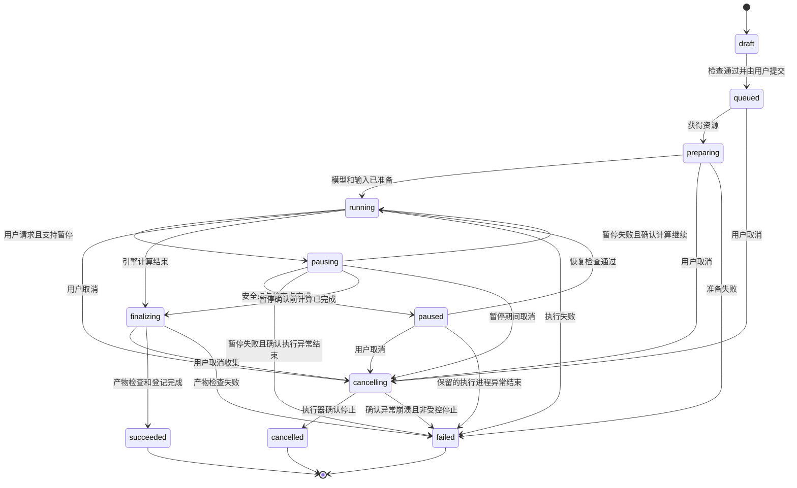

<!-- translation-navigation:start -->
[简体中文](../../../docs/07-api-and-task-lifecycle.md) · [繁體中文](../../zh-TW/docs/07-api-and-task-lifecycle.md) · [English](07-api-and-task-lifecycle.md)
<!-- translation-navigation:end -->

<a id="接口合同与任务生命周期"></a>

# Interface Contracts and Task Lifecycle

Version: 1.1 · Date: 2026-09-09 · Status: Interface contracts revised following the audit and awaiting implementation; these are not currently callable APIs.

Related documents: [Architecture](06-architecture-and-adapters.md), [Object model](05-data-model-and-assets.md), [Testing and acceptance](11-testing-and-acceptance.md).

<a id="1-接口约定"></a>

## 1. Interface Conventions

The recommended interface prefix is `/api/v1`. Bodies use UTF-8 JSON, times use timezone-qualified UTC, and capacities are stored in bytes and formatted by the interface. If monetary values are introduced later, store them with an explicit currency in its smallest unit, not as floating-point numbers.

Resource IDs must not be derived from display names. Collection interfaces use cursor pagination; queries can filter by project, category, state, and time. Draft modifications carry `expected_revision`; conflicts return 409 and the current revision without overwriting newer content.

Submission, registration, control, collection retries, workflow advancement, and preparation / export actions support idempotency keys. For the same command key and request digest, return the existing result before checking the current version. A new key requires version validation again; the same key with a different digest returns 409. Parameter errors return stable codes, Chinese messages, field paths, and suggested fixes. Clients must not decide retryability from arbitrary English exception text.

<a id="2-接口清单"></a>

## 2. Interface List

In the table below, `{id}` represents an existing stable resource ID; all mutations must validate object ownership and version.

| Method and path | Purpose | Key inputs / outputs | Side effects and limits |
| --- | --- | --- | --- |
| GET `/projects` | List projects | Cursor, archive filter | Read-only |
| POST `/projects` | Create a project | Name | Creates a record |
| PATCH `/projects/{id}` | Modify a project | Name, expected_revision | Does not change ownership of existing tasks |
| GET `/models` | List models | Modality, format, availability | Read-only |
| POST `/models/import-plans` | Analyze a model import | Source or selected path | Returns detected format, manifest digest, loader / restricted options, trust class, and execution scope; does not run code being imported or unknown deserialization |
| POST `/models/imports` | User confirms import | plan_id, plan digest, user-selected trust_decision when code execution is required, idempotency key | Fixes the selection and execution scope as decision_ref; rechecks files and loading method before creating a preparation task; restricted-loading failure does not automatically fall back |
| GET `/datasets` | List data | schema, source, download state | Read-only |
| POST `/datasets/import-plans` | Analyze an import | File assets or controlled source | Returns schema, samples, and issues |
| POST `/datasets/imports` | Create a data version | Checked plan | Registers atomically without overwriting old versions |
| POST `/datasets/{id}/checks` | Technical checks | version_id, check set | Creates a check report |
| POST `/datasets/{id}/transforms` | Process a data copy | version_id, operations and parameters | Creates a new version; originals remain unchanged |
| POST `/market/access-requests` | Submit an access application | Provider, data version, intended use | Explicitly sends information to that provider |
| GET `/devices` | Device configuration and state | Latest detection time | No implicit scanning |
| POST `/devices/{id}/probes` | Detect device environment | Check scope | Read-only detection; does not install drivers |
| GET `/capabilities` | Query capabilities | Model, format, environment, operation | Returns status, fields, and evidence sources |
| POST `/environments/prepare-plans` | Calculate environment preparation plan | Adapter version, device | Returns dependencies, space, and changes |
| POST `/environments/preparations` | Execute confirmed preparation | plan_id, idempotency key | Creates an environment without overwriting old environments |
| POST `/tasks` | Create a task draft | project_id, category, name | Creates a task |
| PATCH `/tasks/{id}/draft` | Save a draft | Configuration, expected_revision | Affects only unsubmitted drafts |
| POST `/tasks/{id}/preflight` | Pre-submission checks | draft_revision | Returns effective configuration and a short-lived check ID |
| POST `/tasks/{id}/attempts` | Submit execution | Check ID, revision, idempotency key | Fixes a snapshot and creates an execution attempt |
| GET `/attempts/{id}` | Query run state | None | Returns actual state and available control actions |
| GET `/attempts/{id}/events` | Subscribe to / retrieve missed events | Cursor or Last-Event-ID | SSE; reconnecting does not rerun execution |
| POST `/attempts/{id}/cancel` | Request cancellation | expected_state_version, idempotency key | Distinguishes the request from stop confirmation; during finalizing, cancels only collection / registration |
| POST `/attempts/{id}/pause` | Request a safe pause | expected_state_version, checkpoint policy, idempotency key | Allowed only if supported by the adapter; see the state table for failure exits |
| POST `/attempts/{id}/resume` | Resume from pause / checkpoint | expected_state_version, checkpoint_id, environment digest, idempotency key | Safe resumption in the same process retains the attempt; otherwise creates only a recovery draft, without automatic execution |
| POST `/attempts/{id}/force-stop` | Force-stop an execution task with verified ownership | expected_state_version, idempotency key | Allowed only when declared supported; returns stop evidence or unknown, and does not display stopped because of a timeout |
| POST `/attempts/{id}/retries` | Copy to a new attempt draft | expected_state_version, parameter changes, idempotency key | Creates a draft without automatic execution; the original terminal state is unchanged |
| POST `/attempts/{id}/collections` | Retry collection of original artifacts from completed computation | manifest_digest, expected_collection_version, idempotency key | Only validates / transfers / registers; does not invoke computation or resumption; returns collection_id |
| GET `/collections/{id}` | Query a collection retry | None | Collection state, file validation, registration result, missing files, and available actions |
| POST `/collections/{id}/cancel` | Cancel a collection retry | expected_collection_version, idempotency key | Confirms collection cancelled after transfer / registration stops; does not change the original computation or attempt terminal state |
| POST `/workflow-runs` | Start a workflow instance | definition_version, project_id, idempotency key | Every new action creates an independent execution identity; old run IDs cannot be reused |
| GET `/workflow-runs/{id}` | Query workflow and provenance state | None | Returns revision, current step, input versions, accepted artifacts, reuse records, and stale markers |
| PATCH `/workflow-runs/{id}/steps/{step_id}/input` | Edit step input | expected_revision, input | Creates a new input version and marks old downstream results stale |
| POST `/workflow-runs/{id}/advance` | Accept results and use them in the next step | expected_revision, step_attempt_id, input_revision, artifact_ids, idempotency key | Target occupancy checks, source validation, and advancement share one transaction; failure leaves everything unchanged |
| POST `/workflow-runs/{id}/reuse-output` | Explicitly reuse an old result | expected_revision, source attempt / artifacts, target step and input_revision, idempotency key | Records differences and reuse provenance; does not count as new computation or advance automatically |
| POST `/evaluations` | Create an independent evaluation | Baseline, candidate, data version, rules | Creates an evaluation task |
| POST `/candidates/{id}/register` | Register a usable candidate | evaluation_ids, idempotency key | Server rechecks admission |
| POST `/recipes/{id}/reuse` | Load a recipe | Target project, version-difference policy | Creates a new draft |
| POST `/works` | Save a work | artifact_id, attempt_id | Verifies files have been completely persisted |
| GET `/works/{id}` | Query a work and its revisions | Optional revision_id | Returns the original generation recipe, selected work version, and revision differences without merging or rewriting provenance |
| POST `/works/{id}/revisions` | Save manual revisions such as subtitles | expected_revision, parent_revision_id, changes, idempotency key | Adds a work version without changing the generation recipe / snapshot |
| POST `/exports/prepare` | Prepare a user artifact export | Objects and versions, dependency policy, target format / directory | Fixes the dependency manifest, space, and validation plan; returns ExportPlan without sending or publishing |
| POST `/exports` | Execute a user artifact export | plan_id, plan digest, idempotency key | Rechecks source files, creates a kind=export task and attempt, writes temporarily, then validates and persists |
| GET `/exports/{id}` | Query an export | None | Returns task / attempt IDs, progress, verified output location, and independent-use check results; cancellation uses generic cancel |
| POST `/ai/proposals` | Request an AI suggestion | Context scope, question | Produces suggestions only, without execution |
| POST `/ai/proposals/{id}/apply` | Apply explicit field changes | expected_revision | Validates and applies atomically |
| POST `/ai/proposals/{id}/undo` | Undo that application | Current revision | Checks subsequent changes to avoid overwriting them |

Publishing, cloud-instance purchasing, and organization-permission interfaces are outside the initial contract. If added later, design separate user-confirmation, identity, and audit workflows.

<a id="3-提交前检查合同"></a>

## 3. Pre-submission Check Contract

Check results include blockers, notices, request digest, effective configuration, environment digest, data version, check version, and expiry. The check ID binds the hash of these contents; any input or environment change requires a new check.

A check is not execution authorization. A run attempt is created only when the user clicks the actual submit action. The submission transaction rechecks the draft revision, check expiry, and resource state to prevent model replacements or device changes after checking.

The model, task type, input media, artifact format, prepared speculative-component combination, and applied execution location must agree. Workflow tasks also bind `workflow_run_id`, `step_attempt_id`, `input_revision`, and the input digest; training tasks bind the tokenization and supervision recipe digest and corresponding check report. The submission endpoint must not trust visible interface options, historical result selection, or a `draftReady` boolean. (AUD-01—AUD-06, AUD-10)

```json
{
  "task_id": "task-001",
  "draft_revision": 7,
  "operation": "generate",
  "model_version_id": "model-qwen3-demo-v1",
  "input": {
    "messages": [{"role": "user", "content": "请简要说明数据版本的作用。"}],
    "asset_ids": []
  },
  "runtime": {
    "device_id": "device-local-001",
    "environment_id": "env-mlx-demo-001",
    "thinking": "off",
    "context_tokens": 8192,
    "max_output_tokens": 1024,
    "temperature": 0.7,
    "prefix_cache": false,
    "speculation": {"method": "off"}
  }
}
```

The example IDs and model environments are contract placeholders, not existing service resources.

```json
{
  "preflight_id": "check-001",
  "task_id": "task-001",
  "draft_revision": 7,
  "can_submit": true,
  "blocking": [],
  "warnings": [],
  "effective_config": {
    "thinking": "off",
    "context_tokens": 8192,
    "max_output_tokens": 1024,
    "temperature": 0.7,
    "prefix_cache": false,
    "speculation": {"method": "off"}
  },
  "config_digest": "example-digest-only",
  "expires_at": "2026-09-09T09:10:00Z"
}
```

If an engine automatically adjusts values, the response needs a `changes` list showing reasons and before / after values for renewed user review. It must not silently downgrade through `warnings` while treating the submission as unchanged.

<a id="4-执行快照"></a>

## 4. Execution Snapshot

Each attempt saves task and project IDs, source attempt / checkpoint IDs, model and adapter versions, input-content digests and media-processing versions, data versions, training tokenization / supervision recipe references where applicable, workflow run / step / input versions where applicable, requested configuration, effective configuration, environment digest, device facts, loading-trust decision reference, submitting user action, idempotency key, and schema version.

Snapshots do not include plaintext credentials, mutable UI state, the currently selected tab, or overwritable latest references. The frontend can rename tasks but cannot update execution snapshots. Later actual measurements are written to run records or reports, not backdated into the configuration at submission.

<a id="5-状态机"></a>

## 5. State Machine

Production states are more granular than the demo and are governed by actual executor feedback. `draft` belongs to the task draft; submission creates a RunAttempt starting at `queued`. The diagram shows the main edges; the failure, race, and missing-evidence rules in the tables are also part of the contract. (AUD-07)



`disconnected` is not directly an execution terminal state: connection state and run state are recorded separately. When remote state is temporarily unknown, display “Connection interrupted; run state awaiting confirmation,” rather than immediately marking failure or submitting again.

The only terminal states are `succeeded`, `failed`, and `cancelled`, and they are not rewritten once persisted. Collection-state changes, later evaluations, and new attempts are expressed as related records. The control side saves the last confirmed state and evidence time; while state is unknown, it does not infer that computation has failed, paused, or stopped.

<a id="51-状态字段"></a>

### 5.1 State Fields

| Field | Purpose |
| --- | --- |
| `state` | Last confirmed execution state |
| `state_version` | Monotonically increasing version used as the concurrency condition for control commands |
| `connection_state` | Connected / disconnected / reconnecting |
| `stop_status` | `not_requested` / `pending` / `confirmed` / `unknown`; must not display stopped before confirmation |
| `last_control` | Command ID, action, received / executed / failed / unknown result, reason, and executor-evidence reference |
| `compute_outcome` | `pending` / `succeeded` / `failed` / `cancelled`; confirmed only from computation evidence, separately from final application success |
| `collection_state` | `not_started` / `collecting` / `succeeded` / `failed` / `cancelled`; summarizes independent collection records |
| `collection_version` | Monotonically increasing collection-retry concurrency version, separate from the terminal-state version |
| `output_manifest_ref` | Original artifact manifest and digest sealed by the executor; collection retries may reference only that content |
| `last_event_sequence` | Persisted event cursor |
| `phase` | Phases such as download, load, preprocess, train, generate, evaluate, or write files |
| `progress` | Known fraction or null; unknown progress does not generate a fake percentage |
| `allowed_actions` | Available operations generated from state and adapter capabilities |
| `terminal_reason` | Reason code for success, failure, or cancellation |

<a id="52-状态事件与可用动作"></a>

### 5.2 States, Events, and Available Actions

Every action in the table first checks adapter declarations, object ownership, expected version, and idempotency key. Queries, logs, and retrieval of missed events are always available; “Retry” creates a draft only.

| Current state | Event / action | Result and invariants |
| --- | --- | --- |
| queued | Resources acquired / cancel | Enters preparing / cancelling respectively; reaches cancelled only after the queue confirms it never started and releases resources |
| preparing | Preparation complete / preparation failed / cancel | running / failed / cancelling; if a timeout leaves the remote outcome unknown, retains state and queries |
| running | Pause / cancel / computation complete / execution exception | pausing / cancelling / finalizing / failed; pause is available only when supported |
| pausing | Safe point and complete checkpoint confirmed | paused; command receipt alone or an incomplete checkpoint cannot confirm pause |
| pausing | Checkpoint failure | If the executor confirms computation continues, running with a recorded control failure; if abnormal termination is confirmed, failed; without evidence, retains pausing with unknown control outcome and offers query, cancel, or supported force-stop |
| pausing | Cancel / computation completion arrives first | A legally submitted cancellation enters cancelling; if cancellation has not been accepted and computation completion commits first, enters finalizing and pause returns already finished / not paused |
| paused | Safe resumption of the same attempt / cancel / process crash | running after resumption is confirmed; cancellation enters cancelling; confirmed uncontrolled abnormal exit enters failed; failed resumption validation retains paused |
| finalizing | Collection and registration complete / fail | succeeded / failed; compute_outcome remains succeeded and collection results are recorded separately |
| finalizing | Cancel / pause | Cancellation enters cancelling and stops only collection and registration; pause returns unsupported in this phase, with state unchanged |
| cancelling | Controlled stop or never-started status confirmed | cancelled; complete files are retained and incomplete files cannot be registered as successful; if computation completed, preserves compute_outcome as succeeded |
| cancelling | Executor crash / timeout | Confirmed abnormal exit of the task process and its children enters failed; heartbeat loss or an unknown stop outcome remains cancelling with stop_status=unknown, without fabricating cancelled |
| cancelling | Late pause / completion event | Preserves event evidence without undoing committed cancellation; may record completed computation, but does not register this attempt as succeeded |
| preparing / running / pausing / paused / cancelling | User requests supported force-stop | Enters or remains cancelling, then cancelled after stop confirmation; a confirmed uncontrolled crash may enter failed; rejection or timeout without stop confirmation remains awaiting confirmation and does not act on unrelated processes |
| succeeded / failed / cancelled | New cancel / pause / force-stop command | Returns the existing terminal state and inapplicability reason without changing the terminal state; retries / eligible collection retries create separate records |

Confirmed crashes in the table require executor ownership and process-tree exit evidence; disconnection cannot replace them. During finalizing, force-stop is not an entry point for killing the computation process; collection cancellation uses ordinary cancel. If a control is submitted after the frontend saw stale state, 409 returns the current state, version, and action list, and the user decides what to do after the client refreshes.

<a id="6-暂停恢复取消和重试"></a>

## 6. Pause, Resume, Cancel, and Retry

<a id="61-暂停"></a>

### 6.1 Pause

Pausing is not stopping a frontend animation, nor does it rely by default on the operating system forcibly suspending a process. Trainers supporting safe points write a checkpoint before entering paused. Inference engines unable to resume the same request offer only cancellation and rerunning the same recipe. The page explains the current control capabilities.

A pause failure must report checkpoint integrity, whether computation is still running, the reason, and available actions. Cancellation can interrupt an unconfirmed pause; a late checkpoint_ready only registers the checkpoint and must not change cancelling back to paused.

<a id="62-恢复"></a>

### 6.2 Resume

A checkpoint must contain the required model, optimizer, scheduler, random state, and data position, and record which states are missing. If only weights can be restored without continuing the same optimization trajectory, call it “Start a new attempt from these weights.” Cross-device or engine-version resumption first checks compatibility.

Safe pause / resume within the same surviving executor may retain attempt_id, with a continuation identifier recorded in the control receipt. If the process has exited, the attempt is terminal, or only weights can be restored, the interface returns a new recovery draft and `source_attempt_id` / checkpoint references for the user to check and submit again. It must not change the original terminal state or display an unstarted new draft as running.

<a id="63-取消"></a>

### 6.3 Cancel

A user request enters cancelling; the executor responds at a point where it can stop safely. Complete artifacts and logs are retained after cancellation; unfinished artifacts are marked incomplete. A timeout may offer a `/force-stop` entry declared supported, with the interface explaining possible loss of the latest checkpoint. That command affects only executor processes and children belonging to this attempt. Request acceptance, signal delivery, and timeout are not successful stop confirmation.

Control responses contain `command_id`, command result, latest state / version, and evidence references. When the stop outcome is unknown, continue displaying awaiting confirmation and allow retrieval of updated state; do not automatically create new computation to replace an unknown run. Cancelling a local wait also does not cancel the remote task.

<a id="64-重试"></a>

### 6.4 Retry

By default, create a new attempt draft that inherits the snapshot and preserves `source_attempt_id`. Users may adjust parameters, check again, and submit. New results never overwrite the original attempt's errors, logs, or artifacts.

<a id="65-只补收产物aud-08"></a>

### 6.5 Artifact Collection Retries Only (AUD-08)

Collection retries require `compute_outcome=succeeded`, a complete manifest sealed by the executor, and an original attempt that entered failed because collection failed or cancelled because the user stopped collection. If finalizing is still in progress or a collection retry is active, return the current collection record. This applies only to failures during download, validation, or registration. If original artifacts themselves are missing / corrupted, list unrecoverable files without calling training, inference, run, or resume again.

`POST /attempts/{id}/collections` fixes the original manifest digest, collection destination, and idempotency key, then creates or returns an existing `ArtifactCollection`, whose states are collecting → succeeded / failed / cancelled. Transfers may resume from verified blocks. Registration has a unique constraint on “original attempt + manifest digest + file identity”; collection events and asset registration commit in the same transaction or a reliable outbox. Reopening after interruption retrieves updates by collection_id without creating duplicate assets.

Successful collection recovery updates only the collection record and its summary fields; the original attempt's failed / cancelled terminal state, terminal_reason, and occurrence time remain unchanged. The interface displays “Computation completed; original collection failed; collection now recovered,” or the corresponding cancellation facts. Complete files may be saved as works. Model candidates still require independent loading, evaluation, and registration: old failed evaluations stay failed, and new evaluations have new IDs. AC-18 / AC-21 must verify that disk-full conditions, transfer interruption, and registration-transaction failure do not increase computation calls, that file digests match, and that registration occurs exactly once.

<a id="7-事件流"></a>

## 7. Event Stream

Events are persisted in the backend before being sent to clients. Suggested types: state_changed, phase_changed, progress, log, metric, checkpoint_ready, artifact_ready, control_result, collection_changed, warning, terminal. Collection-retry events include collection_id; workflow acceptance / invalidation events include workflow_run_id, step attempt, input version, and run revision. Subtitle-edit events reference WorkRevision without modifying historical generation events.

```json
{
  "schema_version": "1.1",
  "attempt_id": "attempt-001",
  "sequence": 18,
  "type": "state_changed",
  "created_at": "2026-09-09T09:05:00Z",
  "payload": {
    "state": "running",
    "state_version": 4,
    "phase": "decode",
    "message": "模型已加载，开始生成输出。"
  }
}
```

SSE may deliver duplicates; clients deduplicate by attempt_id + sequence. Reconnection retrieves events from the most recently applied cursor. If the event retention window has been exceeded, fetch a state snapshot first, then continue from a new cursor. Large logs use pagination or range queries rather than loading all text at once and blocking the interface.

<a id="8-幂等与竞争处理"></a>

## 8. Idempotency and Race Handling

The same project, task, idempotency key, and request digest return the same submission result; the same idempotency key with a different request returns a conflict. After a remote timeout, query the corresponding attempt_id before doing anything else; do not directly invoke execution again.

When cancellation races with completion, the first legal transition to commit successfully against the same `state_version` wins: if successful registration and succeeded have committed, cancellation returns already complete; if cancellation commits first, later completion only appends computation evidence, and the attempt becomes cancelled after collection stops, without successful registration. Initial asset registration and succeeded / terminal events must commit atomically or converge through a reliable outbox; there must be no window in which assets have been accepted but success has not committed and the attempt is treated as cancelled. Collection retries are arbitrated separately using collection_version and unique constraints, without rewriting the original terminal state.

Workflow advancement uses the same transaction for the run revision and the target-category occupancy record; a target task starting just after prechecking must still cause rejection. On failure, the step position, accepted-output set, source draft, and target draft remain unchanged, and the response returns the blocking task and view / wait / exit actions. After the blocker clears, use a new command key and advance only once per action. The last step marks the workflow complete only after the same provenance and integrity checks; results from other runs cannot fill gaps. Reusing old results is a separate user action with provenance differences, not an implicit branch when results are empty. (AUD-01 / AUD-02)

Candidate registration uses unique constraints; duplicate registration returns the existing model version. Concurrent user edits and AI applications are resolved using draft revisions and old-value checks rather than last-write-wins overwrites. The same command for the same export plan returns the same attempt, with fixed temporary- and final-directory identities. A complete package is published only once, and cancellation / failure must not produce a falsely complete package.

<a id="9-错误结构与分类"></a>

## 9. Error Structure and Categories

```json
{
  "error": {
    "code": "CONTEXT_BUDGET_EXCEEDED",
    "message": "输入与预留输出超过上下文限制。",
    "field": "runtime.max_output_tokens",
    "retryable": false,
    "details": {
      "input_tokens": 7600,
      "reserved_output_tokens": 1024,
      "context_limit": 8192
    },
    "suggested_actions": ["减少输出上限", "检查并裁剪历史", "选择更大上下文的已验证组合"]
  }
}
```

Main error-code categories: INVALID_CONFIG, UNSUPPORTED_COMBINATION, MODEL_NOT_READY, DATA_SCHEMA_MISMATCH, CONTEXT_BUDGET_EXCEEDED, DEVICE_UNREACHABLE, ENVIRONMENT_CHANGED, OUT_OF_MEMORY, DISK_FULL, ARTIFACT_CORRUPT, CHECKPOINT_INCOMPATIBLE, REVISION_CONFLICT, PROVIDER_ACCESS_REQUIRED. Audit additions: CONTROL_NOT_SUPPORTED, CONTROL_RESULT_UNKNOWN, CHECKPOINT_FAILED, MANIFEST_UNAVAILABLE, COLLECTION_CONFLICT, WORKFLOW_INPUT_STALE, WORKFLOW_TARGET_BUSY, MODEL_LOAD_TRUST_REQUIRED, RESTRICTED_LOAD_FAILED, NO_SUPERVISED_TOKENS, EXPORT_SOURCE_CHANGED, EXPORT_INCOMPLETE. Each must be associated with the current state and executable remedial actions.

`retryable` indicates only whether retrying under the same conditions might work; it does not authorize automatically repeating expensive tasks. Limited retries are allowed by default for network reads; rerunning training is triggered by a user action.

<a id="10-接口安全与本地边界"></a>

## 10. Interface Security and Local Boundaries

The local HTTP service binds only to loopback and uses session authentication and origin restrictions. Ordinary webpages must not use the user's browser to access local execution capabilities. The desktop host exposes only fixed commands, not arbitrary shell execution.

File imports must use user-selected files or explicitly registered asset paths, with authorized root directories validated after resolution; symbolic links and path traversal require tests. Remote authentication uses credential references; logs, recipes, and error details must not return secrets.

<a id="11-接口完成标准"></a>

## 11. Interface Completion Criteria

Contract tests cover types, boundaries, idempotency, revision conflicts, every event in the state table, event reconnection, control / completion races, repeated terminal notifications, collection retries without recomputation, atomic workflow advancement, and artifact-export integrity. An executor returning success with corrupted files must ultimately fail; pause / cancellation without executor confirmation cannot count as passed states. Passing contract tests proves only that the specified implementation follows these rules; it does not replace real-device training, inference, or release acceptance.
