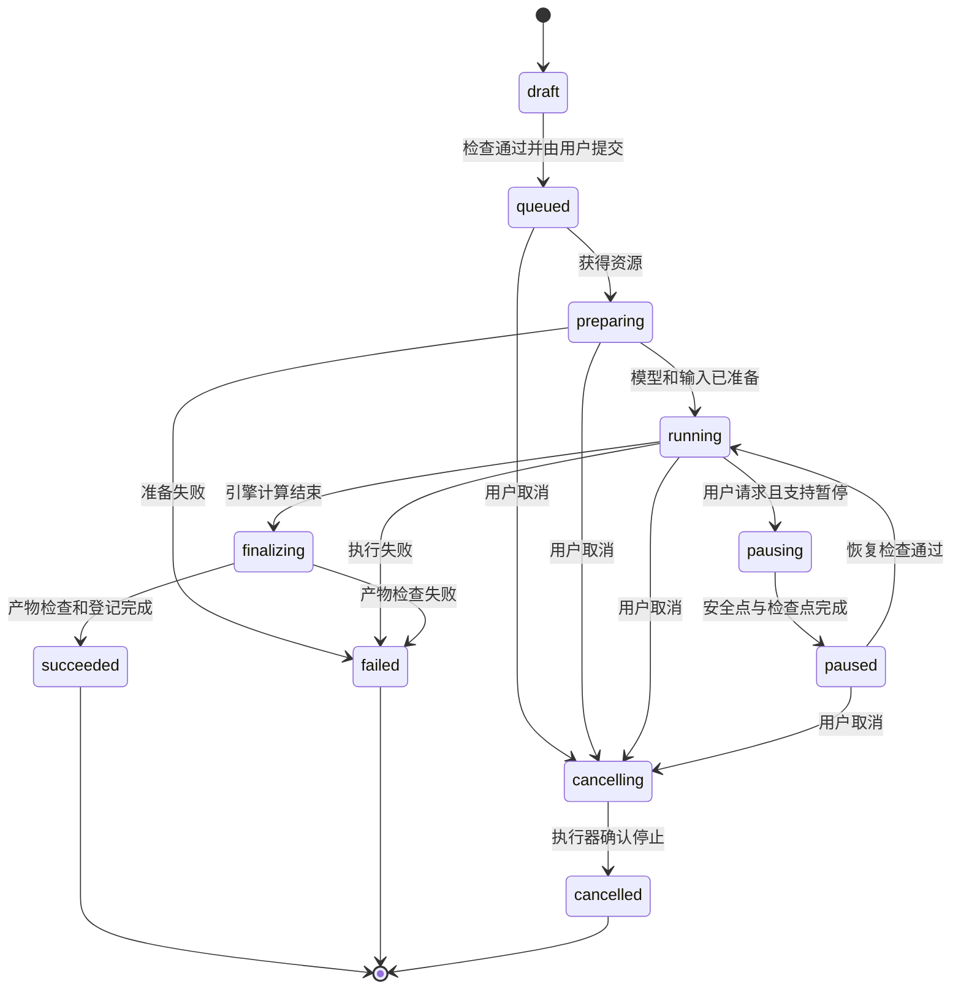

<!-- translation-navigation:start -->
[简体中文](../../../../../docs/archive/v1.0-2026-09-09/07-api-and-task-lifecycle.md) · [繁體中文](../../../../zh-TW/docs/archive/v1.0-2026-09-09/07-api-and-task-lifecycle.md) · [English](07-api-and-task-lifecycle.md)
<!-- translation-navigation:end -->

<a id="接口合同与任务生命周期"></a>

# Interface Contracts and Task Lifecycle

Version: 1.0 · Date: 2026-09-09 · Status: API design awaiting implementation, not currently callable APIs.

Related documents: [Architecture](06-architecture-and-adapters.md), [Object model](05-data-model-and-assets.md), [Testing and acceptance](11-testing-and-acceptance.md).

<a id="1-接口约定"></a>

## 1. Interface Conventions

The recommended interface prefix is `/api/v1`. Bodies use UTF-8 JSON, times use timezone-qualified UTC, and capacities are stored in bytes and formatted by the interface. If monetary values are introduced later, store them with an explicit currency in its smallest unit, not as floating-point numbers.

Resource IDs must not be derived from display names. Collection interfaces use cursor pagination; queries can filter by project, category, state, and time. Draft modifications carry `expected_revision`; conflicts return 409 and the current revision without overwriting newer content.

Submission, registration, cancellation, and preparation support idempotency keys. Parameter errors return stable codes, Chinese messages, field paths, and suggested fixes. Clients must not determine retryability from arbitrary English exception text.

<a id="2-接口清单"></a>

## 2. Interface List

In the table below, `{id}` represents an existing stable resource ID; all mutations must validate object ownership and version.

| Method and path | Purpose | Key inputs / outputs | Side effects and limits |
| --- | --- | --- | --- |
| GET `/projects` | List projects | Cursor, archive filter | Read-only |
| POST `/projects` | Create a project | Name | Creates a record |
| PATCH `/projects/{id}` | Modify a project | Name, expected_revision | Does not change ownership of existing tasks |
| GET `/models` | List models | Modality, format, availability | Read-only |
| POST `/models/import-plans` | Analyze model import | Source or selected path | Returns files and trust requirements without running repository code |
| POST `/models/imports` | User-confirmed import | plan_id, idempotency key | Creates a preparation task |
| GET `/datasets` | List data | schema, source, download state | Read-only |
| POST `/datasets/import-plans` | Analyze an import | File assets or controlled source | Returns schema, samples, and issues |
| POST `/datasets/imports` | Create a data version | Checked plan | Registers atomically without overwriting old versions |
| POST `/datasets/{id}/checks` | Technical checks | version_id, check set | Creates a check report |
| POST `/datasets/{id}/transforms` | Process a data copy | version_id, operations and parameters | Creates a new version; originals remain unchanged |
| POST `/market/access-requests` | Submit an access application | Provider, data version, intended use | Explicitly sends information to that provider |
| GET `/devices` | Device configuration and state | Latest detection time | No implicit scanning |
| POST `/devices/{id}/probes` | Detect device environment | Check scope | Read-only detection; does not install drivers |
| GET `/capabilities` | Query capabilities | Model, format, environment, operation | Returns status, fields, and evidence sources |
| POST `/environments/prepare-plans` | Calculate environment preparation plan | Adapter version, device | Returns dependencies, space, and changes |
| POST `/environments/preparations` | Execute confirmed preparation | plan_id, idempotency key | Creates an environment without overwriting old environments |
| POST `/tasks` | Create a task draft | project_id, category, name | Creates a task |
| PATCH `/tasks/{id}/draft` | Save a draft | Configuration, expected_revision | Affects only unsubmitted drafts |
| POST `/tasks/{id}/preflight` | Pre-submission checks | draft_revision | Returns effective configuration and a short-lived check ID |
| POST `/tasks/{id}/attempts` | Submit execution | Check ID, revision, idempotency key | Fixes a snapshot and creates an execution attempt |
| GET `/attempts/{id}` | Query run state | None | Returns actual state and available control actions |
| GET `/attempts/{id}/events` | Subscribe to / retrieve missed events | Cursor or Last-Event-ID | SSE; reconnecting does not rerun execution |
| POST `/attempts/{id}/cancel` | Request cancellation | expected_state_version | Idempotent; distinguishes request from final cancellation |
| POST `/attempts/{id}/pause` | Request safe pause | Checkpoint policy | Allowed only when supported by the adapter |
| POST `/attempts/{id}/resume` | Resume pause/checkpoint | checkpoint_id, environment digest | Verifies compatibility and records the resumption relationship |
| POST `/attempts/{id}/retries` | Copy into a new attempt | Parameter-draft changes | Creates a draft without automatic execution |
| POST `/evaluations` | Create an independent evaluation | Baseline, candidate, data version, rules | Creates an evaluation task |
| POST `/candidates/{id}/register` | Register a usable candidate | evaluation_ids, idempotency key | Server rechecks admission |
| POST `/recipes/{id}/reuse` | Load a recipe | Target project, version-difference policy | Creates a new draft |
| POST `/works` | Save a work | artifact_id, attempt_id | Verifies files have been completely persisted |
| POST `/exports/prepare` | Prepare export | Assets and target format | Generates an export manifest without sending externally yet |
| POST `/ai/proposals` | Request an AI suggestion | Context scope, question | Produces suggestions only, without execution |
| POST `/ai/proposals/{id}/apply` | Apply explicit field changes | expected_revision | Validates and applies atomically |
| POST `/ai/proposals/{id}/undo` | Undo that application | Current revision | Checks subsequent changes to avoid overwriting them |

Publishing, cloud-instance purchasing, and organization-permission interfaces are outside the initial contract. If added later, design separate user-confirmation, identity, and audit workflows.

<a id="3-提交前检查合同"></a>

## 3. Pre-submission Check Contract

Check results include blockers, notices, request digest, effective configuration, environment digest, data version, check version, and expiry. The check ID binds the hash of these contents; any input or environment change requires a new check.

A check is not execution authorization. A run attempt is created only when the user clicks the actual submit action. The submission transaction rechecks the draft revision, check expiry, and resource state to prevent model replacements or device changes after checking.

```json
{
  "task_id": "task-001",
  "draft_revision": 7,
  "operation": "generate",
  "model_version_id": "model-qwen3-demo-v1",
  "input": {
    "messages": [{"role": "user", "content": "请简要说明数据版本的作用。"}],
    "asset_ids": []
  },
  "runtime": {
    "device_id": "device-local-001",
    "environment_id": "env-mlx-demo-001",
    "thinking": "off",
    "context_tokens": 8192,
    "max_output_tokens": 1024,
    "temperature": 0.7,
    "prefix_cache": false,
    "speculation": {"method": "off"}
  }
}
```

The example IDs and model environments are contract placeholders, not existing service resources.

```json
{
  "preflight_id": "check-001",
  "task_id": "task-001",
  "draft_revision": 7,
  "can_submit": true,
  "blocking": [],
  "warnings": [],
  "effective_config": {
    "thinking": "off",
    "context_tokens": 8192,
    "max_output_tokens": 1024,
    "temperature": 0.7,
    "prefix_cache": false,
    "speculation": {"method": "off"}
  },
  "config_digest": "example-digest-only",
  "expires_at": "2026-09-09T09:10:00Z"
}
```

If an engine automatically adjusts values, the response needs a `changes` list showing reasons and before / after values for renewed user review. It must not silently downgrade through `warnings` while treating the submission as unchanged.

<a id="4-执行快照"></a>

## 4. Execution Snapshot

Each attempt saves: task and project IDs, source attempt/checkpoint IDs, model and adapter versions, input-content digests, data version, requested configuration, actual configuration, environment digest, device facts, submitting user action, idempotency key, and schema version.

Snapshots do not include plaintext credentials, mutable UI state, the currently selected tab, or overwritable latest references. The frontend can rename tasks but cannot update execution snapshots. Later actual measurements are written to run records or reports, not backdated into the configuration at submission.

<a id="5-状态机"></a>

## 5. State Machine

Formal states are more detailed than the Demo and follow real executor feedback.



`disconnected` is not directly an execution terminal state: connection state and run state are recorded separately. When remote state is temporarily unknown, display “Connection interrupted; run state awaiting confirmation,” rather than immediately marking failure or submitting again.

<a id="51-状态字段"></a>

### 5.1 State Fields

| Field | Purpose |
| --- | --- |
| `state` | Last confirmed execution state |
| `state_version` | Monotonically increasing version used as the concurrency condition for control commands |
| `connection_state` | Connected / disconnected / reconnecting |
| `last_event_sequence` | Persisted event cursor |
| `phase` | Phases such as download, load, preprocess, train, generate, evaluate, or write files |
| `progress` | Known fraction or null; unknown progress does not generate a fake percentage |
| `allowed_actions` | Available operations generated from state and adapter capabilities |
| `terminal_reason` | Reason code for success, failure, or cancellation |

<a id="6-暂停恢复取消和重试"></a>

## 6. Pause, Resume, Cancel, and Retry

<a id="61-暂停"></a>

### 6.1 Pause

Pausing is not stopping a frontend animation, nor does it rely by default on the operating system forcibly suspending a process. Trainers supporting safe points write a checkpoint before entering paused. Inference engines unable to resume the same request offer only cancellation and rerunning the same recipe. The page explains the current control capabilities.

<a id="62-恢复"></a>

### 6.2 Resume

A checkpoint must contain the required model, optimizer, scheduler, random state, and data position, and record which states are missing. If only weights can be restored without continuing the same optimization trajectory, call it “Start a new attempt from these weights.” Cross-device or engine-version resumption first checks compatibility.

<a id="63-取消"></a>

### 6.3 Cancel

A user request enters cancelling; the executor responds at a safe stopping point. Cancellation retains complete artifacts and logs while marking unfinished artifacts incomplete. A timeout may expose forced termination, but must explain that the latest checkpoint may be lost and cannot directly display cancellation success.

<a id="64-重试"></a>

### 6.4 Retry

By default, create a new attempt draft that inherits the snapshot and preserves `source_attempt_id`. Users may adjust parameters, check again, and submit. New results never overwrite the original attempt's errors, logs, or artifacts.

<a id="7-事件流"></a>

## 7. Event Stream

Events are persisted on the backend before delivery to clients. Suggested types: state_changed, phase_changed, progress, log, metric, checkpoint_ready, artifact_ready, warning, terminal.

```json
{
  "schema_version": "1.0",
  "attempt_id": "attempt-001",
  "sequence": 18,
  "type": "state_changed",
  "created_at": "2026-09-09T09:05:00Z",
  "payload": {
    "state": "running",
    "state_version": 4,
    "phase": "decode",
    "message": "模型已加载，开始生成输出。"
  }
}
```

SSE may deliver duplicates; clients deduplicate by attempt_id + sequence. Reconnection retrieves events from the most recently applied cursor. If the event retention window has been exceeded, fetch a state snapshot first, then continue from a new cursor. Large logs use pagination or range queries rather than loading all text at once and blocking the interface.

<a id="8-幂等与竞争处理"></a>

## 8. Idempotency and Race Handling

The same project, task, idempotency key, and request digest return the same submission result; the same idempotency key with a different request returns a conflict. After a remote timeout, query the corresponding attempt_id before doing anything else; do not directly invoke execution again.

When cancellation and completion race, use the first successfully committed legal state transition; if artifacts are already registered successfully, cancellation returns completed. Candidate registration uses a uniqueness constraint, and repeated registration returns the existing model version. Resolve concurrent user edits and AI application through draft revision and old-value checks, never last-write-wins overwrites.

<a id="9-错误结构与分类"></a>

## 9. Error Structure and Categories

```json
{
  "error": {
    "code": "CONTEXT_BUDGET_EXCEEDED",
    "message": "输入与预留输出超过上下文限制。",
    "field": "runtime.max_output_tokens",
    "retryable": false,
    "details": {
      "input_tokens": 7600,
      "reserved_output_tokens": 1024,
      "context_limit": 8192
    },
    "suggested_actions": ["减少输出上限", "检查并裁剪历史", "选择更大上下文的已验证组合"]
  }
}
```

Main error-code categories: INVALID_CONFIG, UNSUPPORTED_COMBINATION, MODEL_NOT_READY, DATA_SCHEMA_MISMATCH, CONTEXT_BUDGET_EXCEEDED, DEVICE_UNREACHABLE, ENVIRONMENT_CHANGED, OUT_OF_MEMORY, DISK_FULL, ARTIFACT_CORRUPT, CHECKPOINT_INCOMPATIBLE, REVISION_CONFLICT, PROVIDER_ACCESS_REQUIRED.

`retryable` indicates only whether retrying under the same conditions might work; it does not authorize automatically repeating expensive tasks. Limited retries are allowed by default for network reads; rerunning training is triggered by a user action.

<a id="10-接口安全与本地边界"></a>

## 10. Interface Security and Local Boundaries

The local HTTP service binds only to loopback and uses session authentication and origin restrictions. Ordinary webpages must not use the user's browser to access local execution capabilities. The desktop host exposes only fixed commands, not arbitrary shell execution.

File imports must use user-selected files or explicitly registered asset paths, with authorized root directories validated after resolution; symbolic links and path traversal require tests. Remote authentication uses credential references; logs, recipes, and error details must not return secrets.

<a id="11-接口完成标准"></a>

## 11. Interface Completion Criteria

Contract tests cover types, boundaries, idempotency, revision conflicts, illegal state transitions, event reconnection, cancellation races, duplicate terminal notifications, and artifact consistency. Executor success with corrupt files must ultimately fail; pause/cancellation without executor confirmation cannot count as a passing state.
