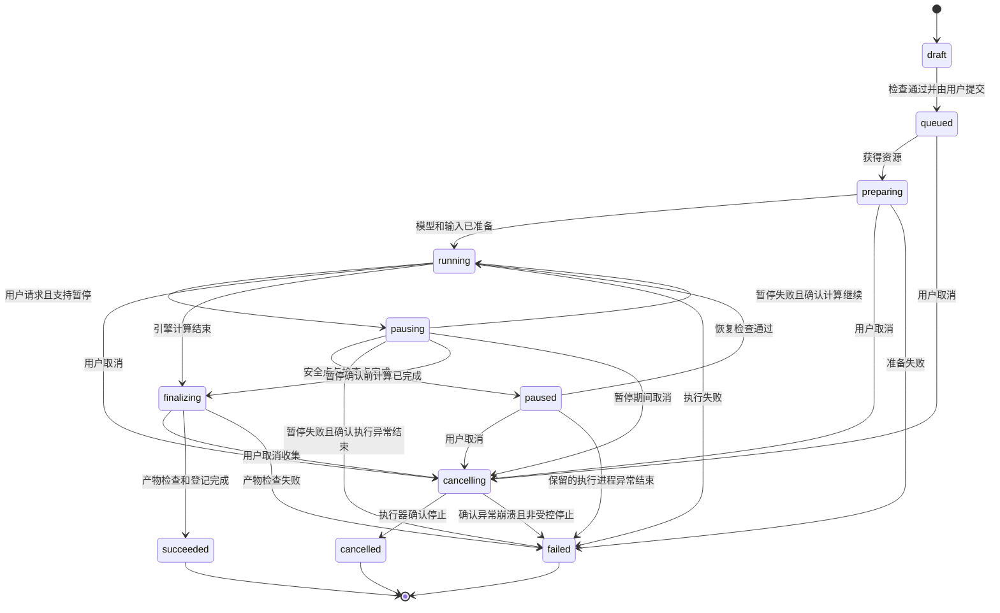

<!-- translation-navigation:start -->
[简体中文](../../../docs/07-api-and-task-lifecycle.md) · [繁體中文](07-api-and-task-lifecycle.md) · [English](../../en/docs/07-api-and-task-lifecycle.md)
<!-- translation-navigation:end -->

<a id="接口合同与任务生命周期"></a>

# 接口合同與任務生命週期

版本：1.1 · 日期：2026-09-09 · 狀態：已按審計修訂的待實現接口合同，不是當前可調用 API。

相關文檔：[架構](06-architecture-and-adapters.md)、[對象模型](05-data-model-and-assets.md)、[測試驗收](11-testing-and-acceptance.md)。

<a id="1-接口约定"></a>

## 1. 接口約定

接口前綴建議為 `/api/v1`。正文採用 UTF-8 JSON，時間使用帶時區的 UTC 時間，容量以字節保存並由界面格式化。金額若未來出現，以明確幣種和最小貨幣單位保存，不用浮點數。

資源編號不可由顯示名稱派生。集合接口採用游標分頁；查詢可按項目、類別、狀態和時間篩選。修改草稿時攜帶 `expected_revision`，衝突返回 409 和當前 revision，不覆蓋更新的內容。

提交、登記、控制、補收、工作流推進和準備／導出動作支持冪等鍵。相同命令鍵與相同請求摘要先返回已有結果，再判斷當前版本；新鍵必須重新校驗版本，相同鍵攜帶不同摘要返回 409。參數錯誤返回穩定代碼、中文消息、字段路徑和修復建議。客戶端不能依據任意英文異常文本判斷是否可以重試。

<a id="2-接口清单"></a>

## 2. 接口清單

下表中的 `{id}` 代表已存在的穩定資源編號；所有修改都要校驗對象歸屬和版本。

| 方法與路徑 | 用途 | 關鍵輸入／輸出 | 副作用與限制 |
| --- | --- | --- | --- |
| GET `/projects` | 項目列表 | 游標、歸檔篩選 | 只讀 |
| POST `/projects` | 新建項目 | 名稱 | 新建記錄 |
| PATCH `/projects/{id}` | 修改項目 | 名稱、expected_revision | 不改變已有任務歸屬 |
| GET `/models` | 模型列表 | 模態、格式、可用狀態 | 只讀 |
| POST `/models/import-plans` | 分析模型導入 | 來源或已選擇路徑 | 返回識別格式、manifest 摘要、加載器／受限選項、信任類別、執行範圍；不運行待導入代碼或未知反序列化 |
| POST `/models/imports` | 用戶確認導入 | plan_id、計劃摘要、需要執行代碼時用戶選擇的 trust_decision、冪等鍵 | 固定選擇與執行範圍為 decision_ref，復核文件和加載方式後創建準備任務；受限失敗不自動降級 |
| GET `/datasets` | 數據列表 | schema、來源、下載狀態 | 只讀 |
| POST `/datasets/import-plans` | 分析導入 | 文件資產或受控來源 | 返回 schema、樣例、問題 |
| POST `/datasets/imports` | 創建數據版本 | 已檢查計劃 | 原子登記，不覆蓋舊版本 |
| POST `/datasets/{id}/checks` | 技術檢查 | version_id、檢查集合 | 新建檢查報告 |
| POST `/datasets/{id}/transforms` | 處理數據副本 | version_id、操作和參數 | 新建版本，原件不變 |
| POST `/market/access-requests` | 提交訪問申請 | 提供方、數據版本、用途 | 明確向該提供方發送信息 |
| GET `/devices` | 設備配置和狀態 | 最近探測時間 | 不隱式掃描 |
| POST `/devices/{id}/probes` | 探測設備環境 | 檢查範圍 | 只讀探測，不安裝驅動 |
| GET `/capabilities` | 查詢能力 | 模型、格式、環境、操作 | 返回狀態、字段和證據來源 |
| POST `/environments/prepare-plans` | 計算環境準備計劃 | 適配器版本、設備 | 返回依賴、空間和變更 |
| POST `/environments/preparations` | 執行已確認準備 | plan_id、冪等鍵 | 新建環境，不覆蓋舊環境 |
| POST `/tasks` | 新建任務草稿 | project_id、類別、名稱 | 新建任務 |
| PATCH `/tasks/{id}/draft` | 保存草稿 | 配置、expected_revision | 只影響未提交草稿 |
| POST `/tasks/{id}/preflight` | 提交前檢查 | draft_revision | 返回有效配置和短期有效檢查編號 |
| POST `/tasks/{id}/attempts` | 提交執行 | 檢查編號、revision、冪等鍵 | 固定快照，創建執行嘗試 |
| GET `/attempts/{id}` | 查詢運行狀態 | 無 | 返回真實狀態及可用控制動作 |
| GET `/attempts/{id}/events` | 訂閱／補拉事件 | 游標或 Last-Event-ID | SSE；重連不重新執行 |
| POST `/attempts/{id}/cancel` | 請求取消 | expected_state_version、冪等鍵 | 區分請求與停止確認；finalizing 階段僅取消收集／登記 |
| POST `/attempts/{id}/pause` | 請求安全暫停 | expected_state_version、檢查點策略、冪等鍵 | 僅適配器支持時允許，失敗出口見狀態表 |
| POST `/attempts/{id}/resume` | 恢復暫停／檢查點 | expected_state_version、checkpoint_id、環境摘要、冪等鍵 | 同進程安全恢復保持嘗試；其他情況只建恢復草稿，不自動執行 |
| POST `/attempts/{id}/force-stop` | 強制停止已歸屬的執行任務 | expected_state_version、冪等鍵 | 僅聲明支持時允許；返回停止證據或未知，不因超時顯示已停止 |
| POST `/attempts/{id}/retries` | 複製為新嘗試草稿 | expected_state_version、參數修改、冪等鍵 | 創建草稿，不自動執行；原終態不變 |
| POST `/attempts/{id}/collections` | 補收已完成計算的原產物 | manifest_digest、expected_collection_version、冪等鍵 | 只校驗／傳輸／登記，不調用計算或恢復；返回 collection_id |
| GET `/collections/{id}` | 查詢補收 | 無 | 收集狀態、文件校驗、登記結果、缺失文件與可選動作 |
| POST `/collections/{id}/cancel` | 取消補收 | expected_collection_version、冪等鍵 | 停止傳輸／登記後確認收集 cancelled，不改原計算或嘗試終態 |
| POST `/workflow-runs` | 開始工作流實例 | definition_version、project_id、冪等鍵 | 每個新動作創建獨立執行身份，不能復用舊運行編號 |
| GET `/workflow-runs/{id}` | 查詢工作流與來源狀態 | 無 | 返回 revision、當前步驟、輸入版本、接受產物、復用記錄及過期標記 |
| PATCH `/workflow-runs/{id}/steps/{step_id}/input` | 編輯步驟輸入 | expected_revision、輸入 | 新建輸入版本，標記下游舊結果過期 |
| POST `/workflow-runs/{id}/advance` | 接受結果並帶入下一步 | expected_revision、step_attempt_id、input_revision、artifact_ids、冪等鍵 | 目標佔用和來源校驗與推進在同一事務，失敗全部不變 |
| POST `/workflow-runs/{id}/reuse-output` | 明確復用舊結果 | expected_revision、源嘗試／產物、目標步驟及 input_revision、冪等鍵 | 記錄差異和復用來源，不記為新計算、不自動推進 |
| POST `/evaluations` | 創建獨立評測 | 基線、候選、數據版本、規則 | 新建評測任務 |
| POST `/candidates/{id}/register` | 登記可用候選 | evaluation_ids、冪等鍵 | 服務端重新檢查准入 |
| POST `/recipes/{id}/reuse` | 載入配方 | 目標項目、版本差異策略 | 創建新草稿 |
| POST `/works` | 保存作品 | artifact_id、attempt_id | 校驗文件已完整落盤 |
| GET `/works/{id}` | 查詢作品及修訂 | 可選 revision_id | 返回原生成配方、選定作品版本及修訂差異，不合併改寫來源 |
| POST `/works/{id}/revisions` | 保存字幕等人工修訂 | expected_revision、parent_revision_id、修改內容、冪等鍵 | 新增作品版本，不改生成配方／快照 |
| POST `/exports/prepare` | 準備用戶產物導出 | 對象及版本、依賴策略、目標格式／目錄 | 固定依賴清單、空間和校驗計劃，返回 ExportPlan，不發送或發佈 |
| POST `/exports` | 執行用戶產物導出 | plan_id、計劃摘要、冪等鍵 | 重新檢查源文件，創建 kind=export 的任務與嘗試，臨時寫入後校驗落盤 |
| GET `/exports/{id}` | 查詢導出 | 無 | 返回任務／嘗試編號、進度、已驗證輸出位置及獨立使用檢查結果；取消走通用 cancel |
| POST `/ai/proposals` | 請求 AI 建議 | 上下文範圍、問題 | 只產生建議，不執行 |
| POST `/ai/proposals/{id}/apply` | 應用明確字段修改 | expected_revision | 原子校驗和應用 |
| POST `/ai/proposals/{id}/undo` | 撤銷該次應用 | 當前 revision | 檢查後續修改，避免覆蓋 |

發佈、雲實例採購和組織權限接口不進入首期合同。若後續加入，單獨設計用戶確認、身份和審計流程。

<a id="3-提交前检查合同"></a>

## 3. 提交前檢查合同

檢查結果包含阻斷項、提示項、請求摘要、實際配置、環境摘要、數據版本、檢查版本和有效期。檢查編號與這些內容的哈希綁定；任何輸入或環境變化都必須重新檢查。

檢查不等於執行授權。用戶點擊正式提交才創建運行嘗試。提交事務再次檢查草稿 revision、檢查有效期和資源狀態，防止檢查後發生模型替換或設備變化。

模型、任務類型、輸入媒體、產物格式、推測組件準備組合與已應用執行位置必須一致。工作流任務還綁定 `workflow_run_id`、`step_attempt_id`、`input_revision` 和輸入摘要；訓練任務綁定分詞與監督配方摘要及對應檢查報告。提交端不可相信界面可見選項、歷史結果選擇或一個 `draftReady` 布爾值。（AUD-01—AUD-06、AUD-10）

```json
{
  "task_id": "task-001",
  "draft_revision": 7,
  "operation": "generate",
  "model_version_id": "model-qwen3-demo-v1",
  "input": {
    "messages": [{"role": "user", "content": "请简要说明数据版本的作用。"}],
    "asset_ids": []
  },
  "runtime": {
    "device_id": "device-local-001",
    "environment_id": "env-mlx-demo-001",
    "thinking": "off",
    "context_tokens": 8192,
    "max_output_tokens": 1024,
    "temperature": 0.7,
    "prefix_cache": false,
    "speculation": {"method": "off"}
  }
}
```

示例編號和模型環境均為合同佔位數據，不代表已經存在的服務資源。

```json
{
  "preflight_id": "check-001",
  "task_id": "task-001",
  "draft_revision": 7,
  "can_submit": true,
  "blocking": [],
  "warnings": [],
  "effective_config": {
    "thinking": "off",
    "context_tokens": 8192,
    "max_output_tokens": 1024,
    "temperature": 0.7,
    "prefix_cache": false,
    "speculation": {"method": "off"}
  },
  "config_digest": "example-digest-only",
  "expires_at": "2026-09-09T09:10:00Z"
}
```

若發生引擎自動值調整，響應中需要 `changes` 列表顯示原因和前後值，重新讓用戶查看，不能在 `warnings` 中悄悄降級仍將提交視為無變化。

<a id="4-执行快照"></a>

## 4. 執行快照

每個嘗試保存：任務和項目編號、源嘗試／檢查點編號、模型與適配器版本、輸入內容摘要與媒體處理版本、數據版本、訓練分詞／監督配方引用（如適用）、工作流運行／步驟／輸入版本（如適用）、請求配置、實際配置、環境摘要、設備事實、加載信任決定引用、提交用戶動作、冪等鍵和 schema 版本。

快照不包含明文憑證、可變 UI 狀態、當前選中頁簽或可覆蓋的 latest 引用。前端可以重命名任務，但不得更新執行快照。後續真實測量信息寫到運行記錄或報告，不回寫成當時的配置。

<a id="5-状态机"></a>

## 5. 狀態機

正式狀態比 Demo 更細，以真實執行器反饋為準。`draft` 屬於任務草稿，提交後才創建從 `queued` 開始的 RunAttempt。下圖展示主要邊；表中的失敗、競爭和無證據規則同樣屬於合同。（AUD-07）



`disconnected` 不直接作為執行終態：連接狀態與運行狀態分別記錄。遠端狀態暫不可知時顯示“連接中斷，運行狀態待確認”，不能立即標記失敗或再次提交。

終態只有 `succeeded`、`failed`、`cancelled`，一旦持久化不回寫。補收狀態變化、後續評測和新嘗試都以關聯記錄表達。控制端保存最後確認狀態與證據時間；狀態未知期間不推斷計算已經失敗、暫停或停止。

<a id="51-状态字段"></a>

### 5.1 狀態字段

| 字段 | 用途 |
| --- | --- |
| `state` | 最後確認的執行狀態 |
| `state_version` | 單調遞增版本，控制命令的併發條件 |
| `connection_state` | 已連接／斷開／重連中 |
| `stop_status` | `not_requested`／`pending`／`confirmed`／`unknown`；停止未確認時不得顯示已停止 |
| `last_control` | 命令編號、動作、接收／執行／失敗／未知結果、原因及執行器證據引用 |
| `compute_outcome` | `pending`／`succeeded`／`failed`／`cancelled`；只按計算證據確認，與應用最終成功分開 |
| `collection_state` | `not_started`／`collecting`／`succeeded`／`failed`／`cancelled`；匯總獨立收集記錄 |
| `collection_version` | 單調遞增補收併發版本，與終態版本分開 |
| `output_manifest_ref` | 執行器封存的原產物清單及摘要；補收只能引用該內容 |
| `last_event_sequence` | 已持久化事件游標 |
| `phase` | 下載、加載、預處理、訓練、生成、評測、寫文件等階段 |
| `progress` | 已知比例或 null；未知不生成偽百分比 |
| `allowed_actions` | 根據狀態和適配器能力生成的可用操作 |
| `terminal_reason` | 成功、失敗或取消的原因代碼 |

<a id="52-状态事件与可用动作"></a>

### 5.2 狀態、事件與可用動作

所有表內動作先檢查適配器聲明、對象歸屬、期望版本和冪等鍵。查詢、日誌和事件補拉始終可用；“重試”只創建草稿。

| 當前狀態 | 事件／動作 | 結果與不變量 |
| --- | --- | --- |
| queued | 獲得資源／取消 | 分別進入 preparing／cancelling；隊列確認未啓動並解除資源後才 cancelled |
| preparing | 準備完成／準備失敗／取消 | running／failed／cancelling；超時且遠端結果未知時保留狀態並查詢 |
| running | 暫停／取消／計算完成／執行異常 | pausing／cancelling／finalizing／failed；暫停僅在支持時可用 |
| pausing | 安全點和完整檢查點確認 | paused；單獨的命令接收或不完整檢查點不能確認暫停 |
| pausing | 檢查點失敗 | 執行器確認繼續計算則 running 並記錄控制失敗；確認異常結束則 failed；無證據保留 pausing、控制結果未知，提供查詢、取消或已支持的強制停止 |
| pausing | 取消／計算完成搶先到達 | 取消合法提交則 cancelling；尚未接受取消且計算完成先提交則 finalizing，暫停返回已結束／未暫停 |
| paused | 同嘗試安全恢復／取消／進程崩潰 | 確認恢復後 running；取消進入 cancelling；確認非受控異常退出則 failed；恢復校驗失敗保持 paused |
| finalizing | 收集和登記完成／失敗 | succeeded／failed；compute_outcome 保留 succeeded，收集結果單獨記錄 |
| finalizing | 取消／暫停 | 取消進入 cancelling，僅停止收集與登記；暫停返回不支持當前階段，狀態不變 |
| cancelling | 確認受控停止或從未啓動 | cancelled；完整文件保留，未完成文件不可登記成功；計算已完成時保留 succeeded 的 compute_outcome |
| cancelling | 執行器異常崩潰／超時 | 確認任務進程及子進程異常退出則 failed；心跳丟失或停止結果未知繼續 cancelling，stop_status=unknown，不偽造 cancelled |
| cancelling | 遲到的暫停／完成事件 | 保留事件證據但不撤銷已提交取消；允許記錄計算已完成，不再將本嘗試登記為 succeeded |
| preparing／running／pausing／paused／cancelling | 用戶請求已支持的強制停止 | 進入或保持 cancelling，停止確認後 cancelled；明確的非受控崩潰可 failed；拒絕或超時但未確認停止則保持待確認，不操作無關進程 |
| succeeded／failed／cancelled | 新取消／暫停／強制停止命令 | 返回已有終態和不適用原因，不改變終態；重試／合格的補收另建記錄 |

表中的明確崩潰以執行器歸屬和進程樹退出證據為依據；斷連不能替代它。強制停止在 finalizing 不作為殺計算進程的入口，收集取消走普通 cancel。若在前端看到舊狀態後提交控制，409 返回當前狀態、版本和動作列表，客戶端刷新後由用戶決定下一步。

<a id="6-暂停恢复取消和重试"></a>

## 6. 暫停、恢復、取消和重試

<a id="61-暂停"></a>

### 6.1 暫停

暫停不是停止前端動畫，也不默認依賴操作系統強行掛起進程。訓練器支持安全點時寫檢查點再轉暫停；推理引擎不能恢復同一請求時只提供取消和以相同配方重跑。頁面要解釋當前控制能力。

暫停失敗必須輸出檢查點完整性、是否仍在計算、失敗原因和可選動作。取消可以打斷尚未確認的暫停；遲到的 checkpoint_ready 只登記檢查點，不把 cancelling 改回 paused。

<a id="62-恢复"></a>

### 6.2 恢復

檢查點必須包含需要的模型、優化器、調度器、隨機狀態和數據位置，且記錄哪些狀態缺失。若只能恢復權重而無法繼續同一優化軌跡，應稱為“從該權重開始新嘗試”。跨設備或引擎版本恢復先檢查兼容性。

同一存活執行器的安全暫停恢復可以保持 attempt_id，控制回執記錄續跑標識。進程已退出、終態嘗試或只能從權重恢復時接口返回新的恢復草稿及 `source_attempt_id`／checkpoint 引用，用戶重新檢查並提交；不能修改原終態或把尚未啓動的新草稿顯示為運行中。

<a id="63-取消"></a>

### 6.3 取消

用戶請求進入 cancelling，執行器在可安全停止點響應。取消後保留已完整產物和日誌，未完成產物標記不完整。超時可提供已聲明支持的 `/force-stop` 入口，界面說明可能失去最近檢查點；該命令只作用於此嘗試所屬的執行器進程及子進程。請求已接受、信號已發送和超時均不等於停止成功。

控制響應包含 `command_id`、命令結果、最新狀態／版本和證據引用。停止結果未知時繼續顯示待確認並允許補拉狀態；不自動新建計算以替代未知運行。用戶取消本地等待也不等於取消遠端任務。

<a id="64-重试"></a>

### 6.4 重試

默認生成新嘗試草稿，繼承快照並保留 `source_attempt_id`。用戶可調整參數後重新檢查和提交。原嘗試的錯誤、日誌和產物永不被新結果覆蓋。

<a id="65-只补收产物aud-08"></a>

### 6.5 只補收產物（AUD-08）

允許補收的前提是 `compute_outcome=succeeded`，執行器已封存完整 manifest，且原嘗試已因收集失敗進入 failed 或因用戶停止收集進入 cancelled；正在 finalizing 或已有活動補收時返回當前收集記錄。失敗僅發生在下載、校驗或登記階段才適用；原產物本身缺失／損壞時列出不可恢復文件，不重新調用訓練、推理、run 或 resume。

`POST /attempts/{id}/collections` 固定原 manifest 摘要、收集目標和冪等鍵，新建或返回已有 `ArtifactCollection`；其狀態為 collecting → succeeded／failed／cancelled。傳輸可從已校驗塊繼續，登記按“原嘗試 + manifest 摘要 + 文件身份”唯一約束；收集事件和資產登記在同一事務或可靠 outbox 提交。中斷重開以 collection_id 補拉，不產生重復資產。

補收成功只更新收集記錄與其匯總字段，原 attempt 的失敗／取消終態、terminal_reason 和發生時間保持不變。界面顯示“計算完成，原收集失敗，現已補收”或對應的取消事實；完整文件可保存為作品。需要模型候選時仍獨立加載、評測和登記，失敗的舊評測保持失敗，新評測有新編號。AC-18／AC-21 必須驗證磁盤滿、傳輸中斷和登記事務失敗後，計算調用次數不增加、文件摘要一致、登記恰好一次。

<a id="7-事件流"></a>

## 7. 事件流

事件在後端持久化後再發給客戶端。建議類型：state_changed、phase_changed、progress、log、metric、checkpoint_ready、artifact_ready、control_result、collection_changed、warning、terminal。補收事件包含 collection_id，工作流接受／失效事件包含 workflow_run_id、步驟嘗試、輸入版本及運行 revision；字幕編輯事件引用 WorkRevision，不修改歷史生成事件。

```json
{
  "schema_version": "1.1",
  "attempt_id": "attempt-001",
  "sequence": 18,
  "type": "state_changed",
  "created_at": "2026-09-09T09:05:00Z",
  "payload": {
    "state": "running",
    "state_version": 4,
    "phase": "decode",
    "message": "模型已加载，开始生成输出。"
  }
}
```

SSE 可重復傳輸，客戶端按 attempt_id + sequence 去重。重連從最近已應用游標補拉；超出事件保留窗口時先取狀態快照，再從新的游標繼續。日誌量大時分頁或按區間查詢，不能一次加載全部文本阻塞界面。

<a id="8-幂等与竞争处理"></a>

## 8. 冪等與競爭處理

同一項目、任務、冪等鍵和相同請求摘要返回同一次提交結果；同一個冪等鍵攜帶不同請求返回衝突。遠端超時後先查詢對應 attempt_id，不能直接重復調用執行。

取消與完成競爭時，以同一 `state_version` 上最先成功提交的合法轉移決定：成功登記及 succeeded 已提交則取消返回已完成；取消先提交則後續完成只追加計算證據，停止收集後 cancelled，不再成功登記本嘗試。初次資產登記與 succeeded／terminal 事件必須原子提交或經可靠 outbox 收斂；不能出現資產已接受卻成功狀態未提交而被當成取消的窗口。補收單獨以 collection_version 和唯一約束裁決，不重寫原終態。

工作流推進使用運行 revision 和目標類別佔用記錄的同一事務；預檢查後目標剛啓動任務也必須拒絕。失敗時步驟位置、接受的輸出集合、源草稿和目標草稿都不變，返回阻塞任務及查看／等待／退出動作；解除阻塞後使用新命令鍵，一次只推進一次。最後一步通過同樣的來源與完整性檢查後才標記該工作流完整，不能用其他運行的結果填空。舊結果復用是獨立用戶動作且有來源差異，不能作為結果為空時的隱式分支。（AUD-01／AUD-02）

候選登記使用唯一約束，重復登記返回已有模型版本。用戶修改與 AI 應用同時發生時通過草稿 revision 和舊值檢查解決，不使用最後寫入覆蓋。導出同一計劃的同一命令返回同一嘗試，臨時目錄與最終目錄身份固定；完整包只發佈一次，取消／失敗不能出現偽完整包。

<a id="9-错误结构与分类"></a>

## 9. 錯誤結構與分類

```json
{
  "error": {
    "code": "CONTEXT_BUDGET_EXCEEDED",
    "message": "输入与预留输出超过上下文限制。",
    "field": "runtime.max_output_tokens",
    "retryable": false,
    "details": {
      "input_tokens": 7600,
      "reserved_output_tokens": 1024,
      "context_limit": 8192
    },
    "suggested_actions": ["减少输出上限", "检查并裁剪历史", "选择更大上下文的已验证组合"]
  }
}
```

主要錯誤代碼分類：INVALID_CONFIG、UNSUPPORTED_COMBINATION、MODEL_NOT_READY、DATA_SCHEMA_MISMATCH、CONTEXT_BUDGET_EXCEEDED、DEVICE_UNREACHABLE、ENVIRONMENT_CHANGED、OUT_OF_MEMORY、DISK_FULL、ARTIFACT_CORRUPT、CHECKPOINT_INCOMPATIBLE、REVISION_CONFLICT、PROVIDER_ACCESS_REQUIRED。審計補充：CONTROL_NOT_SUPPORTED、CONTROL_RESULT_UNKNOWN、CHECKPOINT_FAILED、MANIFEST_UNAVAILABLE、COLLECTION_CONFLICT、WORKFLOW_INPUT_STALE、WORKFLOW_TARGET_BUSY、MODEL_LOAD_TRUST_REQUIRED、RESTRICTED_LOAD_FAILED、NO_SUPERVISED_TOKENS、EXPORT_SOURCE_CHANGED、EXPORT_INCOMPLETE；每項必須關聯當前狀態和可執行修復動作。

`retryable` 只表示同樣條件下是否可能重試，不授權自動重復昂貴任務。默認對網絡讀取可有限重試；訓練重新執行由用戶動作觸發。

<a id="10-接口安全与本地边界"></a>

## 10. 接口安全與本地邊界

本地 HTTP 服務僅綁定回環地址，使用會話認證和來源限制。普通網頁不能借用用戶瀏覽器訪問本地執行能力。桌面宿主只暴露固定命令，不提供任意 shell 執行接口。

文件導入必須是用戶選擇的文件或明確登記的資產路徑，解析後校驗授權根目錄；符號鏈接和路徑穿越需測試。遠端認證使用憑證引用，日誌、配方和錯誤詳情不返回秘密內容。

<a id="11-接口完成标准"></a>

## 11. 接口完成標準

合同測試覆蓋類型、邊界、冪等、revision 衝突、狀態表逐事件、事件重連、控制／完成競爭、終態重復通知、補收不重算、工作流原子推進和產物導出完整性。執行器返回成功但文件損壞時必須最終失敗；沒有執行器確認的暫停／取消不能作為通過狀態。合同測試通過只證明指定實現與這些規則一致，不代替實機訓練、推理和發佈驗收。
