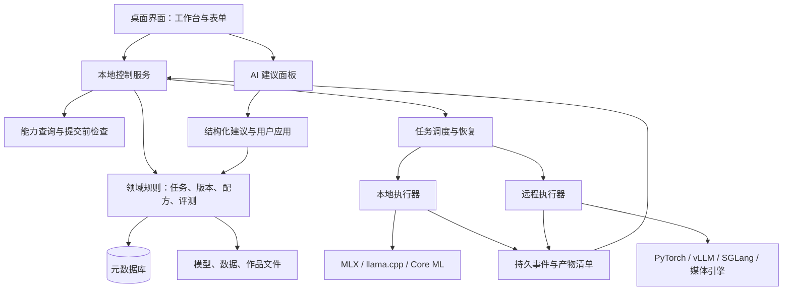

<!-- translation-navigation:start -->
[简体中文](../../../../../docs/archive/v1.0-2026-09-09/06-architecture-and-adapters.md) · [繁體中文](06-architecture-and-adapters.md) · [English](../../../../en/docs/archive/v1.0-2026-09-09/06-architecture-and-adapters.md)
<!-- translation-navigation:end -->

<a id="技术架构与执行适配器设计"></a>

# 技術架構與執行適配器設計

版本：1.0 · 日期：2026-09-09 · 狀態：建議架構；尚未創建正式應用代碼或驗證打包環境。

相關文檔：[數據對象](05-data-model-and-assets.md)、[接口與狀態](07-api-and-task-lifecycle.md)、[技術決策](13-decisions-risks-and-questions.md)。

<a id="1-设计目标"></a>

## 1. 設計目標

保持原型已經明確的任務體驗，替換瀏覽器內存狀態、模擬計時器和預置輸出。業務規則集中管理，真實執行進程獨立運行；一個訓練進程失敗不能使整個應用丟失任務記錄。

首期採用模塊化單體控制服務加獨立執行器，不引入微服務集群、Kubernetes 或複雜的多租戶基礎設施。遠程 GPU 是一個可管理的執行目標，不等於先建設完整雲平台。

<a id="2-推荐技术组合"></a>

## 2. 推薦技術組合

| 層 | 建議 | 選擇理由 | M0 驗證內容 |
| --- | --- | --- | --- |
| 界面 | React + TypeScript | 表單、狀態和可復用頁面結構適合原型產品化 | 鍵盤、中文、長表單、媒體預覽 |
| 桌面宿主 | Tauri 2 | 提供桌面窗口和受控本地能力 | macOS 側進程生命週期、簽名、更新和異常退出 |
| 本地控制服務 | Python + FastAPI + 類型化數據模型 | 接近訓練／推理生態，便於參數校驗和接口測試 | 本地認證、事件流、啓動退出、包分發 |
| 元數據 | SQLite | 單用戶本地元信息，事務與遷移清晰 | 併發讀寫、備份、損壞恢復 |
| 大文件 | 文件系統 + 內容摘要索引 | 模型、媒體和數據文件避免進入數據庫 | 原子寫入、引用計數、磁盤滿 |
| 執行 | 獨立進程／獨立環境 | MLX、CUDA、ROCm 等依賴隔離 | 取消、檢查點、日誌、崩潰隔離 |
| 遠程執行 | 受控遠程執行器，初期可經 SSH 隧道連接 | 復用用戶已有服務器，避免默認開放公網端口 | 身份、版本、重連、日誌補拉 |
| 事件 | HTTP 查詢 + SSE 進度流 | 滿足單向日誌與進度，不必首期雙向複雜通道 | 游標重連、事件去重、終態恢復 |

以上為實現建議，不是用戶已經決定的技術棧。若 M0 的側進程打包成本明顯超出收益，可採用同一控制服務加本地 Web 界面作為開發驗證宿主，再決定桌面殼，領域模型與接口保持不變。

參考：[Tauri 側進程](https://v2.tauri.app/develop/sidecar/)、[FastAPI 生命週期](https://fastapi.tiangolo.com/advanced/events/)、[SQLite WAL](https://www.sqlite.org/wal.html)。SQLite WAL 的併發特性不能替代備份與一致性設計，數據庫文件不直接放在遠程共享盤上充當多機數據庫。

<a id="3-组件关系"></a>

## 3. 組件關係



AI 不直接連接隊列的提交控制路徑。用戶應用建議和用戶提交執行是不同的命令、不同的事件。

<a id="4-模块职责"></a>

## 4. 模塊職責

<a id="41-前端"></a>

### 4.1 前端

負責頁面、表單草稿、即時校驗、焦點、狀態展示和用戶動作。前端可根據能力聲明隱藏或禁用控件，但最終提交校驗必須在控制服務再次執行。刷新頁面後從服務端恢復任務，不依賴前端定時器推進狀態。

<a id="42-控制服务"></a>

### 4.2 控制服務

管理項目、數據、模型、配置、設備、環境、任務和評測。提供原子提交、冪等命令、版本檢查、權限邊界和事件訂閱。控制服務不在請求線程直接加載大模型或執行訓練。

<a id="43-资源与下载管理"></a>

### 4.3 資源與下載管理

管理文件 manifest、校驗、斷點續傳、解壓、路徑解析和引用。模型準備、環境安裝、數據下載都是獨立可觀察任務；下載器不會執行倉庫中的代碼。

<a id="44-能力注册与检查"></a>

### 4.4 能力註冊與檢查

將設備探測、引擎版本、模型格式和適配器參數 schema 匯合，返回支持條件與準備步驟。緩存能力結果時綁定環境摘要；驅動／引擎變更後失效。

<a id="45-执行器"></a>

### 4.5 執行器

讀取不可變運行快照，準備輸入，加載引擎，發出階段事件，寫產物和檢查點，處理取消／恢復。它不能修改項目顯示名或原始數據，也不能為自己擴大文件訪問範圍。

<a id="46-评测与登记"></a>

### 4.6 評測與登記

評測器讀取指定模型／候選、固定數據和評測規則，寫不可變報告。登記服務檢查產物完整性與准入規則，建立新的模型版本和來源關係。不能通過前端傳入一個 `passed: true` 繞過檢查。

<a id="5-适配器最小合同"></a>

## 5. 適配器最小合同

| 操作 | 輸入 | 輸出 | 錯誤要求 |
| --- | --- | --- | --- |
| `describe` | 適配器版本 | 方法、格式、參數 schema、控制能力 | 不訪問網絡、不啓動執行 |
| `probe` | 設備與環境引用 | 硬件事實、驅動、資源、限制 | 區分權限不足與設備不存在 |
| `validate` | 模型、數據、請求配置 | 阻斷／提示、有效配置、準備動作 | 返回字段位置與原因代碼 |
| `prepare` | 已確認的準備計劃 | 環境／模型準備記錄 | 不隱式升級已有環境 |
| `run` | 固定執行快照 | 事件流、產物 manifest | 終態與失敗階段明確 |
| `cancel` | 運行編號 | 請求已接收與最終取消狀態 | 冪等，不立即假定進程已停止 |
| `checkpoint` | 運行編號 | 可恢復檢查點或不支持 | 說明包含哪些恢復狀態 |
| `resume` | 檢查點、兼容環境 | 新嘗試或明確續跑標識 | 錯環境必須拒絕 |
| `collect` | 完成運行 | 文件摘要、指標、日誌位置 | 部分產物不能冒充完整成功 |

首期不要求每個適配器實現所有控制動作。`supports_pause`、`supports_resume`、`supports_stream`、`supports_checkpoint` 等必須由實際適配器聲明，界面按聲明展示。

<a id="6-能力声明示例"></a>

## 6. 能力聲明示例

以下結構是接口設計示例，`未验证` 不能由 UI 自動改為通過。

```json
{
  "schema_version": "1.0",
  "adapter_id": "mlx-text",
  "adapter_version": "待锁定",
  "model_family": "qwen3",
  "operations": ["generate"],
  "hardware_backends": ["metal"],
  "formats": ["mlx"],
  "controls": {
    "cancel": true,
    "pause": false,
    "resume_from_checkpoint": false
  },
  "features": {
    "thinking_toggle": {"status": "conditional", "requires": ["兼容聊天模板"]},
    "prefix_cache": {"status": "conditional", "requires": ["指定引擎版本"]},
    "mtp": {"status": "unsupported", "reason": "此适配目标未声明原生预测组件"}
  },
  "verification": {"status": "未验证", "report_id": null}
}
```

正式 schema 需將參數類型、單位、默認來源、約束、重啓要求和衝突關係一並表達。公開能力名稱不要求與每個底層庫參數一一同名，由映射層轉換並保存結果。

<a id="7-环境隔离"></a>

## 7. 環境隔離

MLX、CUDA、ROCm、oneAPI 和媒體模型可能需要不同 Python 版本、依賴或本地庫。採用按適配器版本生成的隔離環境，環境標識來自鎖文件和平台摘要，不復用一個任意安裝包的全局 Python。

桌面基礎安裝包只包含控制層必要依賴；大模型、訓練環境和可選運行器按明確計劃準備。環境安裝前顯示來源、預計下載和磁盤佔用、目標目錄以及是否需要系統驅動。不要以“連接檢查”名義安裝驅動或修改系統權限。

運行器命令使用固定可執行文件和參數數組，不把用戶輸入拼接成 shell 命令。自定義模型倉庫需要代碼執行時作為獨立信任決定處理，不能混入普通權重下載。

<a id="8-本地与远程执行"></a>

## 8. 本地與遠程執行

本地控制端為每個遠程嘗試分配穩定的任務編號與冪等鍵。遠端保存自己的任務狀態、日誌游標和產物 manifest；控制端斷開後重連拉取增量狀態，而不是再次啓動任務。

模型和數據傳輸按內容摘要確認已有文件，避免重復上傳。用戶在提交前看到哪些輸入要發送到哪個執行設備。憑證保存在操作系統安全存儲中，數據庫只記錄引用；普通日誌和配方不保存密鑰。

雲 GPU 首期只支持用戶已配置的實例／服務，不自動創建付費實例。後續資源申請若實現，需要獨立的預算、確認和資源釋放流程。

<a id="9-调度与资源策略"></a>

## 9. 調度與資源策略

首期採用明確設備隊列和有限併發。訓練默認獨佔一個指定設備資源配額；推理實例復用按模型、適配器、精度和引擎配置鍵進行。無法同時容納的模型明確排隊或卸載，不通過不斷 OOM 重試調度。

資源估計只是估計，記錄來源、測量時刻和不確定性。實際內存由執行器報告；統一內存、GPU 顯存和 CPU 內存分別存儲。緩存、模型實例和用戶資產分別清理。

<a id="10-从-demo-迁移"></a>

## 10. 從 Demo 遷移

1. 保留頁面結構、任務名稱與可發現入口，提取成正式組件。
2. 將字符串數字轉換為類型化字段，統一前後端 schema。
3. 將內存 `store` 拆成服務端領域對象與前端編輯草稿。
4. 用真實任務事件替代每 900 ms 增加進度的模擬計時器。
5. 用資產引用替代內嵌圖像／音頻，用真實文件和解碼結果驗收。
6. 刪除生產路徑里的“模擬連接通過”“預置評測通過”等捷徑，只在獨立演示模式保留。
7. 遷移 59 組原型測試中的業務邊界，並增加接口、進程、設備和持久化測試。

不直接把原型單文件 JavaScript 當作生產後端使用，也不在產品化期間隨意重做已確定的信息架構。

<a id="11-建议目录结构"></a>

## 11. 建議目錄結構

以下僅為開發期建議，當前項目並未創建這些代碼目錄。

```text
apps/desktop/       桌面宿主与前端
services/control/   本地控制服务与领域规则
packages/contracts/ 共享接口与参数 schema
adapters/           训练、推理、评测和转换适配器
workers/            本地与远程执行器
tests/              单元、合同、集成、设备和端到端测试
fixtures/           小型可公开测试数据及来源说明
docs/               本套产品、开发与验收文档
```

<a id="12-架构验收"></a>

## 12. 架構驗收

使用一個最小真實運行適配器驗證前端提交、能力檢查、執行事件、取消、資產落盤和重啓恢復。再接入訓練器，證明新增後端不需要更改項目、任務和結果歸屬規則。架構評審以這條縱向路徑是否簡潔可靠為準，不以接口數量或目錄層級為準。
