<!-- translation-navigation:start -->
[简体中文](../../../../../docs/archive/v1.0-2026-09-09/07-api-and-task-lifecycle.md) · [繁體中文](07-api-and-task-lifecycle.md) · [English](../../../../en/docs/archive/v1.0-2026-09-09/07-api-and-task-lifecycle.md)
<!-- translation-navigation:end -->

<a id="接口合同与任务生命周期"></a>

# 接口合同與任務生命週期

版本：1.0 · 日期：2026-09-09 · 狀態：待實現的接口設計，不是當前可調用 API。

相關文檔：[架構](06-architecture-and-adapters.md)、[對象模型](05-data-model-and-assets.md)、[測試驗收](11-testing-and-acceptance.md)。

<a id="1-接口约定"></a>

## 1. 接口約定

接口前綴建議為 `/api/v1`。正文採用 UTF-8 JSON，時間使用帶時區的 UTC 時間，容量以字節保存並由界面格式化。金額若未來出現，以明確幣種和最小貨幣單位保存，不用浮點數。

資源編號不可由顯示名稱派生。集合接口採用游標分頁；查詢可按項目、類別、狀態和時間篩選。修改草稿時攜帶 `expected_revision`，衝突返回 409 和當前 revision，不覆蓋更新的內容。

提交、登記、取消和準備動作支持冪等鍵。參數錯誤返回穩定代碼、中文消息、字段路徑和修復建議。客戶端不能依據任意英文異常文本判斷是否可以重試。

<a id="2-接口清单"></a>

## 2. 接口清單

下表中的 `{id}` 代表已存在的穩定資源編號；所有修改都要校驗對象歸屬和版本。

| 方法與路徑 | 用途 | 關鍵輸入／輸出 | 副作用與限制 |
| --- | --- | --- | --- |
| GET `/projects` | 項目列表 | 游標、歸檔篩選 | 只讀 |
| POST `/projects` | 新建項目 | 名稱 | 新建記錄 |
| PATCH `/projects/{id}` | 修改項目 | 名稱、expected_revision | 不改變已有任務歸屬 |
| GET `/models` | 模型列表 | 模態、格式、可用狀態 | 只讀 |
| POST `/models/import-plans` | 分析模型導入 | 來源或已選擇路徑 | 返回文件和信任要求，不運行倉庫代碼 |
| POST `/models/imports` | 用戶確認導入 | plan_id、冪等鍵 | 創建準備任務 |
| GET `/datasets` | 數據列表 | schema、來源、下載狀態 | 只讀 |
| POST `/datasets/import-plans` | 分析導入 | 文件資產或受控來源 | 返回 schema、樣例、問題 |
| POST `/datasets/imports` | 創建數據版本 | 已檢查計劃 | 原子登記，不覆蓋舊版本 |
| POST `/datasets/{id}/checks` | 技術檢查 | version_id、檢查集合 | 新建檢查報告 |
| POST `/datasets/{id}/transforms` | 處理數據副本 | version_id、操作和參數 | 新建版本，原件不變 |
| POST `/market/access-requests` | 提交訪問申請 | 提供方、數據版本、用途 | 明確向該提供方發送信息 |
| GET `/devices` | 設備配置和狀態 | 最近探測時間 | 不隱式掃描 |
| POST `/devices/{id}/probes` | 探測設備環境 | 檢查範圍 | 只讀探測，不安裝驅動 |
| GET `/capabilities` | 查詢能力 | 模型、格式、環境、操作 | 返回狀態、字段和證據來源 |
| POST `/environments/prepare-plans` | 計算環境準備計劃 | 適配器版本、設備 | 返回依賴、空間和變更 |
| POST `/environments/preparations` | 執行已確認準備 | plan_id、冪等鍵 | 新建環境，不覆蓋舊環境 |
| POST `/tasks` | 新建任務草稿 | project_id、類別、名稱 | 新建任務 |
| PATCH `/tasks/{id}/draft` | 保存草稿 | 配置、expected_revision | 只影響未提交草稿 |
| POST `/tasks/{id}/preflight` | 提交前檢查 | draft_revision | 返回有效配置和短期有效檢查編號 |
| POST `/tasks/{id}/attempts` | 提交執行 | 檢查編號、revision、冪等鍵 | 固定快照，創建執行嘗試 |
| GET `/attempts/{id}` | 查詢運行狀態 | 無 | 返回真實狀態及可用控制動作 |
| GET `/attempts/{id}/events` | 訂閱／補拉事件 | 游標或 Last-Event-ID | SSE；重連不重新執行 |
| POST `/attempts/{id}/cancel` | 請求取消 | expected_state_version | 冪等，區分請求與最終取消 |
| POST `/attempts/{id}/pause` | 請求安全暫停 | 檢查點策略 | 僅適配器支持時允許 |
| POST `/attempts/{id}/resume` | 恢復暫停／檢查點 | checkpoint_id、環境摘要 | 驗證兼容並記錄恢復關係 |
| POST `/attempts/{id}/retries` | 複製為新嘗試 | 參數草稿修改 | 創建草稿，不自動執行 |
| POST `/evaluations` | 創建獨立評測 | 基線、候選、數據版本、規則 | 新建評測任務 |
| POST `/candidates/{id}/register` | 登記可用候選 | evaluation_ids、冪等鍵 | 服務端重新檢查准入 |
| POST `/recipes/{id}/reuse` | 載入配方 | 目標項目、版本差異策略 | 創建新草稿 |
| POST `/works` | 保存作品 | artifact_id、attempt_id | 校驗文件已完整落盤 |
| POST `/exports/prepare` | 準備導出 | 資產和目標格式 | 生成導出清單，尚未對外發送 |
| POST `/ai/proposals` | 請求 AI 建議 | 上下文範圍、問題 | 只產生建議，不執行 |
| POST `/ai/proposals/{id}/apply` | 應用明確字段修改 | expected_revision | 原子校驗和應用 |
| POST `/ai/proposals/{id}/undo` | 撤銷該次應用 | 當前 revision | 檢查後續修改，避免覆蓋 |

發佈、雲實例採購和組織權限接口不進入首期合同。若後續加入，單獨設計用戶確認、身份和審計流程。

<a id="3-提交前检查合同"></a>

## 3. 提交前檢查合同

檢查結果包含阻斷項、提示項、請求摘要、實際配置、環境摘要、數據版本、檢查版本和有效期。檢查編號與這些內容的哈希綁定；任何輸入或環境變化都必須重新檢查。

檢查不等於執行授權。用戶點擊正式提交才創建運行嘗試。提交事務再次檢查草稿 revision、檢查有效期和資源狀態，防止檢查後發生模型替換或設備變化。

```json
{
  "task_id": "task-001",
  "draft_revision": 7,
  "operation": "generate",
  "model_version_id": "model-qwen3-demo-v1",
  "input": {
    "messages": [{"role": "user", "content": "请简要说明数据版本的作用。"}],
    "asset_ids": []
  },
  "runtime": {
    "device_id": "device-local-001",
    "environment_id": "env-mlx-demo-001",
    "thinking": "off",
    "context_tokens": 8192,
    "max_output_tokens": 1024,
    "temperature": 0.7,
    "prefix_cache": false,
    "speculation": {"method": "off"}
  }
}
```

示例編號和模型環境均為合同佔位數據，不代表已經存在的服務資源。

```json
{
  "preflight_id": "check-001",
  "task_id": "task-001",
  "draft_revision": 7,
  "can_submit": true,
  "blocking": [],
  "warnings": [],
  "effective_config": {
    "thinking": "off",
    "context_tokens": 8192,
    "max_output_tokens": 1024,
    "temperature": 0.7,
    "prefix_cache": false,
    "speculation": {"method": "off"}
  },
  "config_digest": "example-digest-only",
  "expires_at": "2026-09-09T09:10:00Z"
}
```

若發生引擎自動值調整，響應中需要 `changes` 列表顯示原因和前後值，重新讓用戶查看，不能在 `warnings` 中悄悄降級仍將提交視為無變化。

<a id="4-执行快照"></a>

## 4. 執行快照

每個嘗試保存：任務和項目編號、源嘗試／檢查點編號、模型與適配器版本、輸入內容摘要、數據版本、請求配置、實際配置、環境摘要、設備事實、提交用戶動作、冪等鍵和 schema 版本。

快照不包含明文憑證、可變 UI 狀態、當前選中頁簽或可覆蓋的 latest 引用。前端可以重命名任務，但不得更新執行快照。後續真實測量信息寫到運行記錄或報告，不回寫成當時的配置。

<a id="5-状态机"></a>

## 5. 狀態機

正式狀態比 Demo 更細，以真實執行器反饋為準。

```mermaid
stateDiagram-v2
    [*] --> draft
    draft --> queued: 检查通过并由用户提交
    queued --> preparing: 获得资源
    preparing --> running: 模型和输入已准备
    running --> pausing: 用户请求且支持暂停
    pausing --> paused: 安全点与检查点完成
    paused --> running: 恢复检查通过
    queued --> cancelling: 用户取消
    preparing --> cancelling: 用户取消
    running --> cancelling: 用户取消
    paused --> cancelling: 用户取消
    cancelling --> cancelled: 执行器确认停止
    running --> finalizing: 引擎计算结束
    finalizing --> succeeded: 产物检查和登记完成
    preparing --> failed: 准备失败
    running --> failed: 执行失败
    finalizing --> failed: 产物检查失败
    succeeded --> [*]
    failed --> [*]
    cancelled --> [*]
```



`disconnected` 不直接作為執行終態：連接狀態與運行狀態分別記錄。遠端狀態暫不可知時顯示“連接中斷，運行狀態待確認”，不能立即標記失敗或再次提交。

<a id="51-状态字段"></a>

### 5.1 狀態字段

| 字段 | 用途 |
| --- | --- |
| `state` | 最後確認的執行狀態 |
| `state_version` | 單調遞增版本，控制命令的併發條件 |
| `connection_state` | 已連接／斷開／重連中 |
| `last_event_sequence` | 已持久化事件游標 |
| `phase` | 下載、加載、預處理、訓練、生成、評測、寫文件等階段 |
| `progress` | 已知比例或 null；未知不生成偽百分比 |
| `allowed_actions` | 根據狀態和適配器能力生成的可用操作 |
| `terminal_reason` | 成功、失敗或取消的原因代碼 |

<a id="6-暂停恢复取消和重试"></a>

## 6. 暫停、恢復、取消和重試

<a id="61-暂停"></a>

### 6.1 暫停

暫停不是停止前端動畫，也不默認依賴操作系統強行掛起進程。訓練器支持安全點時寫檢查點再轉暫停；推理引擎不能恢復同一請求時只提供取消和以相同配方重跑。頁面要解釋當前控制能力。

<a id="62-恢复"></a>

### 6.2 恢復

檢查點必須包含需要的模型、優化器、調度器、隨機狀態和數據位置，且記錄哪些狀態缺失。若只能恢復權重而無法繼續同一優化軌跡，應稱為“從該權重開始新嘗試”。跨設備或引擎版本恢復先檢查兼容性。

<a id="63-取消"></a>

### 6.3 取消

用戶請求進入 cancelling，執行器在可安全停止點響應。取消後保留已完整產物和日誌，未完成產物標記不完整。超時可提供強制終止入口，但必須說明可能失去最近檢查點，不能直接顯示取消成功。

<a id="64-重试"></a>

### 6.4 重試

默認生成新嘗試草稿，繼承快照並保留 `source_attempt_id`。用戶可調整參數後重新檢查和提交。原嘗試的錯誤、日誌和產物永不被新結果覆蓋。

<a id="7-事件流"></a>

## 7. 事件流

事件在後端持久化後再發給客戶端。建議類型：state_changed、phase_changed、progress、log、metric、checkpoint_ready、artifact_ready、warning、terminal。

```json
{
  "schema_version": "1.0",
  "attempt_id": "attempt-001",
  "sequence": 18,
  "type": "state_changed",
  "created_at": "2026-09-09T09:05:00Z",
  "payload": {
    "state": "running",
    "state_version": 4,
    "phase": "decode",
    "message": "模型已加载，开始生成输出。"
  }
}
```

SSE 可重復傳輸，客戶端按 attempt_id + sequence 去重。重連從最近已應用游標補拉；超出事件保留窗口時先取狀態快照，再從新的游標繼續。日誌量大時分頁或按區間查詢，不能一次加載全部文本阻塞界面。

<a id="8-幂等与竞争处理"></a>

## 8. 冪等與競爭處理

同一項目、任務、冪等鍵和相同請求摘要返回同一次提交結果；同一個冪等鍵攜帶不同請求返回衝突。遠端超時後先查詢對應 attempt_id，不能直接重復調用執行。

取消與完成同時發生時，採用最先成功提交的合法狀態轉移；若產物已經成功登記，取消返回已完成。候選登記使用唯一約束，重復登記返回已有模型版本。用戶修改與 AI 應用同時發生時通過草稿 revision 和舊值檢查解決，不使用最後寫入覆蓋。

<a id="9-错误结构与分类"></a>

## 9. 錯誤結構與分類

```json
{
  "error": {
    "code": "CONTEXT_BUDGET_EXCEEDED",
    "message": "输入与预留输出超过上下文限制。",
    "field": "runtime.max_output_tokens",
    "retryable": false,
    "details": {
      "input_tokens": 7600,
      "reserved_output_tokens": 1024,
      "context_limit": 8192
    },
    "suggested_actions": ["减少输出上限", "检查并裁剪历史", "选择更大上下文的已验证组合"]
  }
}
```

主要錯誤代碼分類：INVALID_CONFIG、UNSUPPORTED_COMBINATION、MODEL_NOT_READY、DATA_SCHEMA_MISMATCH、CONTEXT_BUDGET_EXCEEDED、DEVICE_UNREACHABLE、ENVIRONMENT_CHANGED、OUT_OF_MEMORY、DISK_FULL、ARTIFACT_CORRUPT、CHECKPOINT_INCOMPATIBLE、REVISION_CONFLICT、PROVIDER_ACCESS_REQUIRED。

`retryable` 只表示同樣條件下是否可能重試，不授權自動重復昂貴任務。默認對網絡讀取可有限重試；訓練重新執行由用戶動作觸發。

<a id="10-接口安全与本地边界"></a>

## 10. 接口安全與本地邊界

本地 HTTP 服務僅綁定回環地址，使用會話認證和來源限制。普通網頁不能借用用戶瀏覽器訪問本地執行能力。桌面宿主只暴露固定命令，不提供任意 shell 執行接口。

文件導入必須是用戶選擇的文件或明確登記的資產路徑，解析後校驗授權根目錄；符號鏈接和路徑穿越需測試。遠端認證使用憑證引用，日誌、配方和錯誤詳情不返回秘密內容。

<a id="11-接口完成标准"></a>

## 11. 接口完成標準

合同測試覆蓋類型、邊界、冪等、revision 衝突、狀態非法轉移、事件重連、取消競爭、終態重復通知和產物一致性。執行器返回成功但文件損壞時必須最終失敗；沒有執行器確認的暫停／取消不能作為通過狀態。
